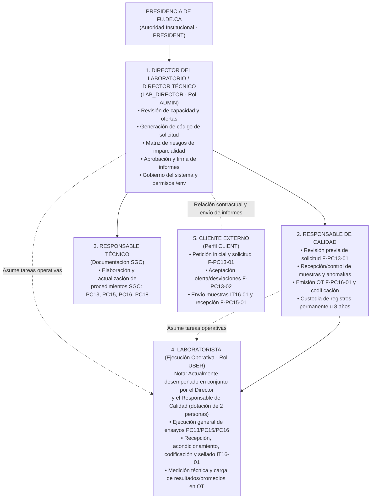

# Módulo I — Organización del Equipo, Escenario, Modelo de Negocio y Organigrama (CTM)

> **Correspondencia con lineamientos (**`Módulo I.pdf`**):** Cubre los entregables **1 (Organización del equipo)**, **2 (Descripción del escenario y posibles desarrollos de software)**, **3 (Descripción del modelo de negocio)** y **4 (Organigrama de la organización)**.

---

## 1. Organización de Actividades del Proyecto (Entregable 1)

Para el relevamiento, análisis, diseño y construcción de la plataforma `gestion.ctmueble.com.ar`, el equipo organizó su trabajo bajo una estructura de roles definida, canales claros de comunicación y un flujo incremental basado en los Módulos I a IV.

### 1.1. Integrantes y Roles del Equipo de Trabajo

| Rol en el proyecto                                 | Responsabilidades principales                                                                                                                                                                       | Módulos liderados       |
| -------------------------------------------------- | --------------------------------------------------------------------------------------------------------------------------------------------------------------------------------------------------- | ----------------------- |
| **Líder Técnico / Arquitectura Backend**           | Diseño de Clean Architecture/DDD (`domain`, `application`, `infrastructure`, `presentation`), inyección de dependencias (`serviceFactory` y `di`), seguridad JWT/Cookies/2FA y revisión de código.  | Módulos I, III y IV     |
| **Responsable de Base de Datos e Infraestructura** | Modelado relacional PostgreSQL (34 tablas en Neon), migraciones Umzug, índices, transacciones ACID, almacenamiento en Cloudflare R2, caché Redis y despliegue en Vercel.                            | Módulos II, III y IV    |
| **Responsable de Análisis Funcional y Dominio**    | Relevamiento del negocio del CTM, reglas de negocio de ensayos (`F-PC13-01`, `F-PC13-02`, `F-PC13-03`), máquinas de estado, casos de uso y documentación funcional.                                 | Módulos I y II          |
| **Responsable de Frontend, Integración y UX**      | Contratos REST API con SPA React, manejo de cookies `HttpOnly` + CSRF (`X-CSRF-Token`), flujos de formularios, tablas y descarga de documentos PDF/XLSX.                                            | Módulos III y IV        |
| **Responsable de QA, Seguridad y Documentación**   | Suite de pruebas automatizadas (`node --test`), auditoría de vulnerabilidades (RBAC, IDOR, CSRF, CSV Injection, cifrado AES-256-GCM, OpenTimestamps), manuales de usuario y compilación documental. | Módulos I, II, III y IV |

### 1.2. Forma de Comunicación del Equipo

- **Comunicación sincrónica (reuniones rápidas / toma de decisiones):** Videollamadas y canales de mensajería directa para destrabar incidencias de integración, revisiones de contratos HTTP o aprobaciones de esquema SQL.
- **Comunicación asincrónica y trazable:**
  - *Issues* y *Pull Requests* en GitHub para cambios técnicos, migraciones y revisiones de seguridad.
  - Documentación técnica y funcional versionada en el directorio `/docs` dentro del mismo repositorio para evitar desincronización entre código y documentos.

### 1.3. Herramientas de Trabajo

| Categoría                           | Herramienta                                                                     | Uso en el proyecto                                                                                                                                         |
| ----------------------------------- | ------------------------------------------------------------------------------- | ---------------------------------------------------------------------------------------------------------------------------------------------------------- |
| **Control de versiones y código**   | Git + GitHub                                                                    | Repositorio fuente (`gestion.ctmueble.com.ar` para el BE y `oficina.ctmueble.com.ar` para el FE), ramas por funcionalidad/remediación y commits trazables. |
| **Gestión de tareas y seguimiento** | Tablero Kanban (Trello / GitHub Projects)                                       | Seguimiento de entregas por módulo, priorización funcional (Alta / Media / Baja) y registro de incidencias.                                                |
| **Documentación colaborativa**      | Markdown (`/docs`), Google Drive y Puppeteer                                    | Redacción estructurada en `.md`, diagramación y compilación en PDF consolidado con índice.                                                                 |
| **Desarrollo y API Testing**        | Visual Studio Code, Node.js, Swagger UI (`/api-docs`), Postman / Thunder Client | Implementación de capas, pruebas manuales de endpoints con cookies CSRF y validación contra esquemas OpenAPI.                                              |
| **Infraestructura Cloud**           | Vercel, Neon PostgreSQL, Cloudflare R2, Redis, Resend, ARCA / Padrón A13 (opcional) | Entorno de ejecución serverless, base de datos administrada, almacenamiento de objetos, envío de correos y sistema auxiliar opcional de autocompletado de datos de clientes. |

### 1.4. Cronograma de Actividades (Ejecución por Fases)

| Fase / Módulo                                               | Horizonte de trabajo                                                                   | Hitos y entregables clave                                                                                                                                                                                          |
| ----------------------------------------------------------- | -------------------------------------------------------------------------------------- | ------------------------------------------------------------------------------------------------------------------------------------------------------------------------------------------------------------------ |
| **Módulo I — Análisis del escenario y problemática**        | Inicio del proyecto (Fase de relevamiento)                                             | Organización del equipo, relevamiento operativo del CTM, modelo de negocio, organigrama, lista de procesos/eventos, problemática, alcance y diagramas AS-IS.                                                       |
| **Módulo II — Jerarquía de procesos y estructura de datos** | Análisis funcional profundo                                                            | Objetivo y alcance definitivo, roles de usuarios, jerarquía de procesos y cascada operativa, requerimientos (`RF`/`RNF`), reglas de negocio, flujos TO-BE, casos de uso y modelo inicial de datos.                 |
| **Módulo III — Arquitectura y planificación**               | Diseño técnico e ingeniería                                                            | Stack tecnológico justificado (Vercel/Neon/R2/Node), diseño lógico definitivo (34 tablas normalizadas), diseño modular, navegación/mockups, seguridad/permisos y plan de implementación.                           |
| **Módulo IV — Desarrollo, implementación y validación**     | Ciclo iterativo (`Febrero 2026 – Noviembre 2026`, migraciones `20260217` a `20261117`) | Construcción física de BD en Neon, desarrollo incremental en 4 etapas (Auth/Base → Clientes y autocompletado opcional ARCA → Ensayos/OT/Muestras → PDFs/Auditoría/2FA/Hardening), 90 tests unitarios/seguridad/contratos y manuales finales. |

### 1.5. Reuniones de Seguimiento del Proyecto

1. **Reunión de planificación por módulo (al inicio de cada etapa):** Validación de entregables previos (regla estricta de que ningún módulo contradiga lo aprobado en el anterior) y asignación de responsables.
2. **Revisión semanal de avance técnico e incidencias:** Verificación de migraciones PostgreSQL ejecutadas con Umzug, cobertura de endpoints en `CONTRATOS_FRONTEND_BACKEND.md`, y ejecución completa de `npm test`.
3. **Demo y validación funcional interna previa al cierre:** Prueba integral punta a punta del flujo completo (Alta manual de cliente o autocompletado opcional con ARCA → Solicitud `F-PC13-02` → Presupuesto → Recepción y `F-PC13-03` → Resultados → Emisión `F-PC13-01` + Snapshot RSA/OTS).

### 1.6. Metodología de Trabajo

Se adoptó una **metodología iterativa e incremental dividida por módulos funcionales y capas arquitectónicas (DDD + Clean Architecture)**:

- Ninguna funcionalidad pasa a código sin haber validado su jerarquía de procesos, reglas de negocio y modelo de datos.
- El desarrollo de software sigue orden de dependencias reales: primero **Seguridad y Usuarios**, luego **Empresas, Clientes y Personas (con soporte auxiliar opcional de autocompletado vía ARCA sin ser necesario activarlo)**, después el núcleo **Ensayos, Órdenes de Trabajo y Muestras**, y finalmente **Documentos PDF bajo demanda, Notificaciones, Exportación XLSX/CSV e Integridad Criptográfica**.

---

## 2. Descripción del Escenario y Posibles Desarrollos de Software (Entregable 2)

### 2.1. Nombre de la Organización y Rubro

- **Organización:** **Centro Tecnológico del Mueble (CTM)** (`ctmueble.com.ar`).
- **Misión / Objeto principal:** **El Centro Tecnológico del Mueble Cañada de Gómez (CTM)**
es una iniciativa público-privada de la ciudad de Cañada de Gómez y la región, zona sur de la provincia de Santa Fe, donde se concentra uno de los clusters del mueble más importantes de Argentina.  
El CTM surge por la necesidad de profesionalizar las industrias del sector, casi en su totalidad conformado por pymes, frente a un escenario que requiere, cada vez más, de mayor competitividad y capacidad de respuesta a un mercado que crece en complejidad y dinamismo. En este marco, la promoción e implementación de actividades relacionadas con la Investigación, el Desarrollo y la Innovación se vuelven de vital importancia y tienen el objeto de asegurar el desarrollo sostenido de este conglomerado de unidades productivas.
Su creación es promovida por la Cámara de la Industria Maderera y Afines de Cañada de Gómez (CIMA), el Centro Económico de Cañada de Gómez, la Fundación para el Desarrollo de Cañada de Gómez (FUDECA) y la Municipalidad de Cañada de Gómez.

### 2.2. Actividades que Realiza

El Laboratorio CTM tiene como misión brindar servicios de análisis sobre tableros derivados de la madera destinados al fortalecimiento de la calidad en la industria maderera, aportando valor agregado a los productos comercializados en el territorio nacional, así como también aquellos que sean exportados.

Toda esta operatoria se rige por un **Sistema de Gestión de Calidad (SGC)** documentado en procedimientos e instrucciones técnicas (`PC13`, `PC15`, `PC16`, `PC18`, `IT16-01`, `IT17-01`). En ese marco, lo que la plataforma `gestion.ctmueble.com.ar` abarca es específicamente la **sistematización de los procedimientos del Sistema de Gestión de Calidad vinculados al vínculo con el cliente y al análisis de laboratorio**:

1. **Asistencia y automatización de procesos del Sistema de Gestión de Calidad (SGC):** Digitaliza y controla de punta a punta las etapas exigidas por los procedimientos `PC13`, `PC15`, `PC16` y `PC18` (solicitudes de ensayo, revisión de capacidad/ofertas, recepción y acondicionamiento de muestras, órdenes de trabajo, carga y cálculo analítico, emisión y rectificación de informes y custodia auditable de registros).
2. **Gestión de la Relación con el Cliente (CRM):** Permite administrar de forma centralizada la cartera de empresas solicitantes, sus domicilios, representantes legales y contactos, el historial comercial y contractual de cada cliente, el seguimiento de presupuestos/términos y las comunicaciones automáticas de avance, articulando la relación con el cliente dentro del propio flujo de calidad.

### 2.3. Partes que intervienen

#### **1. Director del laboratorio / Director Técnico**

- **Revisión y aprobación de solicitudes/ofertas:** Evalúa si el laboratorio cuenta con la capacidad y los recursos para realizar el ensayo solicitado. Si no es posible, se encarga de informarlo por escrito al cliente. Genera el código de solicitud.
- **Gestión de riesgos:** Realiza el análisis de riesgos de imparcialidad en la matriz correspondiente y toma las acciones derivadas de dicho resultado.
- **Aprobación de informes:** Es la persona responsable de aprobar los informes de ensayo emitidos. Asimismo, firma las copias solicitadas por el cliente.

#### **2. Responsable de Calidad**

- **Gestión de solicitudes:** Realiza la revisión previa del formulario de solicitud de ensayo para deducir datos como el peticionario, tipo de servicio y elementos a ensayar.
- **Recepción y control de muestras:** Recibe las muestras enviadas por el cliente, verifica su tipo, cantidad y estado, y registra cualquier anomalía en el formulario correspondiente.
- **Gestión del proceso de laboratorio:** Genera el número de orden de trabajo e identifica las muestras y contramuestras con la codificación requerida. Cuando corresponde a ensayos específicos (como emisión de formaldehído), sella los bordes de las muestras según la instrucción técnica.
- **Custodia de registros:** Es el responsable del archivo y retención permanente u 8 años de los registros y formularios del sistema de gestión.

#### **3. Responsable Técnico**

- **Elaboración de documentos:** Es el responsable de elaborar y actualizar las distintas versiones de los procedimientos del Sistema de Gestión de Calidad (como PC13, PC15 y PC16).

#### **4. Laboratorista**

- **Participación operativa:** Participa en la ejecución general de las actividades dentro del alcance de los procedimientos de revisión de solicitudes, emisión de informes y manipulación de muestras.
- **Recepción y acondicionamiento de muestras (en versiones anteriores/genéricas):** Realiza la recepción de las muestras, control de estado y cantidad, la codificación, así como el sellado de bordes para ensayos de tableros de madera cuando le sea asignado o en procedimientos previos.

#### **5. Cliente**

- **Solicitud de servicios:** Realiza la petición inicial de ensayos a través de cualquier medio de comunicación (personalmente, teléfono, correo electrónico, WhatsApp, etc.).
- **Formulario de solicitud:** Completa el *Formulario de solicitud de ensayo* (F-PC13-01) con la información requerida y lo envía formalmente al laboratorio.
- **Envío de muestras:** Remite al laboratorio los ítems de ensayo y contramuestras según las instrucciones establecidas (IT16-01).
- **Gestión de desviaciones y acuerdos:** Recibe notificaciones y acuerda acciones con el laboratorio en caso de limitaciones de recursos, desviaciones o modificaciones en las especificaciones del contrato.
- **Recepción y solicitud de informes/muestras:** Recibe el informe de ensayo final (en formato impreso o electrónico PDF) y confirma su recepción; asimismo, puede solicitar la devolución de muestras o copias adicionales del informe.

> Estos roles son descritos en los documentos de los Procedimientos de 13, 16 y 18 del Sistema de Gestión de Calidad. De momento el laboratoria cuenta con unicamente dos personas trabajando en el, que son el Director del laboratorio y el responsable de calidad, que cumplen tambien el rol de laboratorista.

### 2.4. Cómo Trabajaban Antes del Sistema y Qué Información Manejaban

Previo a la implementación de `gestion.ctmueble.com.ar`, el flujo administrativo y técnico dependía de:

- **Planillas de cálculo aisladas (Excel) y procesadores de texto (Word):** Para redactar solicitudes `F-PC13-01`, órdenes `F-PC16-01` e informes `F-PC15-01`.
- **Registros manuales o cuadernos de ingreso:** Para anotar códigos correlativos diarios de ensayos y órdenes, estado de recepción de muestras y mediciones crudas en banco de prueba.
- **Envio manual de notificaciones:** Cada acto relacionado a la aceptación y/o rechazo de la solicitud de ensayo, formalización de contrato y la emisión del informe requeria de comunicarse manualmente con los clientes.

La información crítica manejada incluye:

- Datos fiscales de empresas (CUIT, razón social, domicilios por distrito/provincia, datos alternativos de facturación e IVA).
- Datos personales de representantes legales y contactos técnicos (nombre, DNI, correo, teléfono, código de país).
- Especificaciones de producto y normas a ensayar (denominación del producto, material base, tamaño nominal, lote, tipo de ensayo).
- Evidencias operativas (códigos diarios únicos, estados de muestras, mediciones analíticas por duplicado o serie, promedios, observaciones y trazabilidad de cada cambio).

### 2.5. Problemas Detectados y Procesos Candidatos a Informatizarse

El relevamiento evidenció que el laboratorio operaba bajo procedimientos de calidad documentados en papel/Word, sin un software que los sistematizara ni que unificara el seguimiento comercial con sus clientes. Por ello, los procesos candidatos a informatizarse responden directamente a la **asistencia y automatización del Sistema de Gestión de Calidad (SGC)** y a la **gestión integral de la relación con el cliente (CRM)**:

| Problema detectado en la operatoria manual                                                                       | Proceso que debía informatizarse                                                                                                                                            |
| ---------------------------------------------------------------------------------------------------------------- | --------------------------------------------------------------------------------------------------------------------------------------------------------------------------- |
| Errores o colisiones al asignar numeración correlativa diaria de solicitudes y órdenes de trabajo del SGC.       | **Generación atómica de códigos diarios de trazabilidad** secuenciales por fecha Argentina (`daily_sequence_counters`).                                                     |
| Carga repetitiva de empresas, domicilios y contactos sin un historial unificado de relación con cada cliente.    | **Módulo CRM de Empresas, Clientes y Personas** con agenda compartida, historial de vínculos, carga manual autónoma y soporte auxiliar opcional de autocompletado desde Padrón A13 de ARCA/AFIP (sin ser necesaria su activación). |
| Pérdida de trazabilidad digital sobre quién presupuestó, quién aceptó condiciones y cuándo ingresó cada muestra. | **Asistencia y automatización del flujo SGC** mediante máquina de estados estricta y **log de auditoría inmutable** de ensayos y órdenes.                                   |
| Demoras en el armado manual de formularios SGC y riesgo de alteración posterior de informes emitidos.            | **Generación automática on-the-fly de PDFs del SGC (**`F-PC13-01`**,** `F-PC13-02`**,** `F-PC16-01`**,** `F-PC15-01`**)** + **snapshots firmados con RSA-SHA256 y OpenTimestamps**. |
| Falta de avisos oportunos en la relación con el cliente y el personal técnico ante cambios de etapa.             | **Notificaciones CRM automáticas por email (Resend)** vinculadas a hitos del SGC, con control granular de preferencias y desuscripción.                                      |
| Imposibilidad de consolidar estadísticas operativas del SGC y cartera de clientes en Excel de forma rápida.      | **Motor de exportación estructurada a CSV y XLSX** con múltiples hojas (resumen, métricas por estado y muestras).                                                           |

### 2.6. Posibles Sistemas de Software a Desarrollar

Del relevamiento inicial surgieron tres alternativas de desarrollo:

1. *Sistema local de escritorio para carga interna:* Descartado porque impediría la interacción remota en la relación con el cliente (CRM), haciendo imposible que los solicitantes carguen autogestionadamente sus solicitudes `F-PC13-01`, acepten presupuestos en línea o descarguen sus informes desde cualquier ubicación.
2. *Portal informativo estático con formularios por correo:* Insuficiente porque no resuelve la asistencia y automatización interna de los procedimientos del SGC (órdenes de trabajo, trazabilidad de muestras, cálculos de laboratorio ni auditoría).
3. **Plataforma Web de Sistematización del SGC y CRM Cliente/Laboratorio (**`oficina.ctmueble.com.ar` **— Solución Elegida):** Sistema web centralizado que **sistematiza los procedimientos del Sistema de Gestión de Calidad vinculados al vínculo con el cliente (CRM) y al análisis de laboratorio**. Asiste y automatiza los procesos normativos del SGC (`PC13`, `PC15`, `PC16`, `PC18`) y centraliza la relación con el cliente mediante perfiles diferenciados (`CLIENT` y `LABORATORY`), backend API REST serverless, base de datos relacional PostgreSQL, almacenamiento seguro en la nube y soporte auxiliar opcional de autocompletado de datos de clientes vía Padrón A13 de ARCA (no requerido para operar; habilitable mediante `ARCA_CUIT` y certificado/clave `ARCA_*`).

---

## 3. Modelo de Negocio del Escenario (Entregable 3)

### 3.1. Generación de Ingresos y Propuesta de Valor

- El CTM genera ingresos prestando **servicios técnicos arancelados de ensayo de laboratorio y emisión de informes técnicos** respaldados por su Sistema de Gestión de Calidad para la industria del mueble y afines.
- La propuesta de valor de la plataforma radica en la **sistematización conjunta de los procedimientos del SGC y la relación con el cliente (CRM)**:
  - **Eje de relación con el cliente (CRM):** centraliza la ficha integral de cada empresa, sus representantes legales, contactos técnicos, solicitudes históricas, presupuestos y comunicaciones automáticas en un portal compartido cliente/laboratorio.
  - **Eje de asistencia y automatización del SGC y análisis de laboratorio:** guía y automatiza cada acuerdo contractual y operativo conforme a los procedimientos `PC13`, `PC15`, `PC16` y `PC18`: el cliente solicita un ensayo (`F-PC13-01`), el laboratorio fija **costo estimado, plazo de ejecución y fecha de pago** (`F-PC13-02`), el cliente acepta formalmente dichos términos mediante contrato y, tras ejecutarse el análisis sobre las muestras ingresadas (`F-PC16-01`, instrucciones `IT16-01` e `IT17-01`), se emite automáticamente el informe oficial (`F-PC15-01`) con trazabilidad e integridad verificable.

### 3.2. Servicios Ofrecidos y Clientes / Usuarios

- **Servicios principales:** Ensayos normalizados catalogados dinámicamente (`types_essays`), por ejemplo análisis de emisión/contenido de formaldehído, evaluación de productos específicos y emisión de certificados/informes rectificables cuando corresponda.
- **Clientes / Usuarios externos (**`CLIENT`**):** Fábricas de muebles, productores de tableros, importadores, distribuidores y personas físicas/jurídicas que requieren certificar o validar lotes de material. Pueden autogestionar solicitudes propias o ser cargados y agendados por el laboratorio.
- **Usuarios internos (**`LABORATORY`**):** Personal de Dirección, Administración, Recepción, Laboratorio Técnico y Consulta del CTM.

### 3.3. Roles / Partes Intervinientes, Tareas, Información y Documentación Usada

| Parte interviniente / Rol                          | Tareas principales                                                                                                                                                                | Información que utiliza                                                                                                                                      | Documentos / Formularios asociados                                                                       |
| -------------------------------------------------- | --------------------------------------------------------------------------------------------------------------------------------------------------------------------------------- | ------------------------------------------------------------------------------------------------------------------------------------------------------------ | -------------------------------------------------------------------------------------------------------- |
| **1. Director del Laboratorio / Director Técnico** | Revisar capacidad y recursos ante solicitudes, aprobar ofertas y generar código de solicitud, analizar riesgos de imparcialidad, aprobar y firmar informes, administrar sistema.  | Solicitudes recibidas, matriz de imparcialidad, capacidad operativa, parámetros `/env` (`CUIT`, `UNCERTAINTY`, CBU), permisos (`ADMIN`) y reportes CSV/XLSX. | Formularios `F-PC13-01` / `F-PC13-02`, matriz de riesgos, informes `F-PC15-01`, variables `/env`.        |
| **2. Responsable de Calidad**                      | Revisar previamente el formulario de solicitud, recibir y controlar muestras y anomalías, generar OT, codificar y sellar muestras/contramuestras, archivar y custodiar registros. | Datos de peticionario, tipo de servicio, elementos, estado/cantidad de probetas, código diario de OT (`F-PC16-01`), logs de auditoría y archivo histórico.   | Solicitud `F-PC13-01`, Orden de Trabajo `F-PC16-01`, instrucción `IT16-01`, archivo (permanente/8 años). |
| **3. Responsable Técnico**                         | Elaborar, revisar y actualizar las versiones de los procedimientos documentados del Sistema de Gestión de Calidad.                                                                | Normativa aplicable, métodos de ensayo, flujos del laboratorio e instrucciones técnicas vigentes.                                                            | Procedimientos SGC (`PC13`, `PC15`, `PC16`, `PC18`) y sus revisiones.                                    |
| **4. Laboratorista**                               | Ejecutar operativamente las actividades de ensayo, manipular y acondicionar muestras, sellar bordes cuando aplique, cargar lecturas y asistir en emisión de informes.             | Órdenes de trabajo asignadas, código de muestra, instrucciones técnicas (`IT16-01`), lecturas crudas, promedios y observaciones analíticas.                  | Orden de Trabajo `F-PC16-01`, planillas de ensayo, datos en sistema (`USER`).                            |
| **5. Cliente (**`CLIENT` **— externo)**            | Realizar petición inicial, completar y enviar solicitud, remitir muestras y contramuestras, acordar desviaciones/términos y recibir/solicitar copias del informe o devolución.    | CUIT, razón social, domicilio, contactos, especificaciones del producto/tablero, presupuestos, notificaciones y PDFs emitidos.                               | Solicitud `F-PC13-01`, contrato/términos `F-PC13-02`, guía `IT16-01`, Informe `F-PC15-01`.               |

---

## 4. Organigrama de la Organización (Entregable 4)

A continuación se representa el organigrama institucional y operativo del CTM basado en las **partes que intervienen** en el Sistema de Gestión de Calidad (Procedimientos `PC13`, `PC15`, `PC16` y `PC18`) y en la plataforma `gestion.ctmueble.com.ar`:

### 4.1. Jerarquías, Responsabilidades y Relación entre Partes Intervinientes

- **Estructura jerárquica e integración actual:**
  - En la cúspide institucional se encuentra la **Presidencia de FU.DE.CA (**`PRESIDENT`**)**, que delega la conducción operativa, técnica y administrativa del laboratorio en el **1. Director del Laboratorio / Director Técnico (**`LAB_DIRECTOR`**)**.
  - Bajo esta conducción se articulan el **2. Responsable de Calidad** (encargado del control documental previo, recepción de muestras, emisión de OT y custodia de registros) y el **3. Responsable Técnico** (encargado de elaborar y actualizar los procedimientos `PC13`, `PC15`, `PC16` y `PC18`).
  - En el nivel operativo se ubica el rol de **4. Laboratorista**. *Nota organizativa vigente:* actualmente el laboratorio opera con una dotación de **dos personas** —el **Director del Laboratorio** y el **Responsable de Calidad**—, quienes asumen conjuntamente las tareas operativas del **Laboratorista**.
- **Relación operativa transversal con el Cliente (**`5. Cliente`**):**
  1. El **Cliente** inicia la petición y completa la solicitud `F-PC13-01`; el **Responsable de Calidad** realiza la revisión previa de datos y el **Director del Laboratorio** evalúa capacidad/imparcialidad, genera el código de solicitud y aprueba la oferta/contrato (`F-PC13-02`).
  2. El **Cliente** confirma términos/desviaciones y remite las probetas y contramuestras conforme a `IT16-01`.
  3. El **Responsable de Calidad** (y **Laboratorista**) recibe y controla físicamente las muestras, genera la Orden de Trabajo `F-PC16-01`, codifica y sella bordes según corresponda, y registra los resultados analíticos.
  4. El **Director del Laboratorio** aprueba y firma el Informe Final `F-PC15-01` (resguardado con snapshot criptográfico RSA-SHA256 + OpenTimestamps), el **Responsable de Calidad** lo custodia conforme a los plazos de retención (8 años / permanente) y el **Cliente** recibe el informe en formato PDF o impreso.

