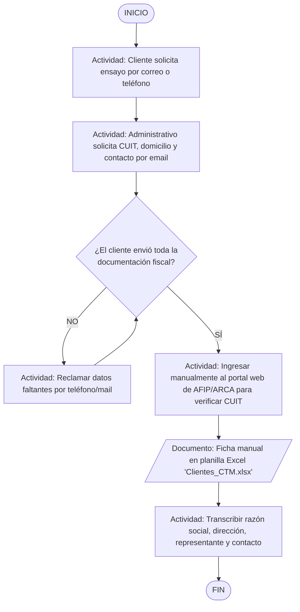
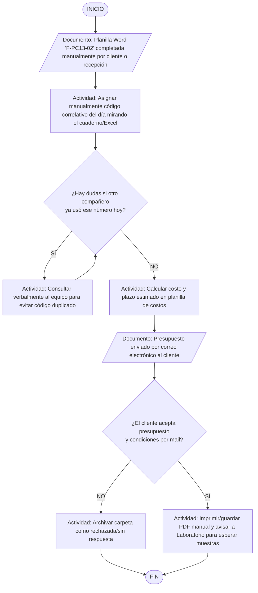
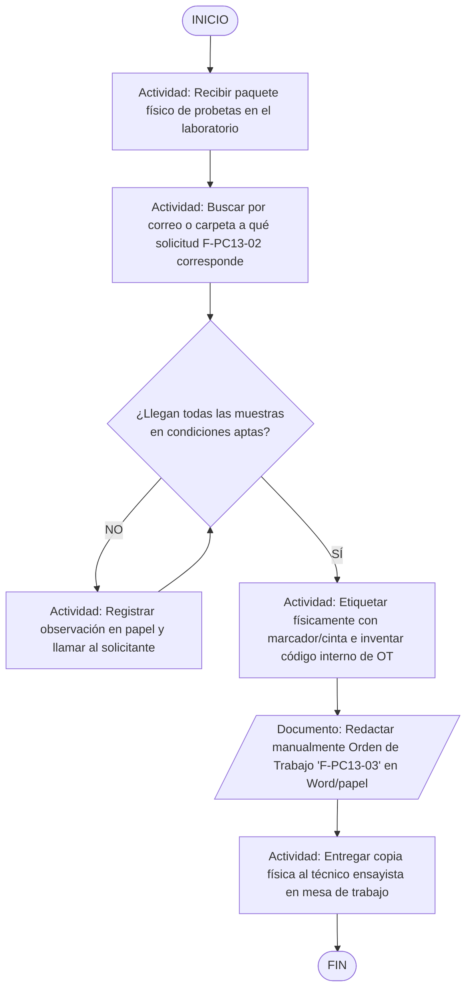
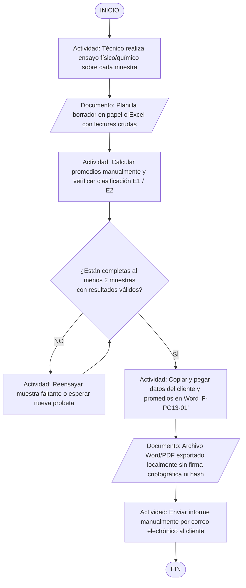

# Módulo I — Procedimientos, Eventos, Problemática, Alcance y Diagramas AS-IS

> **Correspondencia con lineamientos (**`Módulo I.pdf`**):** Cubre los entregables **5 (Lista de procesos y eventos)**, **6 (Documento de problemática)**, **7 (Documento de alcance del sistema)** y **8 (Diagramas de flujo de los procesos actuales AS-IS)**.

---

## 1. Procedimientos (Procesos) y Eventos de la Organización (Entregable 5)

Del análisis operativo del **Centro Tecnológico del Mueble (CTM)** se identifican los procedimientos regulares y los eventos externos/internos que los disparan.

### 1.1. Lista de Procesos de la Organización

| Código  | Proceso organizacional                                         | Sector responsable                 | Descripción sintética                                                                                                                                   |
| ------- | -------------------------------------------------------------- | ---------------------------------- | ------------------------------------------------------------------------------------------------------------------------------------------------------- |
| **P01** | **Registro y autenticación de usuarios**                       | Administración / Solicitante       | Alta de cuenta de cliente o invitación a miembro de laboratorio, verificación de email y control de acceso seguro.                                      |
| **P02** | **Gestión y agendado de clientes**                             | Administración / Solicitante       | Registro de empresa (CUIT, razón social), carga manual directa o autocompletado auxiliar opcional desde Padrón A13 de ARCA/AFIP (si se habilita), domicilios, representante legal y contactos. |
| **P03** | **Solicitud de servicio de ensayo (**`F-PC13-02`**)**          | Solicitante / Recepción            | Creación del pedido de ensayo indicando empresa, contacto, tipo de ensayo, muestras estimadas y elementos/productos a analizar.                         |
| **P04** | **Presupuestación y acuerdo de condiciones**                   | Administración / Solicitante       | Revisión del pedido (`VERIFYING`), asignación de costo, plazo y vencimiento (`PENDING_ACCEPTANCE`) y aceptación/rechazo por el cliente.                 |
| **P05** | **Recepción de muestras y Orden de Trabajo (**`F-PC13-03`**)** | Recepción / Laboratorio            | Verificación física de las probetas recibidas, asignación de códigos internos y apertura de la Orden de Trabajo.                                        |
| **P06** | **Ejecución de ensayos y carga de resultados**                 | Técnicos de Laboratorio            | Medición técnica sobre cada muestra, cálculo de promedio analítico y registro de observaciones/resultados.                                              |
| **P07** | **Emisión y rectificación de informes (**`F-PC13-01`**)**      | Dirección Técnica / Calidad        | Validación mínima de muestras analizadas, clasificación técnica (`E1`/`E2`), emisión del informe PDF y sellado de integridad.                           |
| **P08** | **Notificación y seguimiento documental**                      | Sistema / Atención al Cliente      | Aviso al solicitante en cambios de estado, recordatorios, descarga de formularios y consulta histórica.                                                 |
| **P09** | **Auditoría, reportes y exportación operativa**                | Dirección / Auditoría (`CONSULTA`) | Control de cambios en ensayos/órdenes, eventos de seguridad y exportación consolidada en formatos CSV y XLSX.                                           |

### 1.2. Catálogo de Eventos Disparadores

| Evento identificado                                                                    | Proceso que dispara | Actor que lo origina                 |
| -------------------------------------------------------------------------------------- | ------------------- | ------------------------------------ |
| Un cliente nuevo desea operar con el laboratorio o es invitado por personal interno.   | **P01**, **P02**    | Solicitante externo o Administración |
| Se ingresa o actualiza un CUIT empresarial (carga manual o autocompletado opcional). | **P02**             | Usuario autorizado / Sistema auxiliar ARCA (si está activo) |
| Llega una necesidad de certificar o ensayar un lote de tableros o muebles.             | **P03**             | Cliente / Operador de laboratorio    |
| Se detecta un pedido en evaluación técnica listo para cotizar.                         | **P04**             | Administración / Jefatura técnica    |
| El solicitante acepta el presupuesto y plazos, o rechaza / vence la oferta.            | **P04**             | Cliente (`CLIENT`)                   |
| Ingresa físicamente un paquete o lote de probetas al laboratorio del CTM.              | **P05**             | Transporte / Cliente / Recepción     |
| El técnico finaliza las mediciones analíticas de las muestras de una Orden de Trabajo. | **P06**             | Técnico Ensayista                    |
| Todas las muestras necesarias quedan cargadas y listas para certificación.             | **P07**             | Jefatura / Técnico autorizado        |
| Se detecta una fe de erratas o aclaración técnica sobre un informe ya emitido.         | **P07**             | Dirección Técnica (`MODIFICATION`)   |
| Se requiere rendición mensual o control administrativo de ensayos por rango de fechas. | **P09**             | Administración / Dirección           |

---

## 2. Documento de Problemática a Solucionar con Software (Entregable 6)

### 2.1. Cómo Trabajaban Actualmente (Situación Sin Sistema Integrado)

La operación diaria previa dependía de herramientas desconectadas para ejecutar manualmente tanto los **procedimientos del Sistema de Gestión de Calidad (SGC)** (`PC13`, `PC15`, `PC16`, `PC18`) como el **vínculo con los clientes (CRM)**: planillas Excel para llevar registros de pedidos y resultados, plantillas Word editadas manualmente para generar los formularios oficiales (`F-PC13-02`, `F-PC13-03`, `F-PC13-01`), correo electrónico convencional para recibir solicitudes, enviar presupuestos y hacer seguimiento de clientes, y carpetas compartidas en red local para guardar los PDFs generados.

### 2.2. Detalle de Problemas Detectados

- **Tareas realizadas manualmente:**
  - Tipeo manual de razón social, CUIT y domicilio en cada nueva solicitud o informe.
  - Numeración a mano de códigos de ensayo y órdenes de trabajo según el día del calendario.
  - Cálculo manual de promedios y reclasificación (`E1`/`E2`) antes de volcarlos al documento Word.
  - Redacción repetitiva de correos electrónicos avisando al cliente si su muestra llegó o si su informe está listo.
- **Información que se pierde o fragmenta:**
  - Falta de un historial unificado de contactos adicionales, representantes legales y cambios de domicilio de un cliente a lo largo del tiempo (carencia de una vista CRM consolidada por cliente).
  - Ausencia de vínculo directo entre la versión de los datos del cliente al momento de solicitar el ensayo y modificaciones posteriores de su empresa (riesgo de alterar documentos históricos retrospectivamente).
  - Pérdida de trazabilidad sobre qué usuario interno aprobó un presupuesto, modificó una muestra o reemitió un informe conforme al SGC.
- **Errores frecuentes que se cometen:**
  - Códigos diarios duplicados o salteados cuando dos operadores generan actas el mismo día.
  - Inconsistencias y demoras al transcribir manualmente razón social, CUIT o distritos de las empresas solicitantes.
  - Errores de tipeo en resultados numéricos o emisión prematura de un informe sin completar el mínimo de muestras analizadas.
  - Desactualización accidental de la plantilla oficial del formulario institucional.
- **Tareas que llevan mucho tiempo:**
  - Búsqueda de antecedentes de un mismo cliente o lote ensayado meses atrás entre decenas de carpetas locales.
  - Maquetado y exportación manual a PDF de formularios con encabezado legal, firmas, notas al pie y tabla de elementos.
  - Compilación manual de estadísticas trimestrales o anuales de ensayos completados, cancelados o en curso.
- **Controles e informes que no pueden realizarse:**
  - No se puede garantizar granularmente qué empleado de laboratorio tiene permiso para crear clientes, cargar resultados, emitir informes o cambiar variables institucionales (`UNCERTAINTY`, autoridades, CBU).
  - No es posible detectar criptográficamente si un informe PDF o un registro de resultados fue alterado después de su emisión.
  - No se pueden obtener exportaciones inmediatas filtradas por fecha (zona horaria Argentina), cliente o estado.
- **Qué sucedería si la organización creciera:**
  - Con un aumento en la demanda de fábricas de muebles y exportadores, la gestión manual colapsaría por cuellos de botella en recepción y transcripción, multiplicarían las colisiones de códigos diarios, crecerían las demoras de respuesta comercial en la atención al cliente y se volvería inviable cumplir auditorías de calidad e integridad documental del SGC.
- **Por qué es necesario un sistema informático:**
  - Es indispensable contar con una plataforma web única que **sistematice los procedimientos del Sistema de Gestión de Calidad (SGC) vinculados a la relación con el cliente (CRM) y al análisis de laboratorio**: centralizando la base de datos relacional en un servidor administrado para asistir y automatizar reglas de negocio y máquinas de estado del SGC (`PC13`, `PC15`, `PC16`, `PC18`), llevar el vínculo comercial y técnico integral con cada cliente (CRM), generar códigos diarios de manera atómica sin colisiones, emitir documentos PDF estandarizados bajo demanda con respaldo criptográfico, ofrecer trazabilidad total por usuario y fecha, y disponer opcionalmente de un servicio auxiliar de autocompletado de datos de clientes.

---

## 3. Documento de Alcance Preliminar del Sistema (Entregable 7)

El alcance del sistema abarca la **sistematización de los procedimientos del Sistema de Gestión de Calidad (SGC)** del Laboratorio CTM vinculados al **vínculo con el cliente** y al **análisis de laboratorio**. En términos operativos, la plataforma cumple una doble función integrada:

1. **Asistencia y automatización de procesos del Sistema de Gestión de Calidad (SGC):** Digitaliza, guía y automatiza los flujos normativos (`PC13`, `PC15`, `PC16`, `PC18`), desde el registro de solicitudes y revisión de capacidad hasta la recepción de muestras, ejecución analítica en laboratorio, emisión de informes oficiales y custodia inmutable de registros.
2. **Gestión de la Relación con el Cliente (CRM):** Centraliza la agenda compartida de empresas solicitantes, sus domicilios, representantes legales y contactos, el historial completo de interacciones/ensayos por cliente, el ciclo de presupuestación y acuerdos contractuales, las notificaciones automáticas de estado y el acceso autogestionado al portal de resultados.

### 3.1. Qué Permite Realizar el Sistema

- **Gestionar la relación con el cliente (CRM):** Centralizar fichas de empresas, domicilios, representantes legales y contactos vinculados; consultar el historial completo de solicitudes, contratos y ensayos por cliente; administrar acuerdos comerciales/presupuestos y automatizar notificaciones de seguimiento de extremo a extremo.
- **Asistir y automatizar procesos del SGC y análisis de laboratorio:** Ejecutar con validaciones automáticas y trazabilidad cada etapa de los procedimientos de calidad (`PC13`, `PC15`, `PC16`, `PC18`), asegurando codificación atómica, control de estado de muestras, cálculos analíticos de laboratorio y resguardo documental auditable.
- **Registrar:** Usuarios (`CLIENT` y miembros `LABORATORY`), empresas/clientes/personas (con carga manual autónoma sin depender de servicios externos, o mediante autocompletado auxiliar opcional de Padrón A13 de ARCA si se habilita), solicitudes de ensayo (`F-PC13-02`) con elementos y plantillas reutilizables, recepciones de muestras, órdenes de trabajo (`F-PC13-03`) y resultados analíticos.
- **Modificar:** Perfiles propios y datos de usuarios de laboratorio, fichas de clientes/contactos, condiciones comerciales/términos del ensayo, cliente asociado a un ensayo, parámetros institucionales (`/env`) y reemisión controlada de informes (`MODIFICATION`).
- **Eliminar / Desactivar (baja lógica o revocación):** Eliminación controlada de elementos/variables no protegidas (`hardcoded = false`), cancelación/rechazo trazado de ensayos, desvinculación de contactos, revocación de sesiones activas, dispositivos de confianza y API keys.
- **Buscar y Consultar:** Búsqueda filtrada de ensayos por estado, cliente y rango de fechas (Argentina), agenda compartida de clientes del laboratorio (CRM), búsqueda segura de personas/empresas, consulta de catálogos (`/types`) y detalle de órdenes/muestras.
- **Generar informes y documentos:** Emisión automática bajo demanda (*on-the-fly*) de PDFs oficiales del SGC (`F-PC13-02`, `F-PC13-03`, `F-PC13-01`) y generación de reportes tabulares descargables en **CSV** y **XLSX**.
- **Controlar:** Autenticación con cookies `HttpOnly`, verificación de email, 2FA (TOTP/Email), CSRF, idempotencia, rate limiting, permisos granulares de laboratorio, máquina de estados obligatoria del SGC y verificación criptográfica de integridad (`RSA-SHA256` + OpenTimestamps).

### 3.2. Módulos del Sistema a Desarrollar

1. **Módulo de Seguridad, Usuarios, Sesiones y Permisos:** Registro, login, cookies/CSRF, verificación de email, recuperación de clave, 2FA, sesiones activas, gestión de equipo de laboratorio con roles/permisos y API keys cifradas.
2. **Módulo CRM de Empresas, Clientes, Personas y Autocompletado Auxiliar ARCA (Opcional):** Gestión integral de la relación con el cliente mediante carga manual completa de empresas, domicilios, contactos y agenda compartida del laboratorio, trazabilidad de historial por empresa y servicio auxiliar opcional de autocompletado vía Padrón A13 de ARCA (no necesario activarlo; habilitable mediante `ARCA_CUIT` y certificado/clave `ARCA_*`).
3. **Módulo SGC de Solicitudes, Presupuestos y Plantillas (**`F-PC13-02`**):** Sistematización de solicitudes y acuerdos contractuales con el cliente: creación/cancelación de ensayos, snapshots de cliente, plantillas de elementos y productos, presupuestación y aceptación de términos.
4. **Módulo SGC de Recepción, Órdenes de Trabajo y Análisis de Laboratorio (**`F-PC13-03`**):** Asistencia y automatización de la fase técnica: códigos diarios atómicos, recepción de probetas, transición de OT y carga de mediciones/promedios de laboratorio.
5. **Módulo SGC de Documentos PDF, Notificaciones CRM, Exportación y Auditoría (**`F-PC13-01`**):** Renderizado Handlebars/Puppeteer + R2 de informes oficiales, emails transaccionales Resend para seguimiento al cliente, exportador CSV/XLSX, snapshots firmados y auditoría de seguridad.
6. **Módulo de Configuración Dinámica y Catálogos del SGC:** Variables institucionales/analíticas (`/env`), catálogos geográficos y tipos de ensayo (`/types`).

---

## 4. Diagramas de Flujo de los Procesos Actuales Sin Sistema — AS-IS (Entregable 8)

> Cada diagrama representa la operatoria **manual previa al sistema**, identificando explícitamente **Inicio**, **Actividades**, **Decisiones** y **Documentos**.

### 4.1. Diagrama AS-IS 1 — Alta y Registro Manual de Cliente

### 4.2. Diagrama AS-IS 2 — Solicitud de Ensayo y Presupuestación Manual (`F-PC13-02`)

### 4.3. Diagrama AS-IS 3 — Recepción de Muestras y Orden de Trabajo Manual (`F-PC13-03`)

### 4.4. Diagrama AS-IS 4 — Medición y Emisión Manual de Informe (`F-PC13-01`)

