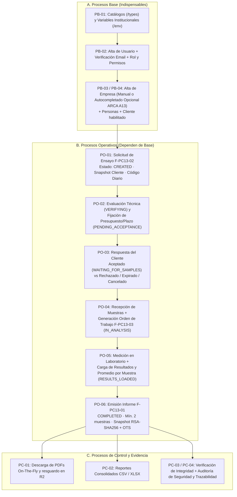

# Módulo II — Objetivo, Alcance Real, Usuarios y Jerarquía de Procesos

> **Correspondencia con lineamientos (**`Módulo II.pdf`**):** Cubre **Organización de actividades del Módulo II**, **Validación del Módulo I**, **Objetivo del sistema**, **Alcance real del sistema**, **Identificación de usuarios y roles**, **Jerarquía de procesos (base, operativos y de control)** y **Cascada operativa de procesos**.

---

## 1. Organización de Actividades del Módulo II y Validación del Módulo I

### 1.1. Responsables y Revisión del Módulo II

| Responsabilidad funcional                   | Alcance asignado                                                                                                                                              |
| ------------------------------------------- | ------------------------------------------------------------------------------------------------------------------------------------------------------------- |
| **Responsables de documentación funcional** | Especificación numerada de Requerimientos Funcionales (`RF01`–`RF36`), No Funcionales (`RNF01`–`RNF18`) y Reglas de Negocio (`RN01`–`RN22`).                  |
| **Responsables de procesos**                | Definición de jerarquía de procesos (base, operativos y de control), dependencias obligatorias y cascada operativa.                                           |
| **Responsables de estructura de datos**     | Identificación de entidades iniciales, atributos principales, relaciones y clasificación de datos por proceso (`03-REQUERIMIENTOS_Y_CLASIFICACION_DATOS.md`). |
| **Responsables de diagramación**            | Elaboración de diagramas de flujo TO-BE y casos de uso principales (`CU01`–`CU12`).                                                                           |
| **Cronograma y revisión grupal**            | Revisión cruzada entre análisis funcional y base técnica antes de congelar el análisis funcional hacia el Módulo III.                                         |

### 1.2. Validación de Consistencia con el Módulo I

Antes de avanzar al diseño detallado, se verificó la alineación estricta con el Módulo I:

- La **problemática detectada** (colisiones de códigos, carga manual en Word/Excel, falta de trazabilidad e integridad documental) coincide directamente con los objetivos funcionales definidos.
- Los **procesos P01–P09 y eventos disparadores** del Módulo I quedan respetados y encadenados en la jerarquía de procesos.
- Ningún requerimiento ni caso de uso del Módulo II contradice el alcance aprobado ni los formularios institucionales (`F-PC13-02`, `F-PC13-03`, `F-PC13-01`).

---

## 2. Objetivo del Sistema

El sistema `gestion.ctmueble.com.ar` tiene como objetivo transformar la operatoria integral del laboratorio de ensayos del **Centro Tecnológico del Mueble (CTM)** mediante una plataforma web unificada que:

- **Problema que resuelve:** Elimina la gestión manual fragmentada (Excel, Word, correos sueltos y numeración manual) que generaba duplicaciones, demoras, pérdida de contexto y ausencia de garantías de integridad documental.
- **Tareas que mejora:** Facilita el alta de clientes (con carga manual directa o mediante un sistema auxiliar opcional de autocompletado vía ARCA/AFIP cuya activación no es necesaria), la solicitud de ensayos (`F-PC13-02`), la asignación atómica de códigos diarios, el control de órdenes de trabajo (`F-PC13-03`), la carga de mediciones y la generación on-the-fly de informes (`F-PC13-01`).
- **Controles que permite:** Garantiza autenticación con cookies `HttpOnly`, 2FA, control de acceso basado en roles y permisos granulares (`RBAC`), transiciones válidas de estado, prevención de duplicados por idempotencia, y detección de alteraciones (*tampering*) mediante snapshots firmados con `RSA-SHA256` y OpenTimestamps.
- **Información que ordena:** Centraliza clientes, empresas, domicilios, contactos, solicitudes, términos contractuales, muestras, órdenes de trabajo, plantillas reutilizables, parámetros del sistema (`/env`) y logs de auditoría en PostgreSQL (34 tablas).
- **Beneficios que genera:** Reduce tiempos de respuesta comercial y técnica, evita colisiones de numeración bajo concurrencia, brinda trazabilidad completa por usuario/dispositivo/fecha y eleva el respaldo probatorio de los certificados e informes emitidos.

---

## 3. Alcance Real del Sistema

Considerando los recursos disponibles, el equipo de desarrollo y la criticidad operativa del CTM, se delimitó exactamente qué abarca el sistema y qué queda fuera de alcance:

### 3.1. El Sistema Permitirá

- **Registrar:** Usuarios (`CLIENT` y miembros `LABORATORY`), empresas (carga manual autónoma o con autocompletado auxiliar opcional de datos desde Padrón A13 de ARCA, sin requerir su activación), domicilios, personas, clientes, contactos, solicitudes de ensayo (`F-PC13-02`), plantillas de elementos, recepciones/órdenes de trabajo (`F-PC13-03`), muestras, resultados numéricos y variables dinámicas.
- **Modificar:** Perfil de usuario y preferencias 2FA, contraseña (vía verificación/reseteo), roles y permisos de miembros del laboratorio, datos de clientes/personas, cliente asociado a un ensayo, términos de servicio/presupuesto, parámetros `/env` y reemisión de informes (`MODIFICATION`).
- **Eliminar / Revocar:** Eliminación de variables operativas no protegidas (`hardcoded = false`), plantillas y elementos editables; revocación de sesiones activas, dispositivos de confianza y API keys; cancelación o rechazo auditado de solicitudes de ensayo.
- **Buscar y Consultar:** Consulta filtrada de ensayos por estado, cliente y rango horario de Argentina, agenda compartida de clientes de laboratorio, búsqueda segura de personas y autocompletado auxiliar de datos de empresas desde ARCA (si se encuentra habilitado con `ARCA_CUIT` y certificado/clave `ARCA_`*), consulta de órdenes de trabajo, muestras, historial de auditoría y catálogos `/types`.
- **Generar reportes y documentos:** Renderizado PDF bajo demanda (`F-PC13-02`, `F-PC13-03`, `F-PC13-01`), snapshots criptográficos verificables (`RSA-SHA256` + `.ots`) y exportación de datos tabulares en **CSV** y **XLSX**.
- **Controlar y Gestionar:** Flujo estricto de estados de ensayo, orden y muestra; notificaciones por correo electrónico con desuscripción; rate limiting distribuido; idempotencia en mutaciones críticas; y trazabilidad inmutable de seguridad.

### 3.2. El Sistema NO Incluirá (Exclusiones de Alcance)

- **Emisión de comprobantes electrónicos fiscales AFIP (WSFEv1 / Factura Electrónica) ni validación impositiva obligatoria:** La integración con ARCA (WSAA + Padrón A13) cumple únicamente el rol de **sistema auxiliar opcional para autocompletar datos básicos de clientes/empresas** a partir del CUIT (razón social y domicilio); **no es necesaria su activación** para operar la plataforma ni emite facturas electrónicas.
- **Gestión de inventario físico de reactivos, compras a proveedores ni liquidación de sueldos:** Quedan fuera del dominio de ensayos técnicos y certificación.
- **Integración directa automática vía hardware/PLC con máquinas de ensayo:** La carga de mediciones en laboratorio es asistida mediante formularios digitales con cálculo y validación de promedios, no por telemetría industrial directa.
- **Modificación retroactiva de informes emitidos sin versión nueva:** Por integridad normativa, todo ajuste posterior a la emisión exige una nueva versión (`MODIFICATION`) y un nuevo snapshot firmado, nunca sobrescritura silenciosa.
- **Modificación del esquema y versionado de los formularios del Sistema de Gestión de Calidad**

---

## 4. Identificación de Usuarios y Roles del Sistema

El sistema implementa segregación estricta de perfiles (`users.user_type`: `CLIENT` vs `LABORATORY`) y roles internos de laboratorio (`roles`: `ADMIN`, `USER`, `CONSULTA`) combinados con permisos granulares (`laboratory_permissions`).

| Rol / Perfil                   | Función principal                                                      | Operaciones permitidas                                                                                                                                                                                                                                                                                                                                                      | Información que consulta                                                                                                                                                          | Nivel de acceso                                                              |
| ------------------------------ | ---------------------------------------------------------------------- | --------------------------------------------------------------------------------------------------------------------------------------------------------------------------------------------------------------------------------------------------------------------------------------------------------------------------------------------------------------------------- | --------------------------------------------------------------------------------------------------------------------------------------------------------------------------------- | ---------------------------------------------------------------------------- |
| `LABORATORY` **—** `ADMIN`     | Dirección técnica, administración del sistema y gobierno de seguridad. | Todas las operaciones de gestión operativa + crear/editar/activar/desactivar usuarios de laboratorio, asignar roles y permisos, gestionar API Keys (`/api-keys`), editar variables institucionales (`/env`) y emitir/modificar informes.                                                                                                                                    | Toda la información del laboratorio: usuarios, permisos, auditorías de seguridad (`security_audit_logs`), ensayos de todos los clientes, órdenes, snapshots y métricas.           | **Total (Administración y Operación Completa)**                              |
| `LABORATORY` **—** `USER`      | Operadores administrativos, recepción y técnicos ensayistas.           | Operar según permisos granulares asignados: alta/edición/agenda de clientes y personas (con autocompletado auxiliar opcional de ARCA si está habilitado), gestión de ensayos (`essays.`*), recepción de muestras (`muestras.recibir`), gestión de órdenes (`ordenes.*`), carga de resultados (`muestras.resultados`), emisión PDF y exportación CSV/XLSX (`essays.export`). | Clientes propios/agendados, ensayos asignados o generales del laboratorio, órdenes de trabajo, muestras, plantillas y documentos PDF.                                             | **Medio / Operativo (Carga, Recepción, Ejecución y Emisión según permisos)** |
| `LABORATORY` **—** `CONSULTA`  | Supervisión, control de calidad y auditoría interna de solo lectura.   | Únicamente operaciones de consulta y lectura habilitadas (visualizar ensayos, órdenes de trabajo, muestras, documentos y exportar/leer reportes si se le otorga permiso de lectura). Bloqueado por RBAC para mutaciones críticas.                                                                                                                                           | Listados de ensayos, historial de auditoría (`essay_audit_logs`, `work_order_audit_logs`), detalles de clientes y órdenes sin capacidad de alteración.                            | **Solo Lectura (Auditoría / Supervisión)**                                   |
| `CLIENT` **(Cliente Externo)** | Solicitante de servicios de ensayo (empresa o particular autenticado). | Registrar y verificar su cuenta, gestionar 2FA/sesiones, crear sus propios perfiles de cliente/empresa/personas, crear y cancelar sus solicitudes de ensayo (`F-PC13-02`), aceptar/rechazar presupuestos, actualizar preferencias de notificación y descargar sus PDFs (`F-PC13-02` / `F-PC13-01`).                                                                         | Exclusivamente sus propias empresas/clientes, personas creadas por su usuario, sus propios ensayos y resultados finales permitidos (aislamiento estricto multi-tenant anti-IDOR). | **Restringido al Propio Tenant (**`req.user.id`**)**                         |

---

## 5. Jerarquía de Procesos del Sistema y Cascada Operativa

En `gestion.ctmueble.com.ar`, las operaciones no pueden ejecutarse en orden arbitrario: existen dependencias estrictas validadas por las capas de Aplicación y Dominio.

### 5.1. Clasificación Jerárquica de Procesos

#### A. Procesos Base (Indispensables para comenzar a operar)

1. **PB-01:** Carga de catálogos de sistema (`types_countries`, `types_districts`, `types_documents`, `types_essays`) y variables institucionales (`/env`).
2. **PB-02:** Registro o alta de usuario (`CLIENT` o invitación `LABORATORY`) con verificación de correo electrónico y habilitación de perfil/permisos.
3. **PB-03:** Registro de empresa (`bussiness`) mediante alta manual (por defecto, sin requerir ARCA) o asistida con el servicio auxiliar opcional de autocompletado del Padrón A13 de ARCA (habilitable mediante `ARCA_CUIT` y certificado/clave `ARCA_`*), domicilio normalizado (`bussiness_address`) y personas (`persons` representante y contactos).
4. **PB-04:** Alta y vinculación del **Cliente** (`clients` + `clients_contacts`) y opcionalmente creación de plantillas de elementos de ensayo (`essay_element_templates`).

#### B. Procesos Operativos (Dependen de los procesos base)

1. **PO-01:** Creación de solicitud de ensayo `F-PC13-02` (`essays` + `essays_elements` + snapshot `essays_client`), con código diario atómico. *Regla: no puede crearse un ensayo sin cliente válido y al menos un elemento.*
2. **PO-02:** Revisión y carga de presupuesto/condiciones (`essays_terms`), cambiando estado a `PENDING_ACCEPTANCE` y notificando por email al cliente.
3. **PO-03:** Respuesta del cliente (**Aceptación** o Rechazo de condiciones → estado `WAITING_FOR_SAMPLES`). *Regla: no pueden recibirse muestras si el ensayo no fue aceptado.*
4. **PO-04:** Recepción unificada de muestras y generación de Orden de Trabajo `F-PC13-03` (`work_orders` + `samples`). *Regla: requiere ensayo aceptado y código diario atómico.*
5. **PO-05:** Ejecución técnica y carga de resultados por muestra (`Sample.setResult`, cálculo de `average_value`). *Regla: no puede emitirse informe si hay menos de 2 muestras con resultados.*
6. **PO-06:** Emisión (o rectificación `MODIFICATION`) de Informe de Resultados `F-PC13-01`, generando snapshot criptográfico firmado (`essay_document_snapshots`) y notificación de informe listo.

#### C. Procesos de Control (Se apoyan en los datos generados y protegen la integridad)

1. **PC-01:** Generación bajo demanda y almacenamiento seguro (local / Cloudflare R2) de documentos PDF oficiales (`F-PC13-02`, `F-PC13-03`, `F-PC13-01`).
2. **PC-02:** Exportación operativa y gerencial de ensayos/métricas/muestras a formatos **CSV / XLSX**.
3. **PC-03:** Verificación pública/interna de integridad criptográfica de informes (`RSA-SHA256` + comprobante binario OpenTimestamps `.ots`).
4. **PC-04:** Trazabilidad completa mediante auditorías de negocio (`essay_audit_logs`, `work_order_audit_logs`) y auditoría de seguridad append-only (`security_audit_logs`) + gestión de sesiones/2FA.

---

### 5.2. Diagrama de Cascada Operativa de Procesos

