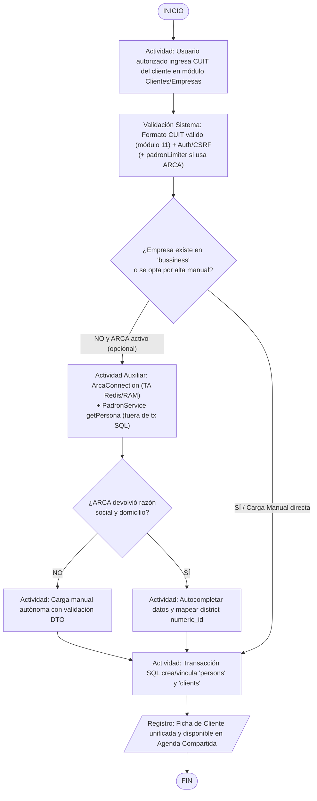
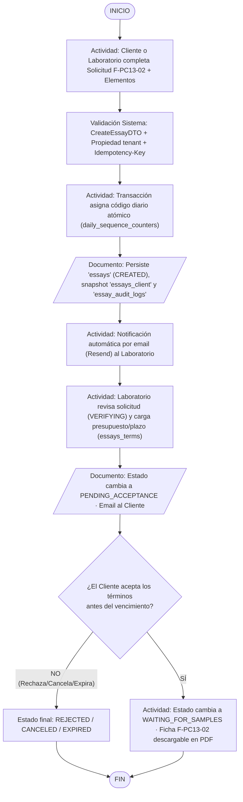
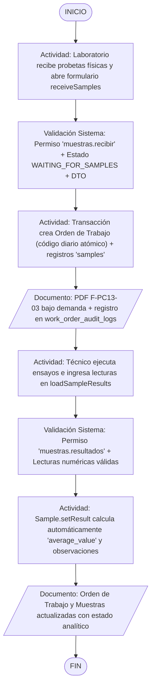
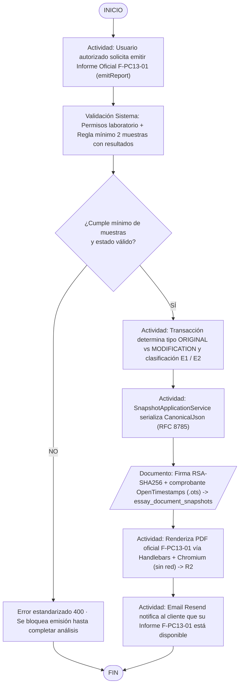

# Módulo II — Requerimientos Funcionales/No Funcionales, Reglas de Negocio, Diagramas TO-BE y Casos de Uso

> **Correspondencia con lineamientos (`Módulo II.pdf`):** Cubre **Requerimientos funcionales numerados**, **Requerimientos no funcionales**, **Reglas de negocio**, **Procesos futuros informatizados (diagramas de flujo TO-BE)**, **Casos de uso principales**, **Priorización funcional** y **Validación del análisis — Módulo II**.

---

## 1. Requerimientos Funcionales (`RF01` – `RF36`)

### 1.1. Seguridad, Usuarios, Autenticación y Sesiones
- **`RF01` Registrar y verificar usuario cliente:** El sistema debe permitir el registro de nuevos usuarios `CLIENT` con email único, contraseña segura, verificación mediante OTP/enlace temporal y rechazo anti-enumeración ante emails ya existentes.
- **`RF02` Autenticar usuarios y gestionar sesión por cookies `HttpOnly`:** El sistema debe autenticar credenciales, emitir Access/Refresh tokens en cookies `HttpOnly` (`ctm_at`, `ctm_rt`) junto con cookie CSRF (`ctm_csrf`) y permitir renovación y cierre de sesión con revocación inmediata.
- **`RF03` Gestionar doble factor de autenticación (2FA):** El usuario debe poder habilitar/deshabilitar 2FA mediante TOTP (app autenticadora con QR) o OTP por Email, generar/usar códigos de recuperación y administrar dispositivos de confianza (`trusted devices`).
- **`RF04` Recuperar contraseña:** El usuario debe poder solicitar restablecimiento de clave mediante OTP de 6 dígitos o enlace seguro, revocando automáticamente sesiones y dispositivos confiables al cambiarla.
- **`RF05` Administrar usuarios de laboratorio y permisos granulares:** Un administrador (`ADMIN`) debe poder invitar usuarios `LABORATORY`, definir su rol (`ADMIN`, `USER`, `CONSULTA`), personalizar su matriz de permisos granulares, activar/desactivar cuentas y reenviar invitaciones.
- **`RF06` Administrar API Keys del sistema:** El laboratorio con privilegios debe poder crear, consultar estado y revocar credenciales cifradas (`system_api_keys`) mediante AES-256-GCM / KMS Envelope.

### 1.2. Empresas, Clientes, Personas y Autocompletado Auxiliar Opcional (ARCA/AFIP)
- **`RF07` Autocompletar opcionalmente datos de clientes vía Padrón A13 de ARCA/AFIP:** Cuando la integración auxiliar está habilitada mediante `ARCA_CUIT` y certificados X.509 (`ARCA_CERT_*` / `ARCA_KEY_*`), el sistema debe autenticarse vía WSAA (`LoginCms`) y consultar razón social y domicilios de un CUIT para prellenar datos del cliente. Su activación **no es obligatoria** para el funcionamiento de la plataforma.
- **`RF08` Registrar y actualizar empresas (con autonomía manual):** Permitir el alta manual completa (`createBusinessManually`) en todo momento sin depender de ARCA, y la sincronización opcional desde padrón (`syncBusinessByCuit`) cuando el servicio auxiliar se encuentre activo, normalizando localidades y distritos (`types_districts`).
- **`RF09` Gestionar personas (representantes y contactos):** Permitir crear, editar y buscar personas con validación de formato de email, teléfono, código de país y DNI/CUIT único.
- **`RF10` Gestionar clientes y contactos adicionales:** Permitir crear, consultar, modificar y listar clientes asociando empresa, domicilio, representante legal, contacto principal, datos opcionales de facturación e IVA y contactos adicionales.
- **`RF11` Agendar clientes compartidos de laboratorio:** El personal de laboratorio debe poder agendar clientes (incluso originados desde un snapshot `essays_client`) y verificar si un cliente/CUIT ya se encuentra agendado para todo el equipo del laboratorio.

### 1.3. Solicitudes de Ensayo (`F-PC13-02`), Términos y Plantillas
- **`RF12` Crear solicitud de ensayo (`F-PC13-02`):** Permitir al cliente o al laboratorio iniciar un ensayo especificando cliente, contacto, tipo de ensayo, muestras estimadas, elementos con características técnicas y preferencias de notificación.
- **`RF13` Generar código correlativo diario atómico:** El sistema debe asignar automáticamente códigos diarios únicos por fecha Argentina tanto para ensayos como para órdenes de trabajo, evitando colisiones concurrentes.
- **`RF14` Guardar snapshot de cliente en el ensayo:** Al crear un ensayo se debe congelar en `essays_client` los datos vigentes de la empresa, domicilio, representante y contacto, permitiendo actualizar explícitamente ese vínculo mediante `PUT /essays/:id/client`.
- **`RF15` Administrar plantillas de elementos:** Usuarios autorizados deben poder guardar, listar y reutilizar plantillas estándar de productos/elementos para acelerar futuras solicitudes.
- **`RF16` Gestionar ciclo de vida y acciones del ensayo:** El sistema debe calcular dinámicamente las acciones permitidas según rol y estado (`/essays/procedure/actions`) y ejecutar transiciones válidas (revisión, fijación de presupuesto/términos, aceptación, rechazo, cancelación, expiración).
- **`RF17` Filtrar y consultar ensayos:** Permitir listar y buscar ensayos con filtros por fecha desde/hasta (zona `America/Argentina/Buenos_Aires`), estado, cliente y origen.

### 1.4. Recepción de Muestras, Órdenes de Trabajo (`F-PC13-03`) y Resultados
- **`RF18` Registrar recepción de muestras y crear Orden de Trabajo:** El laboratorio debe poder registrar el ingreso físico de muestras, crear la OT (`work_orders`) vinculada al ensayo y actualizar el estado de las muestras.
- **`RF19` Gestionar estado de Orden de Trabajo:** Permitir al laboratorio consultar órdenes pendientes/en curso, detallar muestras asociadas y actualizar estados válidos de la orden (`WorkOrderStatus`).
- **`RF20` Cargar resultados analíticos por muestra:** El laboratorio debe poder ingresar mediciones numéricas individuales por muestra, calcular/almacenar el `average_value` y registrar observaciones técnicas.

### 1.5. Informes (`F-PC13-01`), PDFs, Exportación, Notificaciones y Auditoría
- **`RF21` Emitir informe oficial (`F-PC13-01`) y emitir modificación (`MODIFICATION`):** Una vez cumplidos los requisitos analíticos (mínimo 2 muestras con resultado), el laboratorio debe poder emitir el informe original o generar una modificación fundamentada con clasificación técnica (`E1`/`E2`).
- **`RF22` Generar documentos PDF bajo demanda:** Permitir visualizar y descargar PDFs oficiales de Solicitud (`F-PC13-02`), Orden de Trabajo (`F-PC13-03`) e Informe de Resultados (`F-PC13-01`), almacenándolos o sirviéndolos desde almacenamiento local/R2.
- **`RF23` Capturar snapshot criptográfico y sellado temporal (OTS):** Al emitir o modificar un informe `F-PC13-01`, el sistema debe persistir un snapshot JSON canónico firmado con RSA-SHA256 y enviar su hash a calendarios OpenTimestamps.
- **`RF24` Verificar integridad de documentos emitidos:** Permitir validar que un informe/snapshot no haya sido alterado comparando firma RSA y estado de comprobante `.ots`.
- **`RF25` Exportar reportes en CSV y XLSX:** El laboratorio debe poder exportar listados filtrados de ensayos en formato `.csv` y `.xlsx` (libro de 3 hojas con resumen, métricas por estado y muestras).
- **`RF26` Enviar notificaciones por email y gestionar desuscripción:** Notificar automáticamente al cliente ante cambios de estado relevantes y alertar al laboratorio ante nuevas solicitudes, respetando el token público/seguro de desuscripción.
- **`RF27` Registrar auditoría de negocio y seguridad:** Todo cambio en ensayos (`essay_audit_logs`), órdenes (`work_order_audit_logs`) y eventos críticos de autenticación/permisos (`security_audit_logs`) debe quedar registrado con usuario, dispositivo e integridad.

### 1.6. Configuración y Catálogos
- **`RF28` Gestionar variables dinámicas (`/env`):** El laboratorio autorizado debe poder consultar, crear, editar variables institucionales/analíticas (`TEXT`, `NUMBER`, `DECIMAL`, `TIMESTAMP`) y eliminar solo variables no protegidas (`hardcoded = false`).
- **`RF29` Consultar catálogos del sistema (`/types`):** Exponer catálogos de países, distritos, tipos de documento y tipos de ensayo con opción de filtrar solo los habilitados.

*(Nota: Las capacidades `RF30`–`RF36` de soporte operativo incluyen verificación de salud `/health` y `/ready`, manejo idempotente de reintentos vía `Idempotency-Key`, bloqueo anti-fuerza bruta por Rate Limiter, aislamiento de perfil vía `switchProfile`, validación masiva de DTOs, desuscripción directa por enlace firmado y auditoría pública/interna de snapshots.)*

---

## 2. Requerimientos No Funcionales (`RNF01` – `RNF18`)

| Código | Categoría | Descripción del requerimiento |
| :--- | :--- | :--- |
| **`RNF01`** | **Seguridad de acceso** | Las contraseñas deben almacenarse exclusivamente con `bcrypt` (coste 12). En producción solo se aceptan cookies `HttpOnly` + `SameSite` + CSRF (`X-CSRF-Token`). |
| **`RNF02`** | **Prevención CSRF / CORS** | Mutaciones protegidas por validación Double-Submit CSRF (`ctm_csrf` vs `X-CSRF-Token`) y lista blanca estricta de orígenes (`CORS_ORIGINS`), con bloqueo de *Open Redirect*. |
| **`RNF03`** | **Aislamiento Multi-Tenant y Anti-IDOR** | Todo recurso perteneciente a un cliente valida propiedad (`req.user.id`) en repositorios y servicios; las pruebas de seguridad deben verificar bloqueo ante accesos cruzados. |
| **`RNF04`** | **Protección criptográfica de datos sensibles** | Las credenciales y secretos externos (`system_api_keys`) deben cifrarse con AES-256-GCM y opcionalmente AWS KMS Envelope, con soporte de rotación por versión. |
| **`RNF05`** | **Integridad e inmutabilidad probatoria** | Los informes `F-PC13-01` deben sellarse mediante `CanonicalJson` (RFC 8785), firma asimétrica RSA-SHA256 y OpenTimestamps; los logs `security_audit_logs` encadenan `record_hash` y firma. |
| **`RNF06`** | **Control de concurrencia y atomicidad** | Todas las mutaciones complejas se ejecutan dentro de transacciones ACID PostgreSQL (`withTransaction`), usando `daily_sequence_counters` / `pg_advisory_xact_lock` para códigos únicos. |
| **`RNF07`** | **Idempotencia ante reintentos** | Endpoints críticos soportan `Idempotency-Key` en Redis/RAM por usuario, devolviendo `409 IDEMPOTENCY_IN_PROGRESS` ante concurrencia simultánea y evitando cachear errores `4xx`/`5xx`. |
| **`RNF08`** | **Tolerancia a abuso y disponibilidad** | 10 limitadores de tasa específicos (`auth`, `login`, `passwordReset`, `emailVerification`, `twoFactor`, `padron` —para autocompletado opcional ARCA—, `pdfDownload`, `export`, etc.) protegidos detrás de Redis con fallback en memoria. |
| **`RNF09`** | **Rendimiento en generación PDF** | Motor Puppeteer/Chromium acotado mediante semáforo (`PDF_MAX_CONCURRENCY`, default 2) y timeouts de cola/render para prevenir OOM en entornos serverless. |
| **`RNF10`** | **Seguridad en renderizado y exportaciones** | Bloqueo de red saliente en Chromium durante renderizado HTML→PDF (anti-SSRF/LFI), escape de HTML (`escapeHtml`) y neutralización de fórmulas en CSV/XLSX (anti-CSV Injection). |
| **`RNF11`** | **Consistencia horaria** | Todas las fechas de filtrado operativo y códigos diarios utilizan la zona oficial `America/Argentina/Buenos_Aires` con cálculo mediante `luxon`. |
| **`RNF12`** | **Escalabilidad Serverless y DB Administrada** | Despliegue compatible con funciones serverless Vercel / AWS Lambda (`src/handler.js`) sobre Neon PostgreSQL con SSL y `serverless-http`. |
| **`RNF13`** | **Mantenibilidad y Arquitectura Limpia** | Código estructurado en capas DDD (`domain`, `application`, `infrastructure`, `presentation`, `shared`) con validación de dependencias en `ServiceRegistry`. |
| **`RNF14`** | **Trazabilidad y observabilidad** | Cada petición asigna `X-Request-Id`, registra acceso `HTTP_ACCESS` sanitizado y expone `/health` y `/ready` para monitoreo. |
| **`RNF15`** | **Estandarización de respuestas de error** | Todos los errores se normalizan a `{ code, message, details? }` ocultando trazas técnicas internas en producción. |
| **`RNF16`** | **Evolución controlada de base de datos** | Esquema versionado 100% mediante migraciones ordenadas en `umzug` (`npm run migrate:up`). |
| **`RNF17`** | **Cobertura de pruebas automatizadas** | Mantenimiento de suite nativa `node --test` cubriendo seguridad, contratos HTTP, validaciones DTO/dominio y criptografía. |
| **`RNF18`** | **Resiliencia ante fallos externos** | Respaldo en memoria cuando Redis no está configurado, fallback PostgreSQL en revocación JWT, operación autónoma sin depender de ARCA y cacheado de Tickets ARCA (TA) en dos niveles cuando está habilitado. |

---

## 3. Reglas de Negocio (`RN01` – `RN22`)

1. **`RN01` Código único diario:** Todo ensayo y orden de trabajo recibe un código correlativo único por fecha Argentina (`daily_sequence_counters` + sufijo alfabético `sequenceNumberToLetters`).
2. **`RN02` Prohibición de ensayo sin cliente ni elementos:** No puede registrarse una solicitud `F-PC13-02` sin especificar un cliente válido existente (o `isSelf`) y al menos un elemento de ensayo.
3. **`RN03` Validación fiscal de CUIT / DNI:** Todo CUIT ingresado en empresas o clientes debe cumplir el algoritmo verificador argentino de módulo 11; cuando un usuario opera `isSelf` con DNI, se convierte mediante `dniToValidCuit`.
4. **`RN04` Inmutabilidad histórica del cliente en el ensayo:** Al crear un ensayo se guarda un snapshot en `essays_client`. Cambios posteriores en la tabla maestra `clients` no alteran automáticamente los documentos emitidos de ensayos antiguos, salvo actualización explícita `PUT /essays/:id/client`.
5. **`RN05` Presupuesto obligatorio antes de aceptar:** El cliente solo puede aceptar o rechazar un ensayo cuando el laboratorio haya fijado condiciones comerciales (`essays_terms`) y el ensayo se encuentre en estado `PENDING_ACCEPTANCE`.
6. **`RN06` Prohibición de recibir muestras sin aceptación:** No se pueden registrar muestras recibidas ni generar una Orden de Trabajo si el ensayo no pasó previamente por la aceptación de condiciones (`WAITING_FOR_SAMPLES`).
7. **`RN07` Mínimo de muestras para emitir informe (`F-PC13-01`):** Para emitir el informe final de resultados se requiere un mínimo de **2 muestras con resultados analíticos cargados** (`emitReport` valida este umbral).
8. **`RN08` Cálculo automático de promedio analítico:** Al cargar las mediciones de cada muestra (`loadSampleResults`), el sistema computa automáticamente el `average_value` y lo persiste junto al estado resultante de la muestra.
9. **`RN09` Rectificación formal exclusiva (`MODIFICATION`):** Un informe ya emitido (`COMPLETED`) no se reescribe silenciosamente; cualquier corrección emite una versión `MODIFICATION` registrando el motivo y generando un nuevo snapshot versionado.
10. **`RN10` Protección de variables institucionales (`hardcoded`):** Las variables críticas en `/env` (`CUIT`, `SOCIAL_NAME`, `PRESIDENT`, `LAB_DIRECTOR`, `BANK_CBU`, etc.) pueden actualizarse por usuarios con permiso `configuracion.env`, pero nunca eliminarse (`400 ENV_HARDCODED`).
11. **`RN11` Rol y permisos granulares en laboratorio:** Un miembro de laboratorio con estado inactivo (`active = false`) queda bloqueado inmediatamente; un usuario `CONSULTA` solo accede a lecturas permitidas y las operaciones sensibles exigen el permiso explícito en `laboratory_permissions`.
12. **`RN12` Prohibición de auto-eliminación o escalada en laboratorio:** Ningún usuario puede auto-asignarse rol `LABORATORY` vía endpoints de cliente (`switchProfile` restringido) ni deshabilitar controles de seguridad propios sin autenticación vigente.
13. **`RN13` Agenda de clientes compartida en el laboratorio:** Todos los usuarios activos del laboratorio comparten la visibilidad de la agenda de clientes agendados (`/clients/scheduled`), incluyendo clientes agendados desde `essays_client`.
14. **`RN14` Vigencia de códigos OTP y enlaces de seguridad:** Los códigos OTP de verificación de email y recuperación de contraseña expiran a los **15 minutos** y bloquean tras **5 intentos fallidos** (`email_verifications` / `password_resets`).
15. **`RN15` Política de contraseñas de invitación:** La contraseña definida por un miembro invitado del laboratorio al activar su cuenta debe tener entre **12 y 64 caracteres**.
16. **`RN16` Revocación automática al restablecer contraseña:** Al completar un cambio/reseteo de contraseña exitoso se revocan automáticamente todas las sesiones activas y dispositivos de confianza del usuario.
17. **`RN17` Límite de concurrencia de PDF y aislamiento de red:** Durante la generación de HTML→PDF en Chromium se bloquean solicitudes externas de red; nunca pueden ejecutarse más de `PDF_MAX_CONCURRENCY` renderizados simultáneos.
18. **`RN18` Llamadas auxiliares ARCA fuera de transacción DB (cuando está habilitado):** Si se activa el autocompletado opcional con ARCA (`ARCA_CUIT` + certificados X.509), las consultas SOAP hacia WSAA y Padrón A13 se ejecutan **antes** de abrir transacciones PostgreSQL; si no está activado, el flujo manual opera de inmediato sin llamadas externas.
19. **`RN19` Mapeo de distrito al autocompletar desde ARCA:** Toda dirección devuelta por el autocompletado auxiliar del Padrón A13 normaliza su código numérico de provincia contra `types_districts.numeric_id`.
20. **`RN20` Preferencias de notificación del cliente:** El cliente puede deshabilitar alertas por email sin perder acceso a consultar el estado dentro de la plataforma; la desuscripción por link verifica firma/token válido.
21. **`RN21` Solo respuestas exitosas en caché de idempotencia:** Si una operación con `Idempotency-Key` falla (`4xx` o `5xx`), la clave no queda cacheada como éxito y permite reintento limpio.
22. **`RN22` Tamaño máximo de payload:** Toda petición JSON estándar está acotada a 100 KB para proteger la estabilidad del servidor.

---

## 4. Procesos Futuros Informatizados — Diagramas de Flujo TO-BE

> Cada diagrama muestra el flujo **informatizado con el sistema actual**, indicando **Inicio**, **Actividades**, **Validaciones automáticas**, **Decisiones**, **Documentos/Evidencias** y **Fin**.

### 4.1. Diagrama TO-BE 1 — Alta de Cliente (Manual o con Autocompletado Auxiliar Opcional de ARCA)

### 4.2. Diagrama TO-BE 2 — Solicitud de Ensayo, Presupuesto y Aceptación (`F-PC13-02`)

### 4.3. Diagrama TO-BE 3 — Recepción de Muestras, Orden de Trabajo (`F-PC13-03`) y Resultados

### 4.4. Diagrama TO-BE 4 — Emisión de Informe (`F-PC13-01`) con Snapshot RSA-SHA256 y OTS

---

## 5. Casos de Uso Principales (`CU01` – `CU12`)

| ID | Caso de uso | Actor | Objetivo | Datos necesarios | Resultado esperado |
| :--- | :--- | :--- | :--- | :--- | :--- |
| **`CU01`** | Registrar e ingresar al sistema | Cliente (`CLIENT`) o Usuario Lab | Acceder autenticado a la plataforma de forma segura. | Email, password, código OTP verificación (alta), código TOTP/Email si tiene 2FA activo, metadata dispositivo. | Usuario verificado, cookies `HttpOnly` + `ctm_csrf` emitidas y sesión registrada en `user_sessions`. |
| **`CU02`** | Invitar y habilitar operador interno | Administrador Lab (`ADMIN`) | Incorporar personal técnico o administrativo asignándole rol y permisos. | Email, nombre, código rol (`ADMIN`/`USER`/`CONSULTA`) y array de permisos granulares. | Miembro creado en laboratorio, email de invitación enviado y cuenta lista tras definir contraseña (12–64 caracteres). |
| **`CU03`** | Alta de empresa y cliente (manual o autocompletado opcional ARCA) | Cliente o Operador Lab | Dar de alta una firma y su red de contactos con carga manual autónoma o autocompletado auxiliar si ARCA está habilitado. | CUIT (11 dígitos), razón social/domicilio (cargados manualmente o prellenados desde ARCA), representante legal, contacto, facturación opcional. | Empresa registrada en `bussiness` y `bussiness_address`, personas y cliente persistidos sin depender de activación externa. |
| **`CU04`** | Agendar cliente compartido del laboratorio | Operador Lab (`USER`/`ADMIN`) | Incorporar a la agenda común un cliente o solicitante nacido de un ensayo. | `clientId` (de `clients` o `essays_client`) o `cuit` de empresa. | Cliente visible en `/clients/scheduled` para todo el equipo de laboratorio. |
| **`CU05`** | Solicitar servicio de ensayo (`F-PC13-02`) | Cliente o Operador Lab | Formalizar un pedido técnico sobre tableros o muebles. | `clientId`, `contactId`, tipo de ensayo, muestras estimadas, array de elementos (material, medidas, espesor, norma), notificaciones. | Ensayo creado en `CREATED`, código diario único asignado, snapshot `essays_client` guardado y alerta enviada al laboratorio. |
| **`CU06`** | Presupuestar y aceptar condiciones de ensayo | Operador Lab + Cliente | Acordar costo, plazo de entrega y vencimiento antes de ensayar. | `essayId`, costo estimado, plazo de ejecución, fecha de vencimiento/pago (`essays_terms`), decisión aceptar/rechazar. | Estado transiciona `VERIFYING` → `PENDING_ACCEPTANCE` → `WAITING_FOR_SAMPLES` (o `REJECTED`) con auditoría completa. |
| **`CU07`** | Recibir muestras y abrir Orden de Trabajo (`F-PC13-03`) | Recepción / Lab | Ingresar probetas físicas y generar orden interna de análisis. | `essayId`, cantidad/identificación de muestras recibidas, condición física de recepción, observaciones. | Muestras registradas, `work_orders` creada con código diario único, estado actualizado y PDF `F-PC13-03` disponible. |
| **`CU08`** | Cargar resultados de laboratorio | Técnico Ensayista (`USER`) | Registrar mediciones obtenidas por cada muestra y calcular promedios. | `workOrderId`, array de muestras con valores medidos individuales y observaciones analíticas. | Muestras actualizadas con lecturas y `average_value` calculado, listas para evaluación final. |
| **`CU09`** | Emitir o modificar informe oficial (`F-PC13-01`) | Lab autorizado / `ADMIN` | Generar el informe técnico certificado `ORIGINAL` o `MODIFICATION`. | `essayId`, observaciones finales, motivo (si es modificación). Mínimo 2 muestras cargadas. | Ensayo en `COMPLETED`, clasificación `E1`/`E2` aplicada, snapshot firmado RSA-SHA256 + OTS guardado y cliente notificado. |
| **`CU10`** | Descargar PDF y verificar integridad criptográfica | Cliente o Lab / Auditor | Obtener formularios oficiales en PDF y comprobar que no fueron adulterados. | `essayId` (o `workOrderId`), tipo de documento (`F-PC13-01`, `F-PC13-02`, `F-PC13-03`), hash/snapshot. | PDF generado bajo demanda desde HTML+Handlebars y verificación positiva contra firma RSA y `.ots`. |
| **`CU11`** | Exportar reportes en CSV / XLSX | Lab (`essays.export`) | Consolidar gestión operativa y métricas por rango de fechas para gerencia. | `dateFrom`, `dateTo`, `status`, `clientId`, formato (`csv` / `xlsx`). | Descarga segura de reporte (sin CSV Injection) en formato CSV o libro Excel de 3 hojas. |
| **`CU12`** | Configurar variables `/env` y seguridad de cuenta | `ADMIN` / Usuario | Ajustar parámetros institucionales o gestionar 2FA/sesiones/API Keys. | Clave/valor `/env`, token TOTP, ID de sesión/dispositivo a revocar o nombre de API Key. | Parámetro actualizado (caché invalidada), sesión/dispositivo revocado o API Key cifrada AES-256-GCM emitida. |

---

## 6. Priorización Funcional

| Prioridad | Criterio | Funcionalidades incluidas |
| :--- | :--- | :--- |
| **Alta Prioridad (Necesarias para operar)** | Indispensables para habilitar el circuito comercial, operativo y seguro de punta a punta. | Autenticación y verificación de email (`RF01`–`RF02`), roles de laboratorio (`RF05`), alta manual autónoma de empresas y clientes (`RF08`–`RF10`), creación y presupuesto de ensayos `F-PC13-02` (`RF12`–`RF14`, `RF16`), código diario atómico (`RF13`), recepción de muestras y OT `F-PC13-03` (`RF18`–`RF19`), carga de resultados (`RF20`), emisión `F-PC13-01` (`RF21`), generación PDF (`RF22`), transacciones y catálogos (`RF28`–`RF29`). |
| **Media Prioridad (Importantes para eficiencia, seguridad avanzada y trazabilidad)** | Elevan control interno, seguridad corporativa, calidad documental y velocidad operativa. | 2FA TOTP/Email y dispositivos confiables (`RF03`), recuperación de clave (`RF04`), autocompletado auxiliar opcional de datos de clientes vía ARCA (`RF07`, no necesario activarlo), agenda compartida de clientes (`RF11`), plantillas de elementos (`RF15`), filtrado avanzado por fecha Argentina (`RF17`), notificaciones por email + desuscripción (`RF26`), exportación CSV/XLSX (`RF25`), snapshots firmados RSA-SHA256 + OpenTimestamps (`RF23`–`RF24`), auditoría completa (`RF27`). |
| **Baja Prioridad (Mejoras de plataforma y automatización externa)** | Extienden capacidades de observabilidad, integraciones B2B y tolerancia avanzada. | Gestión de `system_api_keys` cifradas (`RF06`), endpoints de probes `/health` y `/ready`, caché Redis multi-nivel para Tickets ARCA e idempotencia extendida para clientes externos. |

---

## 7. Validación del Análisis — Checklist de Cierre (Módulo II)

| Pregunta de control (`Módulo II.pdf`) | Verificación realizada | Estado |
| :--- | :--- | :--- |
| **¿El sistema resuelve problemas reales?** | Sí: erradica colisiones de códigos diarios, carga fragmentada de clientes, pérdida de trazabilidad entre solicitud/muestra/informe y falta de evidencia de integridad en PDFs. | **Aprobado** |
| **¿Los procesos tienen orden lógico?** | Sí: jerarquía en procesos base (`PB`), operativos (`PO`) y de control (`PC`), con máquinas de estado estrictas en `EssayStatus`, `WorkOrderStatus` y `SampleStatus`. | **Aprobado** |
| **¿Existen dependencias claras?** | Sí: cascada operativa formalizada (Usuario/Permisos → Empresa/Cliente → Ensayo F-PC13-02 → Aceptación → Recepción/OT F-PC13-03 → Resultados → Informe F-PC13-01 → Reportes/Snapshots). | **Aprobado** |
| **¿Los datos necesarios están identificados?** | Sí: todas las entidades iniciales y atributos se relevan en detalle en `03-REQUERIMIENTOS_Y_CLASIFICACION_DATOS.md` para los 9 procesos. | **Aprobado** |
| **¿El alcance es posible?** | Sí: delimitado con precisión incluyendo exclusiones claras (sin facturación AFIP WSFEv1 ni telemetría PLC directa). | **Aprobado** |
| **¿Se puede continuar al diseño (Módulo III)?** | Sí: la base funcional, reglas de negocio y casos de uso permiten diseñar sin ambigüedades la arquitectura, base de datos física normalizada y mockups. | **Aprobado** |
