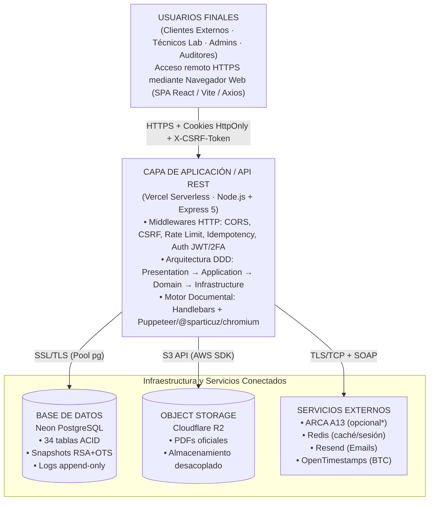

# Módulo III — Tipo de Solución, Arquitectura y Selección Tecnológica Justificada

Este documento define y justifica el tipo de solución informática, su arquitectura cliente/servidor web y el stack tecnológico adoptado en producción para **`gestion.ctmueble.com.ar`**.

## 0. Organización de Actividades del Módulo III y Validación de Módulos I–II

- **Responsabilidades técnicas:** Base de datos (modelado lógico definitivo de 34 tablas e índices), arquitectura backend (Clean Architecture/DDD + Serverless), diseño de interfaz y navegación (mockups y matriz de permisos), documentación técnica y gobierno del repositorio GitHub.
- **Validación previa:** Se revisaron y congelaron los entregables de los Módulos I y II (alcance aprobado, `RF01`–`RF36`, `RNF01`–`RNF18`, jerarquía de procesos `PB`/`PO`/`PC` y entidades iniciales), confirmando que ninguna decisión de diseño técnico contradice el análisis funcional.

## 0.1. Definición y Justificación del Tipo de Solución Informática

- **Tipo de solución elegida:** **Sistema Web Cliente/Servidor con acceso remoto y arquitectura cloud serverless**.
- **Justificación según los criterios de ingeniería (`Módulo III.pdf`):**
  - **Tipo de organización:** El CTM interactúa tanto con su equipo técnico interno en laboratorio como con fábricas de muebles, madereras e importadores ubicados en distintas provincias; un sistema web elimina barreras geográficas.
  - **Cantidad de usuarios:** Permite escalar simultáneamente múltiples usuarios `CLIENT` externos y miembros internos `LABORATORY` (`ADMIN`, `USER`, `CONSULTA`) sin instalaciones locales por puesto.
  - **Recursos disponibles:** Al apoyarse en plataformas administradas (Vercel Serverless + Neon PostgreSQL + Cloudflare R2 + Redis), el CTM evita costos fijos de mantenimiento de servidores físicos propios.
  - **Facilidad de uso:** Acceso universal desde cualquier navegador moderno mediante interfaz React responsiva, con descarga directa de PDFs y planillas XLSX/CSV.
  - **Mantenimiento futuro:** Cualquier despliegue de correcciones o mejoras impacta de inmediato en todos los usuarios mediante despliegues automatizados, migraciones versionadas Umzug y configuración dinámica en caliente (`/env`).

## 0.2. Arquitectura Técnica del Sistema (Dónde Vive, Datos, Acceso e Instalación)

> \* **Autocompletado auxiliar con ARCA (opcional):** La conexión con ARCA/AFIP (WSAA + Padrón A13) es únicamente un servicio auxiliar para autocompletar datos de clientes/empresas y **no necesita estar activada** para operar el sistema. Para habilitarla en el futuro, deben cargarse las variables `ARCA_CUIT` y los certificados X.509 (`ARCA_CERT_BASE64`/`ARCA_KEY_BASE64` en producción o `ARCA_CERT_FILE`/`ARCA_KEY_FILE` en local) autorizando el servicio `ws_sr_padron_a13` en ARCA.

- **Dónde estará el sistema:** Frontend SPA y Backend API desplegados en infraestructura cloud de Vercel (`src/app.js` / `src/handler.js`).
- **Dónde estarán los datos:** Datos relacionales y auditorías en PostgreSQL administrado en **Neon**; archivos PDF binarios en **Cloudflare R2** (o `STORAGE_DIR` en local); caché efímera y tokens de revocación/idempotencia en **Redis**.
- **Cómo accederán los usuarios:** A través de navegador web moderno bajo HTTPS, con autenticación protegida por cookies `HttpOnly` (`ctm_at`, `ctm_rt`) y cabecera `X-CSRF-Token`.
- **Qué necesita instalarse:** En el usuario final, **nada** (solo navegador web actualizado y lector PDF estándar). En entorno de desarrollo/administración CLI: Node.js, dependencias `npm` y variables `.env`.

## 0.3. Selección Tecnológica Justificada

| Componente | Tecnología elegida | Justificación (motivo, conocimiento, facilidad y compatibilidad) |
| :--- | :--- | :--- |
| **Lenguaje y Runtime** | **JavaScript (Node.js)** | Unifica el lenguaje entre frontend (React) y backend (Express 5), reduce fricción de desarrollo para el equipo y ofrece amplio ecosistema criptográfico y PDF (`crypto`, `puppeteer`, `exceljs`). |
| **Framework API** | **Express 5 + Swagger UI** | Sintaxis madura, integración directa de middlewares de seguridad, fácil compatibilidad con Vercel y `serverless-http` (`AWS Lambda`), y auto-documentación OpenAPI. |
| **Base de Datos** | **PostgreSQL (Neon)** | Motor relacional robusto con transacciones ACID estrictas, `UUID`, `JSONB`, bloqueos consultivos (`pg_advisory_xact_lock`), SSL nativo y compatibilidad total con Sequelize 6 + Umzug. |
| **Herramientas complementarias** | **GitHub, VSCode, Trello, Puppeteer, Handlebars, ExcelJS, Redis, R2, node-forge, Resend** | Conocimiento previo del equipo en flujo Git/VSCode; plantillas Handlebars embebidas sin dependencias de I/O frágiles en serverless; `node-forge` para firma PKCS#7 cuando se habilita el autocompletado auxiliar opcional de ARCA; `exceljs` para reportes sin riesgo de CSV Injection. |

## 1) Resumen ejecutivo

La solucion corre en una arquitectura cloud desacoplada:

- **Aplicacion/API:** Vercel
- **Base de datos transaccional:** Neon (PostgreSQL)
- **Almacenamiento de archivos/documentos:** Cloudflare R2

## 2) Componentes principales

## 2.1 Runtime y despliegue

- **Plataforma:** Vercel
- **Tipo de despliegue:** backend Node.js (API) desplegado en infraestructura serverless/managed de Vercel.
- **Responsabilidades:**
  - exponer endpoints HTTP de negocio,
  - aplicar autenticacion/autorizacion,
  - ejecutar validaciones, reglas de negocio y contratos API.

## 2.2 Base de datos

- **Proveedor:** Neon
- **Motor:** PostgreSQL administrado
- **Responsabilidades:**
  - persistencia transaccional del sistema,
  - integridad de datos relacionales,
  - soporte de migraciones y evolucion de esquema.

## 2.3 Almacenamiento de objetos

- **Proveedor:** Cloudflare R2
- **Uso:** almacenamiento de documentos generados y archivos asociados (ej. informes en PDF).
- **Responsabilidades:**
  - guardar objetos binarios,
  - servir descargas de documentos,
  - desacoplar almacenamiento de archivos de la base de datos.

## 3) Stack de aplicacion (backend)

- **Lenguaje:** JavaScript (Node.js)
- **Framework HTTP:** Express
- **ORM/DB Access:** Sequelize (con PostgreSQL)
- **Autenticacion:** JWT
- **Documentacion API:** Swagger UI / OpenAPI
- **Migraciones:** scripts de migracion versionados en el repositorio

## 4) Flujo tecnico simplificado

1. Frontend/cliente invoca endpoint en API desplegada en Vercel.
2. API valida token y permisos.
3. API lee/escribe datos de negocio en Neon.
4. Si hay documentos, API genera/recupera archivo en Cloudflare R2.
5. API responde payload JSON o archivo segun el endpoint.

## 5) Variables de entorno clave (referencia)

> Nota: los nombres exactos deben mantenerse segun configuracion vigente del proyecto.

- Conexion DB: `DATABASE_URL` (Neon/PostgreSQL)
- JWT: `JWT_SECRET`
- R2:
  - `R2_ACCOUNT_ID`
  - `R2_ACCESS_KEY_ID`
  - `R2_SECRET_ACCESS_KEY`
  - `R2_BUCKET_NAME`
- Otros: variables de integraciones externas (si aplica).

## 6) Consideraciones operativas

- **Escalabilidad:** Vercel y Neon permiten escalar por demanda.
- **Seguridad:** secretos gestionados por ambiente, nunca en repositorio.
- **Disponibilidad:** separar compute (Vercel), datos (Neon) y storage (R2) reduce acoplamiento.
- **Mantenibilidad:** migraciones controladas y contratos API documentados en Swagger.

## 7) Ambientes recomendados

- **Dev:** pruebas locales/integracion.
- **Staging:** validacion pre-productiva.
- **Prod:** operacion final con controles de cambios.

Cada ambiente debe tener:

- variables de entorno propias,
- credenciales separadas,
- recursos de datos/storage aislados o segmentados.

