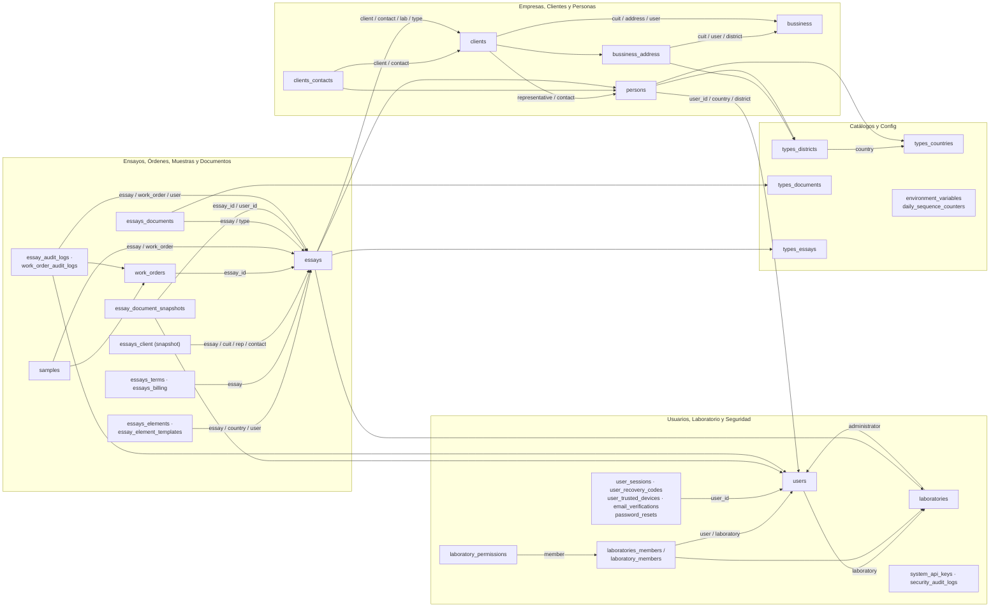

# Descripción de la base de datos (gestion.ctmueble.com.ar)

Documento generado a partir de los modelos Sequelize. Incluye todas las tablas, columnas, tipos, restricciones y relaciones.

---

## Índice de tablas

| Tabla | Descripción |
|-------|-------------|
| `types_countries` | Catálogo de países |
| `types_districts` | Catálogo de distritos (depende de país) |
| `types_documents` | Tipos de documentos (informes, contratos, etc.) |
| `types_essays` | Tipos de ensayo |
| `environment_variables` | Variables de entorno/configuración |
| `daily_sequence_counters` | Contadores atómicos diarios para códigos de ensayos y órdenes de trabajo |
| `users` | Usuarios del sistema (con 2FA y estado activo) |
| `user_sessions` | Sesiones activas y revocadas vinculadas a JWT (`sid`) |
| `user_recovery_codes` | Códigos de recuperación de emergencia 2FA (SHA-256) |
| `user_trusted_devices` | Dispositivos de confianza para bypass temporal de 2FA |
| `email_verifications` | Verificaciones de correo e invitaciones (OTP + token SHA-256) |
| `password_resets` | Solicitudes de restablecimiento de contraseña (OTP + token SHA-256) |
| `laboratories` | Laboratorios |
| `laboratories_members` / `laboratory_members` | Relación usuario–laboratorio (miembros y rol `ADMIN`/`USER`/`CONSULTA`) |
| `laboratory_permissions` | Matriz configurable de permisos granulares por rol de laboratorio |
| `system_api_keys` | Credenciales externas cifradas con AES-256-GCM (ej. Resend mailing) |
| `security_audit_logs` | Bitácora inmutable (append-only) de eventos de seguridad con firma criptográfica |
| `bussiness` | Empresas por CUIT (razón social) |
| `bussiness_address` | Direcciones de empresas |
| `persons` | Personas físicas (representantes, contactos) |
| `clients` | Clientes (empresa + dirección + representante/contacto) |
| `clients_contacts` | Contactos adicionales de un cliente (N–N cliente–persona) |
| `essays` | Solicitudes/ensayos |
| `essays_elements` | Datos del producto/material del ensayo |
| `essays_terms` | Plazos y precio del ensayo |
| `essays_billing` | Datos de facturación del ensayo (tabla histórica de esquema inicial) |
| `essays_client` | Snapshot del cliente al crear el ensayo |
| `essay_element_templates` | Plantillas de elementos de ensayo por usuario/origen |
| `essay_audit_logs` | Auditoría de cambios en ensayos (con huella de dispositivo y firma) |
| `essay_document_snapshots` | Snapshots inmutables RFC 8785 firmadas y selladas con OpenTimestamps |
| `work_orders` | Órdenes de trabajo |
| `work_order_audit_logs` | Auditoría de cambios en órdenes de trabajo (con huella de dispositivo y firma) |
| `samples` | Muestras (por ensayo y opcionalmente por orden de trabajo) |
| `essays_documents` | Documentos asociados a ensayos (metadatos para generación On The Fly) |

---

## 1. Catálogos y tipos (geo y documentos)

### 1.1. `types_countries`

Catálogo de países.

| Columna       | Tipo        | Nulo | Default | PK | FK | Descripción        |
|---------------|-------------|------|---------|----|----|--------------------|
| `id`          | CHAR(2)     | NO   | —       | SÍ | —  | Código país (ISO)  |
| `name`        | STRING      | NO   | —       | —  | —  | Nombre del país    |
| `country_code`| CHAR(3)     | SÍ   | —       | —  | —  | Código telefónico  |

Índice único: `country_code`.

---

### 1.2. `types_districts`

Distritos/localidades (geo).

| Columna   | Tipo    | Nulo | Default | PK | FK                    | Descripción   |
|-----------|---------|------|---------|----|-----------------------|---------------|
| `id`      | CHAR(6)  | NO   | —       | SÍ | —                     | Código distrito|
| `country` | CHAR(2)  | SÍ   | —       | —  | → `types_countries.id`| País          |
| `name`    | STRING  | NO   | —       | —  | —                     | Nombre        |
| `numeric_id` | INTEGER | SÍ | —     | —  | —                     | Código numérico de provincia (AFIP) |

---

### 1.3. `types_documents`

Tipos de documento (informe, contrato, etc.).

| Columna    | Tipo    | Nulo | Default | PK | FK | Descripción      |
|------------|---------|------|---------|----|----|------------------|
| `id`       | INTEGER | NO   | auto    | SÍ | —  | Identificador    |
| `code`     | STRING  | NO   | —       | —  | —  | Código interno   |
| `name`     | STRING  | NO   | —       | —  | —  | Nombre           |
| `filesheet`| STRING  | NO   | —       | —  | —  | Plantilla/hoja   |

---

### 1.4. `types_essays`

Tipos de ensayo.

| Columna | Tipo    | Nulo | Default | PK | FK | Descripción   |
|---------|---------|------|---------|----|----|----------------|
| `id`    | INTEGER | NO   | auto    | SÍ | —  | Identificador  |
| `name`  | STRING  | NO   | —       | —  | —  | Nombre del tipo|

**Relación:** `essays.essay` (INTEGER) referencia lógicamente a `types_essays.id` (sin FK explícita en el modelo).

---

## 2. Configuración y usuarios

### 2.1. `environment_variables`

Variables de configuración (clave–valor tipado).

| Columna         | Tipo    | Nulo | Default | PK | FK | Descripción      |
|-----------------|---------|------|---------|----|----|------------------|
| `id`            | STRING  | NO   | —       | SÍ | —  | Clave            |
| `label`         | STRING  | NO   | —       | —  | —  | Etiqueta         |
| `type`          | ENUM    | NO   | —       | —  | —  | TEXT, NUMBER, DECIMAL, TIMESTAMP |
| `value_text`    | STRING  | SÍ   | —       | —  | —  | Valor si TEXT    |
| `value_number`  | INTEGER | SÍ   | —       | —  | —  | Valor si NUMBER  |
| `value_decimal` | DECIMAL(12,2) | SÍ | —   | —  | —  | Valor si DECIMAL |
| `value_timestamp`| DATE   | SÍ   | —       | —  | —  | Valor si TIMESTAMP|
| `hardcoded`     | BOOLEAN | NO   | false   | —  | —  | No editable      |

---

### 2.2. `users`

Usuarios del sistema.

| Columna       | Tipo     | Nulo | Default   | PK | FK                      | Descripción   |
|---------------|----------|------|-----------|----|-------------------------|---------------|
| `id`          | UUID     | NO   | UUIDv4    | SÍ | —                       | Identificador |
| `name`        | STRING   | NO   | —         | —  | —                       | Nombre        |
| `dni`         | STRING(8)| NO   | —         | —  | —                       | DNI           |
| `mail`        | STRING   | NO   | —         | —  | —                       | Email (único) |
| `password`    | STRING   | NO   | —         | —  | —                       | Contraseña    |
| `profile`     | STRING   | NO   | —         | —  | —                       | Perfil/rol    |
| `laboratory`  | UUID     | SÍ   | —         | —  | → `laboratories.id`     | Laboratorio   |
| `is_active`   | BOOLEAN  | NO   | true      | —  | —                       | Cuenta activa / suspendida |
| `two_factor_enabled` | BOOLEAN | NO | false | —  | —                       | 2FA habilitado |
| `two_factor_method`  | VARCHAR(20) | NO | 'NONE' | — | —                   | `NONE`, `TOTP`, `EMAIL` |
| `two_factor_secret`  | TEXT | SÍ | —        | —  | —                       | Secreto Base32 TOTP (excluido por defaultScope) |
| `two_factor_temp_secret` | TEXT | SÍ | —   | —  | —                       | Secreto temporal durante vinculación TOTP |
| `two_factor_confirmed_at` | DATE | SÍ | —   | —  | —                       | Fecha de confirmación 2FA |
| `created_at`  | DATE     | NO   | NOW       | —  | —                       | Alta          |

Índice único: `mail`.

---

### 2.3. `laboratories`

Laboratorios.

| Columna        | Tipo   | Nulo | Default | PK | FK                  | Descripción    |
|----------------|--------|------|---------|----|---------------------|----------------|
| `id`           | UUID   | NO   | UUIDv4  | SÍ | —                   | Identificador  |
| `name`         | STRING | NO   | —       | —  | —                   | Nombre         |
| `cuit`         | STRING | NO   | —       | —  | —                   | CUIT           |
| `administrator`| UUID   | NO   | —       | —  | → `users.id`        | Administrador  |
| `mail`         | STRING | NO   | —       | —  | —                   | Email          |
| `address`      | STRING | NO   | —       | —  | —                   | Dirección      |
| `location`     | STRING | NO   | —       | —  | —                   | Localidad      |
| `district`     | STRING | NO   | —       | —  | —                   | Distrito       |
| `country`      | STRING | NO   | —       | —  | —                   | País           |

---

### 2.4. `laboratories_members` / `laboratory_members`

Usuarios miembros de un laboratorio con su rol interno.

> **Nota de esquema:** La migración inicial creó `laboratories_members` (`laboratory`, `user`, `role` con valores `ADMIN`, `USER`, `CONSULTA`), mientras que el modelo Sequelize vigente (`src/infrastructure/models/laboratories/members.js`) mapea sobre `laboratory_members` con `user` como clave primaria y `role`.

| Columna     | Tipo   | Nulo | Default | PK | FK                  | Descripción   |
|-------------|--------|------|---------|----|---------------------|---------------|
| `user`      | UUID   | NO   | —       | SÍ | → `users.id`        | Usuario       |
| `role`      | ENUM   | NO   | 'USER'  | —  | —                   | `ADMIN`, `USER`, `CONSULTA` |

---

### 2.5. `laboratory_permissions`

Matriz configurable de permisos granulares por rol interno de laboratorio.

| Columna      | Tipo         | Nulo | Default | PK | FK | Descripción |
|--------------|--------------|------|---------|----|----|-------------|
| `id`         | UUID         | NO   | UUIDv4  | SÍ | —  | Identificador |
| `rol`        | VARCHAR(50)  | NO   | —       | —  | —  | `Usuario` o `Consulta` |
| `accion`     | VARCHAR(100) | NO   | —       | —  | —  | Clave de acción (ej. `essays.crear`) |
| `permitido`  | BOOLEAN      | NO   | false   | —  | —  | Permiso habilitado |
| `created_at` | DATE         | NO   | NOW     | —  | —  | Fecha de creación |
| `updated_at` | DATE         | NO   | NOW     | —  | —  | Última modificación |

Índice único: (`rol`, `accion`).

---

### 2.6. `daily_sequence_counters`

Contadores atómicos diarios para la generación libre de colisiones de códigos de ensayos (`YYMMDD<L>`) y órdenes de trabajo.

| Columna      | Tipo        | Nulo | Default | PK | FK | Descripción |
|--------------|-------------|------|---------|----|----|-------------|
| `scope`      | VARCHAR(32) | NO   | —       | SÍ | —  | Ámbito (`'essay'` o `'work_order'`) |
| `date_key`   | VARCHAR(16) | NO   | —       | SÍ | —  | Fecha en formato `YYMMDD` |
| `last_value` | INTEGER     | NO   | 0       | —  | —  | Último correlativo asignado en el día |

Clave primaria compuesta: (`scope`, `date_key`).

---

## 3. Clientes y empresas

### 3.1. `bussiness`

Empresas identificadas por CUIT.

| Columna | Tipo        | Nulo | Default | PK | FK | Descripción   |
|---------|-------------|------|---------|----|----|---------------|
| `cuit`  | STRING(12)  | NO   | —       | SÍ | —  | CUIT (PK)     |
| `name`  | STRING(100) | NO   | —       | —  | —  | Razón social  |

---

### 3.2. `bussiness_address`

Direcciones de empresas.

| Columna   | Tipo        | Nulo | Default | PK | FK                     | Descripción   |
|-----------|-------------|------|---------|----|------------------------|---------------|
| `id`      | UUID        | NO   | UUIDv4  | SÍ | —                      | Identificador |
| `cuit`    | STRING(12)  | NO   | —       | —  | → `bussiness.cuit`     | Empresa       |
| `address` | STRING(100) | NO   | —       | —  | —                      | Calle/número  |
| `location`| STRING(100) | NO   | —       | —  | —                      | Localidad     |
| `province`| STRING(100) | NO   | —       | —  | —                      | Provincia     |
| `district`| CHAR(6)     | SÍ   | —       | —  | → `types_districts.id` | Distrito      |
| `origin`  | ENUM        | NO   | 'PUBLIC'| —  | —                      | CLIENT, LABORATORY, PUBLIC |
| `user`    | UUID        | SÍ   | —       | —  | → `users.id`           | Usuario alta  |

---

### 3.3. `persons`

Personas físicas (representantes, contactos, terceros).

| Columna       | Tipo   | Nulo | Default | PK | FK                        | Descripción        |
|---------------|--------|------|---------|----|---------------------------|--------------------|
| `id`          | UUID   | NO   | UUIDv4  | SÍ | —                         | Identificador      |
| `name`        | STRING | NO   | —       | —  | —                         | Nombre             |
| `dni`         | STRING | NO   | —       | —  | —                         | DNI                |
| `mail`        | STRING | SÍ   | —       | —  | —                         | Email              |
| `country_code`| CHAR(3)| SÍ   | —       | —  | → `types_countries.country_code` | Código teléfono |
| `phone`       | STRING | SÍ   | —       | —  | —                         | Teléfono           |
| `address`     | STRING | SÍ   | —       | —  | —                         | Dirección          |
| `location`    | STRING | SÍ   | —       | —  | —                         | Localidad          |
| `district`    | CHAR(6)| SÍ   | —       | —  | → `types_districts.id`    | Distrito           |
| `country`     | CHAR(2)| SÍ   | —       | —  | → `types_countries.id`    | País (código ISO)  |
| `user_id`     | UUID   | SÍ   | —       | —  | → `users.id` (unique)     | Usuario vinculado  |
| `origin`      | ENUM   | SÍ   | —       | —  | —                         | CLIENT, LABORATORY, PUBLIC |
| `is_third_party`| BOOLEAN| NO  | false   | —  | —                         | Es tercero         |

---

### 3.4. `clients`

Cliente: empresa + dirección + representante/contacto.

| Columna          | Tipo        | Nulo | Default  | PK | FK                     | Descripción              |
|------------------|-------------|------|----------|----|------------------------|--------------------------|
| `id`             | UUID        | NO   | UUIDv4   | SÍ | —                      | Identificador            |
| `cuit`           | STRING(12)  | NO   | —        | —  | (hist. `bussiness.cuit`) | Empresa                |
| `name`           | STRING(100) | SÍ   | —        | —  | —                      | Razón social / Nombre    |
| `address`        | UUID        | SÍ   | —        | —  | (hist. `bussiness_address.id`) | Dirección (opcional) |
| `address_address`| STRING(100) | SÍ   | —        | —  | —                      | Calle/número embebido    |
| `address_location`| STRING(100)| SÍ   | —        | —  | —                      | Localidad embebida       |
| `address_province`| STRING(100)| SÍ   | —        | —  | —                      | Provincia embebida       |
| `address_district`| CHAR(6)    | SÍ   | —        | —  | → `types_districts.id` | Distrito embebido        |
| `representative` | UUID        | SÍ   | —        | —  | → `persons.id`         | Representante legal      |
| `contact`        | UUID        | SÍ   | —        | —  | → `persons.id`         | Contacto adicional       |
| `origin`         | ENUM        | NO   | 'CLIENT' | —  | —                      | CLIENT, LABORATORY       |
| `billing_cuit`   | STRING(12)  | SÍ   | —        | —  | —                      | CUIT facturación alternativo |
| `billing_address`| STRING(100) | SÍ   | —        | —  | —                      | Dirección facturación    |
| `billing_location`| STRING(100)| SÍ   | —        | —  | —                      | Localidad facturación    |
| `billing_province`| STRING(100)| SÍ   | —        | —  | —                      | Provincia facturación    |
| `billing_iva`    | BOOLEAN     | SÍ   | —        | —  | —                      | Tributa IVA              |
| `user`           | UUID        | SÍ   | —        | —  | → `users.id`            | Usuario que cargó        |

---

### 3.5. `clients_contacts`

Contactos adicionales del cliente (N–N cliente–persona).

| Columna   | Tipo | Nulo | Default | PK | FK                | Descripción   |
|-----------|------|------|---------|----|-------------------|---------------|
| `client`  | UUID | NO   | —       | SÍ | → `clients.id`    | Cliente       |
| `contact` | UUID | NO   | —       | SÍ | → `persons.id`    | Persona       |

Clave primaria compuesta: (`client`, `contact`). Restricción única: (`client`, `contact`).

---

## 4. Ensayos (solicitudes y datos asociados)

### 4.1. `essays`

Solicitudes de ensayo / expedientes.

| Columna         | Tipo     | Nulo | Default    | PK | FK                  | Descripción   |
|-----------------|----------|------|------------|----|---------------------|---------------|
| `id`            | UUID     | NO   | UUIDv4     | SÍ | —                   | Identificador |
| `client`        | CHAR(36) | SÍ   | —          | —  | → `clients.id`      | Cliente (histórico) |
| `contact`       | UUID     | SÍ   | —          | —  | → `persons.id`      | Contacto (histórico) |
| `laboratory`    | UUID     | SÍ   | —          | —  | → `laboratories.id` | Laboratorio   |
| `essay`         | INTEGER  | NO   | 1          | —  | (→ types_essays.id) | Tipo de ensayo|
| `request_date`  | DATE     | NO   | NOW        | —  | —                   | Fecha solicitud |
| `signing_date`  | DATE     | SÍ   | —          | —  | —                   | Firma         |
| `finish_date`   | DATE     | SÍ   | —          | —  | —                   | Fin           |
| `due_date`      | DATE     | SÍ   | —          | —  | —                   | Vencimiento   |
| `observations`  | TEXT     | SÍ   | —          | —  | —                   | Observaciones |
| `status`        | ENUM     | NO   | 'REQUESTED'| —  | —                   | Ver abajo     |
| `code`          | STRING(16)| NO  | —          | —  | —                   | Código corto (`YYMMDD<L>`) |
| `last_update`   | DATE     | SÍ   | —          | —  | —                   | Última actualización por auditoría |
| `last_report_generated` | DATE | SÍ | —       | —  | —                   | Fecha del último informe emitido |
| `result`        | DECIMAL(12,2)| SÍ | —          | —  | —                   | Resultado     |
| `uncertainty`   | DECIMAL(12,2)| SÍ | —          | —  | —                   | Incertidumbre |
| `client_notifications_enabled` | BOOLEAN | NO | true | — | —                 | Consentimiento notificaciones email |
| `notification_token` | UUID | NO   | UUIDv4     | —  | —                   | Token único para baja 1-clic |

**status:** REQUESTED, ACCEPTED, REJECTED, SERVICE_AGREEMENT_MADED, IN_WORK, COMPLETED, CANCELLED.

---

### 4.2. `essays_elements`

Datos del producto/material del ensayo (1–1 con essay).

| Columna        | Tipo   | Nulo | Default | PK | FK                     | Descripción   |
|----------------|--------|------|---------|----|------------------------|---------------|
| `essay`        | UUID   | NO   | —       | SÍ | → `essays.id`          | Ensayo        |
| `product`      | STRING | NO   | —       | —  | —                      | Producto      |
| `manufacturer` | STRING | NO   | —       | —  | —                      | Fabricante    |
| `date`         | DATE   | NO   | —       | —  | —                      | Fecha         |
| `country`      | CHAR(2)| SÍ   | —       | —  | → `types_countries.id` | País origen   |
| `batch_number` | STRING | SÍ   | —       | —  | —                      | Nº de lote    |

---

### 4.3. `essays_terms`

Plazos y precio del ensayo (1–1 con essay).

| Columna                   | Tipo         | Nulo | Default | PK | FK            | Descripción        |
|---------------------------|--------------|------|---------|----|---------------|--------------------|
| `essay`                   | UUID         | NO   | —       | SÍ | → `essays.id` | Ensayo             |
| `days_to_do`              | INTEGER      | NO   | —       | —  | —             | Días para realizar |
| `samples_conservation_days`| INTEGER     | NO   | —       | —  | —             | Días conservación  |
| `price`                   | DECIMAL(12,2)| NO   | —       | —  | —             | Precio             |

---

### 4.4. `essays_billing`

Datos de facturación del ensayo (1–1 con essay).

| Columna  | Tipo         | Nulo | Default | PK | FK                     | Descripción   |
|----------|--------------|------|---------|----|------------------------|---------------|
| `essay`  | UUID         | NO   | —       | SÍ | → `essays.id`          | Ensayo        |
| `cuit`   | STRING(12)   | NO   | —       | —  | → `bussiness.cuit`     | Empresa facturar |
| `address`| STRING(36)   | SÍ   | —       | —  | → `bussiness_address.id`| Dirección facturación |
| `amount` | DECIMAL(12,2)| SÍ   | 0.0     | —  | —                      | Monto          |
| `pays_iva`| BOOLEAN      | NO   | false   | —  | —                      | Tributa IVA   |

---

### 4.5. `essays_client`

Snapshot del cliente al momento de crear el ensayo (1–1 con essay). Permite detectar cambios y decidir si actualizar.

| Columna               | Tipo        | Nulo | Default | PK | FK                     | Descripción   |
|-----------------------|-------------|------|---------|----|------------------------|---------------|
| `id`                  | UUID        | NO   | UUIDv4  | SÍ | —                      | Identificador |
| `essay`               | UUID        | NO   | —       | —  | → `essays.id` (unique) | Ensayo        |
| `cuit`                | STRING(12)  | NO   | —       | —  | (hist. `bussiness.cuit`) | Empresa     |
| `name`                | STRING(100) | SÍ   | —       | —  | —                      | Snapshot nombre / razón social |
| `address`             | UUID        | SÍ   | —       | —  | (hist. `bussiness_address.id`) | Dirección |
| `representative`      | UUID        | SÍ   | —       | —  | → `persons.id`         | Representante|
| `contact`             | UUID        | NO   | —       | —  | → `persons.id`         | Contacto      |
| `address_address`     | STRING(100) | SÍ   | —       | —  | —                      | Snapshot dirección |
| `address_location`    | STRING(100) | SÍ   | —       | —  | —                      | Snapshot localidad |
| `address_province`    | STRING(100) | SÍ   | —       | —  | —                      | Snapshot provincia |
| `representative_name` | STRING(100) | SÍ   | —       | —  | —                      | Snapshot nombre rep. |
| `representative_dni`  | STRING(8)   | SÍ   | —       | —  | —                      | Snapshot DNI rep. |
| `representative_contact`| UUID       | SÍ   | —       | —  | —                      | ID contacto rep. |
| `contact_name`        | STRING      | SÍ   | —       | —  | —                      | Snapshot nombre contacto |
| `contact_dni`         | STRING      | SÍ   | —       | —  | —                      | Snapshot DNI contacto |
| `contact_mail`        | STRING      | SÍ   | —       | —  | —                      | Snapshot email |
| `contact_country_code`| CHAR(3)     | SÍ   | —       | —  | —                      | Snapshot código país |
| `contact_phone`       | STRING      | SÍ   | —       | —  | —                      | Snapshot teléfono |
| `contact_address`     | STRING      | SÍ   | —       | —  | —                      | Snapshot dirección |
| `contact_location`    | STRING      | SÍ   | —       | —  | —                      | Snapshot localidad |
| `contact_district`    | CHAR(6)     | SÍ   | —       | —  | —                      | Snapshot distrito |
| `contact_country`     | CHAR(2)     | SÍ   | —       | —  | —                      | Snapshot país |
| `billing_cuit`        | STRING(12)  | SÍ   | —       | —  | —                      | Facturación alternativa |
| `billing_address`     | STRING(100) | SÍ   | —       | —  | —                      | Idem           |
| `billing_location`    | STRING(100) | SÍ   | —       | —  | —                      | Idem           |
| `billing_province`    | STRING(100) | SÍ   | —       | —  | —                      | Idem           |
| `billing_iva`         | BOOLEAN     | SÍ   | —       | —  | —                      | Idem           |
| `address_raw_*` / `representative_raw_*` / `contact_raw_*` / `bussiness_raw_name` | VARIOS | SÍ | — | — | — | Columnas de datos crudos en origen (migración `20260220000001`) |

---

### 4.6. `essay_element_templates`

Plantillas de elementos de ensayo (producto/fabricante/país) por usuario u origen.

| Columna    | Tipo        | Nulo | Default  | PK | FK                     | Descripción   |
|------------|-------------|------|----------|----|------------------------|---------------|
| `id`       | UUID        | NO   | UUIDv4   | SÍ | —                      | Identificador |
| `user_id`  | UUID        | SÍ   | —        | —  | → `users.id`           | Usuario       |
| `origin`   | ENUM        | NO   | 'CLIENT' | —  | —                      | CLIENT, LABORATORY |
| `product`  | STRING      | NO   | —        | —  | —                      | Producto      |
| `manufacturer`| STRING    | NO   | —        | —  | —                      | Fabricante    |
| `country`  | CHAR(2)     | SÍ   | —        | —  | → `types_countries.id` | País          |

---

### 4.7. `essay_audit_logs`

Registro de eventos sobre ensayos con trazabilidad de dispositivo e integridad criptográfica.

| Columna              | Tipo        | Nulo | Default | PK | FK            | Descripción   |
|----------------------|-------------|------|---------|----|---------------|---------------|
| `id`                 | CHAR(36)    | NO   | UUIDv4  | SÍ | —             | Identificador |
| `essay`              | CHAR(36)    | NO   | —       | —  | → `essays.id` | Ensayo        |
| `user_id`            | CHAR(36)    | NO   | —       | —  | → `users.id`  | Usuario       |
| `event_code`         | STRING(50)  | NO   | —       | —  | —             | Código evento |
| `timestamp`          | DATE        | NO   | NOW     | —  | —             | Fecha/hora    |
| `ip_address`         | STRING(64)  | SÍ   | —       | —  | —             | IP de origen  |
| `user_agent`         | STRING(512) | SÍ   | —       | —  | —             | User-Agent    |
| `client_name`        | STRING(120) | SÍ   | —       | —  | —             | Navegador/SO  |
| `device_id`          | STRING(100) | SÍ   | —       | —  | —             | ID dispositivo|
| `device_fingerprint` | STRING(128) | SÍ   | —       | —  | —             | Huella digital|
| `session_id`         | STRING(64)  | SÍ   | —       | —  | —             | `sid` de sesión|
| `record_hash`        | STRING(64)  | SÍ   | —       | —  | —             | Hash SHA-256 canónico |
| `signature`          | TEXT        | SÍ   | —       | —  | —             | Firma digital |
| `previous_hash`      | STRING(64)  | SÍ   | —       | —  | —             | Encadenamiento al registro previo |
| `metadata`           | JSON        | SÍ   | —       | —  | —             | Datos extra   |

Índices: `essay`, `user_id`, `timestamp`, `event_code`.

---

## 5. Órdenes de trabajo y muestras

### 5.1. `work_orders`

Órdenes de trabajo generadas a partir de un ensayo.

| Columna                    | Tipo          | Nulo | Default           | PK | FK            | Descripción   |
|----------------------------|---------------|------|-------------------|----|---------------|---------------|
| `id`                       | UUID          | NO   | UUIDv4            | SÍ | —             | Identificador |
| `essay_id`                 | UUID          | NO   | —                 | —  | → `essays.id` | Ensayo        |
| `code`                     | STRING(16)    | NO   | —                 | —  | —             | Código orden  |
| `essay_track_code`         | STRING(64)    | SÍ   | —                 | —  | —             | Código tracking|
| `report_delivery_deadline` | DATEONLY      | SÍ   | —                 | —  | —             | Fecha límite informe |
| `samples_received_at`      | DATE          | SÍ   | —                 | —  | —             | Fecha recepción muestras |
| `sample_dimensions`        | STRING(255)   | SÍ   | —                 | —  | —             | Dimensiones legibles |
| `sample_width`             | DECIMAL(12,4) | SÍ   | —                 | —  | —             | Ancho         |
| `sample_height`            | DECIMAL(12,4) | SÍ   | —                 | —  | —             | Largo/Alto    |
| `sample_thickness`         | DECIMAL(12,4) | SÍ   | —                 | —  | —             | Espesor       |
| `generated_at`             | DATE          | NO   | NOW               | —  | —             | Fecha generación |
| `observations`             | TEXT          | SÍ   | —                 | —  | —             | Observaciones |
| `internal_aconditioning`   | BOOLEAN       | SÍ   | false             | —  | —             | Acondicionamiento |
| `uncertainty`              | STRING(64)    | SÍ   | —                 | —  | —             | Incertidumbre |
| `average_value`            | DECIMAL(12,4) | SÍ   | —                 | —  | —             | Promedio calculado |
| `status`                   | ENUM          | NO   | 'WAITING_SAMPLES' | —  | —             | Ver abajo     |
| `closed_at`                | DATE          | SÍ   | —                 | —  | —             | Fecha de cierre |
| `last_update`              | DATE          | SÍ   | —                 | —  | —             | Última actualización |

**status:** WAITING_SAMPLES, ANALYZING, COMPLETED, CANCELLED.

---

### 5.2. `work_order_audit_logs`

Registro de eventos sobre órdenes de trabajo con trazabilidad de dispositivo e integridad criptográfica.

| Columna              | Tipo        | Nulo | Default | PK | FK                | Descripción   |
|----------------------|-------------|------|---------|----|-------------------|---------------|
| `id`                 | UUID        | NO   | UUIDv4  | SÍ | —                 | Identificador |
| `work_order_id`      | UUID        | NO   | —       | —  | → `work_orders.id` (ON DELETE CASCADE) | Orden   |
| `user_id`            | UUID        | NO   | —       | —  | → `users.id`      | Usuario       |
| `event_code`         | STRING(50)  | NO   | —       | —  | —                 | Código evento |
| `timestamp`          | DATE        | NO   | NOW     | —  | —                 | Fecha/hora    |
| `ip_address`         | STRING(64)  | SÍ   | —       | —  | —                 | IP de origen  |
| `user_agent`         | STRING(512) | SÍ   | —       | —  | —                 | User-Agent    |
| `client_name`        | STRING(120) | SÍ   | —       | —  | —                 | Navegador/SO  |
| `device_id`          | STRING(100) | SÍ   | —       | —  | —                 | ID dispositivo|
| `device_fingerprint` | STRING(128) | SÍ   | —       | —  | —                 | Huella digital|
| `session_id`         | STRING(64)  | SÍ   | —       | —  | —                 | `sid` de sesión|
| `record_hash`        | STRING(64)  | SÍ   | —       | —  | —                 | Hash SHA-256 canónico |
| `signature`          | TEXT        | SÍ   | —       | —  | —                 | Firma digital |
| `previous_hash`      | STRING(64)  | SÍ   | —       | —  | —                 | Encadenamiento |
| `metadata`           | JSON        | SÍ   | —       | —  | —                 | Datos extra   |

Índices: `work_order_id`, `user_id`, `timestamp`.

---

### 5.3. `samples`

Muestras asociadas a un ensayo y opcionalmente a una orden de trabajo.

| Columna                | Tipo         | Nulo | Default  | PK | FK                  | Descripción   |
|------------------------|--------------|------|----------|----|---------------------|---------------|
| `id`                   | STRING(36)   | NO   | —        | SÍ | —                   | Identificador |
| `essay`                | STRING(36)   | NO   | —        | —  | → `essays.id`       | Ensayo        |
| `status`               | ENUM         | NO   | 'PENDING'| —  | —                   | Ver abajo     |
| `date_code`            | STRING(7)    | SÍ   | —        | —  | —                   | Código base (`YYMMDD<L>`) |
| `correlative`          | INTEGER      | NO   | —        | —  | —                   | Correlativo   |
| `countersample`        | BOOLEAN      | NO   | false    | —  | —                   | Es contramuestra |
| `received_at`          | DATE         | NO   | NOW      | —  | —                   | Fecha recepción |
| `accepted`             | BOOLEAN      | SÍ   | false    | —  | —                   | Aceptada       |
| `internal_conditioning`| BOOLEAN      | SÍ   | false    | —  | —                   | Acondicionamiento |
| `observations`         | TEXT         | SÍ   | —        | —  | —                   | Observaciones |
| `result`               | DECIMAL(12,2)| SÍ   | —        | —  | —                   | Resultado     |
| `work_order`           | UUID         | SÍ   | —        | —  | → `work_orders.id`  | Orden de trabajo |
| `height`               | DECIMAL(12,4)| SÍ   | —        | —  | —                   | Alto (mm)      |
| `width`                | DECIMAL(12,4)| SÍ   | —        | —  | —                   | Ancho          |
| `thickness`            | DECIMAL(12,4)| SÍ   | —        | —  | —                   | Espesor        |

**status:** PENDING, ANALYZED, REJECTED, SAVED, RETURNED.

---

## 6. Documentos de ensayos

### 6.1. `essays_documents`

Documentos (informes, PDFs) asociados a ensayos.

| Columna      | Tipo    | Nulo | Default | PK | FK                  | Descripción   |
|--------------|---------|------|---------|----|---------------------|---------------|
| `id`         | UUID    | NO   | UUIDv4  | SÍ | —                   | Identificador |
| `essay`      | UUID    | NO   | —       | SÍ | → `essays.id`       | Ensayo        |
| `type`       | INTEGER | NO   | —       | —  | → `types_documents.id`| Tipo documento |
| `copy`       | INTEGER | NO   | 0       | —  | —                   | Número de copia |
| `modificated`| BOOLEAN | NO   | false   | —  | —                   | Modificado    |
| `generated_at`| DATE   | NO   | NOW     | —  | —                   | Fecha generación |
| `file`      | STRING  | NO   | —       | —  | —                   | Ruta/archivo  |

Clave primaria compuesta en el modelo: (`id`, `essay`). En la práctica se usa `id` como PK y `essay` como FK.

---

### 6.2. `essay_document_snapshots`

Snapshots inmutables de documentos oficiales firmadas criptográficamente (RFC 8785) y certificadas con OpenTimestamps (OTS).

| Columna               | Tipo         | Nulo | Default        | PK | FK            | Descripción |
|-----------------------|--------------|------|----------------|----|---------------|-------------|
| `id`                  | UUID         | NO   | UUIDv4         | SÍ | —             | Identificador |
| `essay_id`            | UUID         | NO   | —              | —  | → `essays.id` | Ensayo |
| `document_type`       | STRING(32)   | NO   | —              | —  | —             | `F-PC13-01`, `F-PC13-02`, etc. |
| `version`             | INTEGER      | NO   | 1              | —  | —             | Versión secuencial por ensayo/tipo |
| `event_code`          | STRING(64)   | NO   | —              | —  | —             | Evento disparador |
| `snapshot_data`       | JSONB        | NO   | —              | —  | —             | Payload canónico estructurado |
| `canonical_hash`      | STRING(64)   | NO   | —              | —  | —             | Hash SHA-256 canónico (RFC 8785) |
| `signature`           | TEXT         | NO   | —              | —  | —             | Firma digital RSA / HMAC |
| `signature_algorithm` | STRING(32)   | NO   | 'HMAC-SHA256'  | —  | —             | Algoritmo de firma |
| `ots_status`          | STRING(24)   | NO   | 'PENDING'      | —  | —             | `PENDING`, `STAMPED`, `FAILED`, `SKIPPED` |
| `ots_proof`           | TEXT         | SÍ   | —              | —  | —             | Comprobante binario `.ots` en Base64 |
| `ots_calendar_url`    | STRING(255)  | SÍ   | —              | —  | —             | URL del calendario OpenTimestamps |
| `ots_stamped_at`      | DATE         | SÍ   | —              | —  | —             | Fecha cierta certificada |
| `ots_error`           | TEXT         | SÍ   | —              | —  | —             | Error de sellado (si falló) |
| `user_id`             | UUID         | SÍ   | —              | —  | → `users.id`  | Usuario autor |
| `session_id`          | STRING(64)   | SÍ   | —              | —  | —             | `sid` de sesión |
| `device_id`           | STRING(100)  | SÍ   | —              | —  | —             | ID de dispositivo |
| `device_fingerprint`  | STRING(128)  | SÍ   | —              | —  | —             | Huella del dispositivo |
| `client_name`         | STRING(120)  | SÍ   | —              | —  | —             | Navegador/SO legible |
| `ip_address`          | STRING(64)   | SÍ   | —              | —  | —             | IP de origen |
| `user_agent`          | STRING(512)  | SÍ   | —              | —  | —             | User-Agent |
| `created_at`          | DATE         | NO   | NOW            | —  | —             | Fecha de captura |

Índice único: (`essay_id`, `document_type`, `version`). Otros índices: `canonical_hash`, `ots_status`, `created_at`.

---

## 7. Seguridad, sesiones, verificaciones y credenciales

### 7.1. `user_sessions`

Sesiones activas vinculadas a los JWT (`sid`).

| Columna          | Tipo        | Nulo | Default | PK | FK                         | Descripción |
|------------------|-------------|------|---------|----|----------------------------|-------------|
| `id`             | UUID        | NO   | UUIDv4  | SÍ | —                          | `sid` de sesión |
| `user_id`        | UUID        | NO   | —       | —  | → `users.id` (CASCADE)     | Usuario |
| `ip_address`     | STRING(45)  | SÍ   | —       | —  | —                          | Dirección IP |
| `user_agent`     | TEXT        | SÍ   | —       | —  | —                          | User-Agent |
| `client_name`    | STRING(100) | SÍ   | —       | —  | —                          | Navegador y SO |
| `is_revoked`     | BOOLEAN     | NO   | false   | —  | —                          | Revocada manualmente |
| `created_at`     | DATE        | NO   | NOW     | —  | —                          | Inicio de sesión |
| `last_active_at` | DATE        | NO   | NOW     | —  | —                          | Última actividad |
| `expires_at`     | DATE        | NO   | —       | —  | —                          | Expiración (24h o 30d) |

---

### 7.2. `user_recovery_codes`

Códigos de recuperación de emergencia para 2FA (almacenados como hash SHA-256).

| Columna      | Tipo        | Nulo | Default | PK | FK                     | Descripción |
|--------------|-------------|------|---------|----|------------------------|-------------|
| `id`         | UUID        | NO   | UUIDv4  | SÍ | —                      | Identificador |
| `user_id`    | UUID        | NO   | —       | —  | → `users.id` (CASCADE) | Usuario |
| `code_hash`  | STRING(128) | NO   | —       | —  | —                      | Hash SHA-256 del código |
| `used`       | BOOLEAN     | NO   | false   | —  | —                      | Ya canjeado |
| `used_at`    | DATE        | SÍ   | —       | —  | —                      | Fecha de canje |
| `created_at` | DATE        | NO   | NOW     | —  | —                      | Fecha de generación |

---

### 7.3. `user_trusted_devices`

Dispositivos de confianza autorizados para omitir el desafío 2FA por 7 días.

| Columna              | Tipo        | Nulo | Default | PK | FK                     | Descripción |
|----------------------|-------------|------|---------|----|------------------------|-------------|
| `id`                 | UUID        | NO   | UUIDv4  | SÍ | —                      | Identificador |
| `user_id`            | UUID        | NO   | —       | —  | → `users.id` (CASCADE) | Usuario |
| `device_id`          | STRING(100) | NO   | —       | —  | —                      | ID persistente del cliente |
| `device_fingerprint` | STRING(128) | NO   | —       | —  | —                      | Huella SHA-256 del navegador |
| `device_name`        | STRING(100) | SÍ   | —       | —  | —                      | Nombre legible del equipo |
| `ip_address`         | STRING(45)  | SÍ   | —       | —  | —                      | IP registrada |
| `trusted_until`      | DATE        | NO   | —       | —  | —                      | Vigencia de confianza |
| `is_revoked`         | BOOLEAN     | NO   | false   | —  | —                      | Revocado |
| `last_used_at`       | DATE        | NO   | NOW     | —  | —                      | Último uso |
| `created_at`         | DATE        | NO   | NOW     | —  | —                      | Alta |

---

### 7.4. `email_verifications`

Registros efímeros para verificación de email, activación por invitación y OTPs de 2FA por correo.

| Columna         | Tipo        | Nulo | Default | PK | FK                     | Descripción |
|-----------------|-------------|------|---------|----|------------------------|-------------|
| `id`            | UUID        | NO   | UUIDv4  | SÍ | —                      | Identificador |
| `user_id`       | UUID        | SÍ   | —       | —  | → `users.id` (CASCADE) | Usuario (opcional) |
| `mail`          | STRING      | NO   | —       | —  | —                      | Correo destino |
| `otp_code_hash` | STRING(128) | NO   | —       | —  | —                      | Hash SHA-256 del OTP |
| `token_hash`    | STRING(128) | NO   | —       | —  | —                      | Hash SHA-256 del token (o prefijo `2fa_otp_`) |
| `expires_at`    | DATE        | NO   | —       | —  | —                      | Expiración |
| `verified_at`   | DATE        | SÍ   | —       | —  | —                      | Fecha de validación |
| `attempts`      | INTEGER     | NO   | 0       | —  | —                      | Intentos fallidos |
| `created_at`    | DATE        | NO   | NOW     | —  | —                      | Alta |

---

### 7.5. `password_resets`

Solicitudes temporales de restablecimiento de contraseña.

| Columna         | Tipo        | Nulo | Default | PK | FK                     | Descripción |
|-----------------|-------------|------|---------|----|------------------------|-------------|
| `id`            | UUID        | NO   | UUIDv4  | SÍ | —                      | Identificador |
| `user_id`       | UUID        | NO   | —       | —  | → `users.id` (CASCADE) | Usuario |
| `mail`          | STRING      | NO   | —       | —  | —                      | Correo destino |
| `otp_code_hash` | STRING(128) | NO   | —       | —  | —                      | Hash SHA-256 del OTP |
| `token_hash`    | STRING(128) | NO   | —       | —  | —                      | Hash SHA-256 del token de enlace |
| `expires_at`    | DATE        | NO   | —       | —  | —                      | Expiración (15 min) |
| `used_at`       | DATE        | SÍ   | —       | —  | —                      | Fecha de consumo |
| `attempts`      | INTEGER     | NO   | 0       | —  | —                      | Intentos fallidos |
| `created_at`    | DATE        | NO   | NOW     | —  | —                      | Alta |

---

### 7.6. `system_api_keys`

Credenciales de servicios externos cifradas con AES-256-GCM (o KMS Envelope Encryption).

| Columna        | Tipo        | Nulo | Default       | PK | FK | Descripción |
|----------------|-------------|------|---------------|----|----|-------------|
| `id`           | UUID        | NO   | UUIDv4        | SÍ | —  | Identificador |
| `service`      | STRING(50)  | NO   | —             | —  | —  | `MAILING`, `AFIP`, etc. |
| `provider`     | STRING(50)  | NO   | —             | —  | —  | `RESEND`, etc. |
| `name`         | STRING(100) | NO   | —             | —  | —  | Nombre descriptivo |
| `encrypted_key`| TEXT        | NO   | —             | —  | —  | Ciphertext en Base64 |
| `iv`           | STRING(64)  | NO   | —             | —  | —  | Vector de inicialización (Base64) |
| `tag`          | STRING(64)  | NO   | —             | —  | —  | Auth Tag GCM (Base64) |
| `key_version`  | STRING(20)  | NO   | 'v1'          | —  | —  | Versión de clave maestra |
| `algorithm`    | STRING(30)  | NO   | 'AES-256-GCM' | —  | —  | Algoritmo AEAD |
| `key_hint`     | STRING(30)  | SÍ   | —             | —  | —  | Máscara segura (ej. `re_...1234`) |
| `metadata`     | JSONB       | SÍ   | `{}`          | —  | —  | Configuración asociada (`fromEmail`, `notifyNewRequests`, etc.) |
| `envelope`     | JSONB       | SÍ   | —             | —  | —  | Metadata de Envelope Encryption (KMS) |
| `is_active`    | BOOLEAN     | NO   | true          | —  | —  | Clave activa |
| `created_at`   | DATE        | NO   | NOW           | —  | —  | Alta |
| `updated_at`   | DATE        | NO   | NOW           | —  | —  | Última modificación |

---

### 7.7. `security_audit_logs`

Bitácora inmutable (append-only, protegida en PostgreSQL por trigger `trg_security_audit_logs_immutable`) de eventos de seguridad.

| Columna              | Tipo        | Nulo | Default   | PK | FK | Descripción |
|----------------------|-------------|------|-----------|----|----|-------------|
| `id`                 | UUID        | NO   | UUIDv4    | SÍ | —  | Identificador |
| `request_id`         | STRING(64)  | SÍ   | —         | —  | —  | `X-Request-Id` de correlación |
| `user_id`            | UUID        | SÍ   | —         | —  | —  | Actor (si está autenticado) |
| `session_id`         | STRING(64)  | SÍ   | —         | —  | —  | `sid` de sesión |
| `action`             | STRING(80)  | NO   | —         | —  | —  | Acción auditada (`AUTH_LOGIN`, `ACCESS_FORBIDDEN`, etc.) |
| `resource`           | STRING(80)  | NO   | —         | —  | —  | Recurso afectado |
| `resource_id`        | STRING(128) | SÍ   | —         | —  | —  | ID del recurso |
| `outcome`            | STRING(24)  | NO   | 'SUCCESS' | —  | —  | `SUCCESS`, `FAILURE`, `DENIED` |
| `ip_address`         | STRING(64)  | SÍ   | —         | —  | —  | IP de origen |
| `user_agent`         | STRING(512) | SÍ   | —         | —  | —  | User-Agent |
| `client_name`        | STRING(120) | SÍ   | —         | —  | —  | Navegador/SO |
| `device_id`          | STRING(100) | SÍ   | —         | —  | —  | ID de dispositivo |
| `device_fingerprint` | STRING(128) | SÍ   | —         | —  | —  | Huella digital |
| `record_hash`        | STRING(64)  | SÍ   | —         | —  | —  | Hash SHA-256 canónico del registro |
| `signature`          | TEXT        | SÍ   | —         | —  | —  | Firma criptográfica del registro |
| `previous_hash`      | STRING(64)  | SÍ   | —         | —  | —  | Hash del registro previo |
| `metadata`           | JSONB       | SÍ   | —         | —  | —  | Contexto extra (secretos redactados) |
| `created_at`         | DATE        | NO   | NOW       | —  | —  | Fecha/hora del evento |

---

## 8. Diagrama de relaciones (resumen)

---

## 9. Total de tablas

**34 tablas** en total:

- Catálogos: `types_countries`, `types_districts`, `types_documents`, `types_essays`
- Config y secuencias: `environment_variables`, `daily_sequence_counters`
- Usuarios y labs: `users`, `laboratories`, `laboratories_members` / `laboratory_members`, `laboratory_permissions`
- Seguridad y sesiones: `user_sessions`, `user_recovery_codes`, `user_trusted_devices`, `email_verifications`, `password_resets`, `system_api_keys`, `security_audit_logs`
- Clientes: `bussiness`, `bussiness_address`, `persons`, `clients`, `clients_contacts`
- Ensayos: `essays`, `essays_elements`, `essays_terms`, `essays_billing`, `essays_client`, `essay_element_templates`, `essay_audit_logs`
- Órdenes y muestras: `work_orders`, `work_order_audit_logs`, `samples`
- Documentos y snapshots: `essays_documents`, `essay_document_snapshots`

---

## 10. Diagnóstico de Redundancias, Coherencia y Normalización (`Módulo III.pdf`)

Previo a la implementación de migraciones físicas en PostgreSQL, se realizó una auditoría estructural de normalización y coherencia relacional sobre las 34 tablas del esquema:

### 10.1. Cumplimiento de Formas Normales (1FN, 2FN y 3FN)
- **Primera Forma Normal (1FN):** Todos los atributos almacenan valores atómicos en columnas tipadas. Los arreglos repetitivos se separaron en tablas hijas relacionales (`essays_elements` para ítems solicitados, `samples` para unidades físicas recibidas, `clients_contacts` para múltiples contactos adicionales y `laboratory_permissions` para permisos por miembro). En casos puntuales de mediciones seriadas analíticas variables (`samples.result` en `JSONB`) o metadata de auditoría (`security_audit_logs.metadata`), se utiliza `JSONB` estructurado y validado por DTO/dominio.
- **Segunda Forma Normal (2FN):** Todas las entidades con claves compuestas (`laboratories_members`, `clients_contacts`, `daily_sequence_counters`) dependen funcionalmente de la totalidad de su clave primaria (por ejemplo, `daily_sequence_counters` almacena `last_value` dependiente de `(scope, date_key)`).
- **Tercera Forma Normal (3FN):** Se eliminaron dependencias transitivas separando catálogos reutilizables (`types_countries`, `types_districts`, `types_documents`, `types_essays`) y normalizando los datos maestros de empresas (`bussiness`) y domicilios (`bussiness_address`) de los perfiles comerciales (`clients`) y personas (`persons`).

### 10.2. Redundancias Detectadas y Decisiones de Diseño Controlado

| Hallazgo analizado | Decisión técnica adoptada | Justificación de negocio / integridad |
| :--- | :--- | :--- |
| **`essays_client` duplica campos de `clients`, `bussiness`, `bussiness_address` y `persons`** | **Desnormalización histórica controlada (Snapshot)** | Regla de negocio `RN04`: si un cliente cambia razón social, domicilio o representante meses después de emitir un informe oficial, los ensayos antiguos **no deben alterarse retrospectivamente**. `essays_client` congela el estado vigente al momento de la solicitud. |
| **`essay_document_snapshots` almacena `payload_json` completo además de tablas normalizadas** | **Desnormalización probatoria para firma RSA/OTS** | Para garantizar verificación criptográfica determinista (`CanonicalJson` RFC 8785 + `RSA-SHA256` + OpenTimestamps) a lo largo del tiempo independientemente de futuras migraciones de columnas, el snapshot guarda el payload exacto firmado. |
| **`essays_billing` vs columnas `billing_*` en `clients`** | **Consolidación y depuración** | Las tablas de configuración comercial heredaron `billing_*` directamente en `clients` / `essays_client` para simplificar facturación alternativa opcional sin generar filas vacías innecesarias. |
| **Dualidad nominal `laboratories_members` / `laboratory_members`** | **Compatibilidad de modelo y migración controlada** | La migración inicial creó `laboratories_members` y el modelo operativo `members.js` referencia `laboratory_members`; documentado para mantener coherencia en migraciones posteriores. |
| **Prevención de campos derivados inconsistentes en muestras** | **Cálculo centralizado en dominio** | `samples.average_value` se recalcula automáticamente dentro de la entidad `Sample.setResult(...)` en transacción al recibir `samples.result`, evitando discrepancias entre valores individuales y promedio. |

---

## 11. Comandos de Migraciones y Seedeo de Datos Base

El esquema físico completo (34 tablas en PostgreSQL) se crea y evoluciona mediante Umzug (`SequelizeMeta`) y se inicializa de forma global o granular con los siguientes comandos en español:

### 11.1. Migraciones
- `npm run migrate` (o `npm run migrate:up`): ejecuta todas las migraciones pendientes.
- `npm run migrate:status`: muestra el estado actual de migraciones aplicadas y pendientes.
- `npm run migrate:down`: revierte la última migración aplicada.
- `npm run migrate:undo`: revierte todas las migraciones ejecutadas.

### 11.2. Seedeo global, granular y restablecimiento de contraseñas
- `npm run seed`: ejecuta el seedeo completo (249 países ISO 3166-1 alpha-2 en `types_countries`, 24 provincias/jurisdicciones argentinas en `types_districts`, tipo de ensayo de formaldehído según IT17-01 en `types_essays`, 5 documentos en `types_documents`, datos ficticios de laboratorio en `environment_variables` y `laboratories`, cuenta Admin de Laboratorio y cuenta de Cliente demo).
- Seedeo granular por módulo:
  - `npm run seed:countries` (`--countries`): solo países.
  - `npm run seed:provinces` (`--provinces`): solo provincias argentinas.
  - `npm run seed:essay-types` (`--essay-types`): solo tipo de ensayo de formaldehído.
  - `npm run seed:lab` (`--lab` / opcional `--overwrite-lab`): solo datos ficticios de laboratorio.
  - `npm run seed:users` (`--users`, o `--admin` / `--client`): solo cuentas de usuario.
- Restablecimiento de contraseñas si los usuarios ya están creados:
  - `npm run seed:reset-passwords`: actualiza el hash bcrypt de las cuentas base existentes sin duplicar registros.
  - `npm run create-user -- --mail <email> --password <clave> --reset-password`: crea o restablece la contraseña de un usuario específico.
