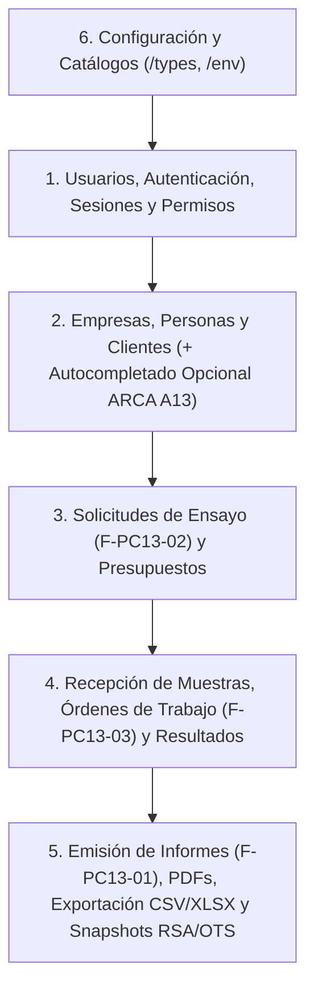
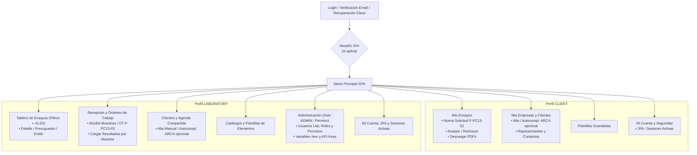
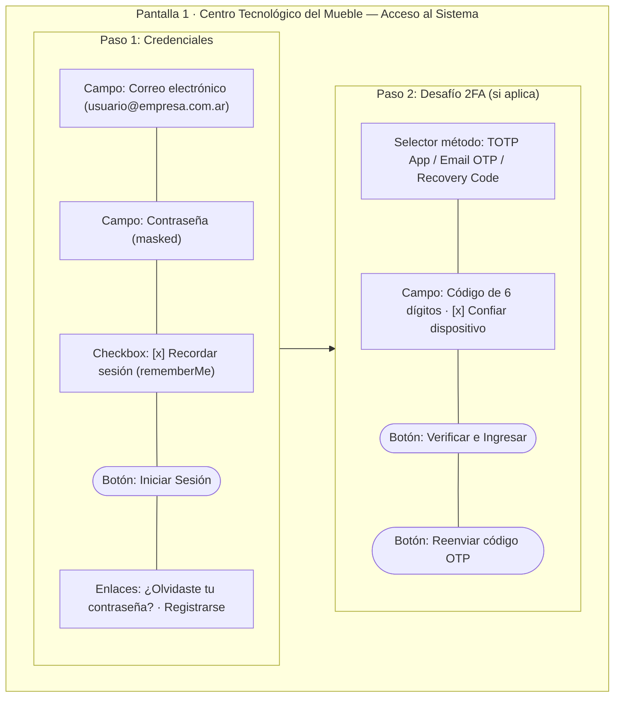
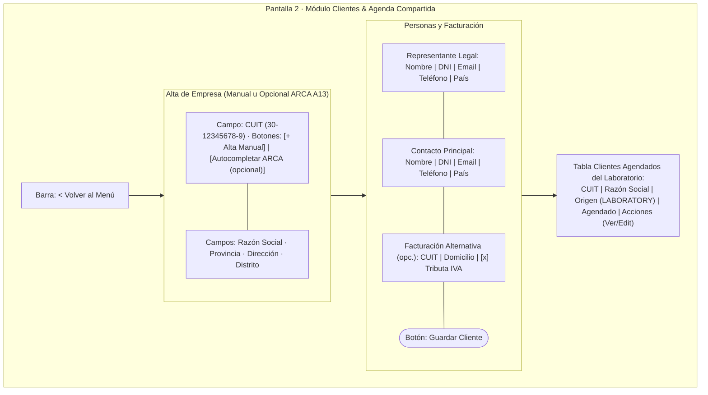
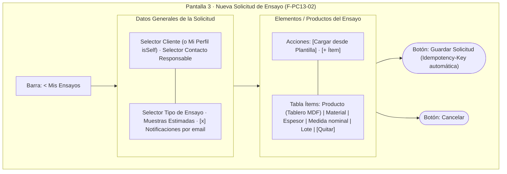
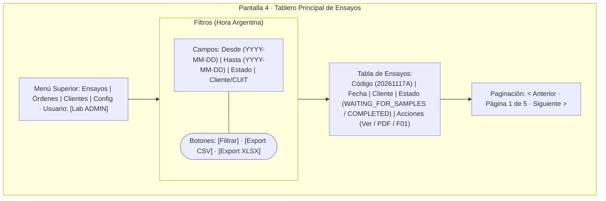
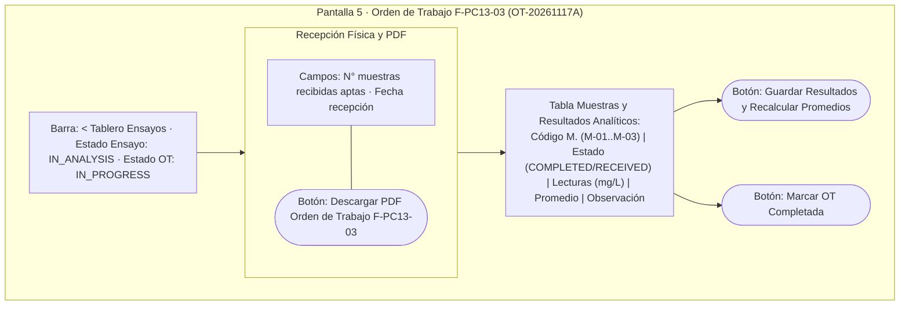
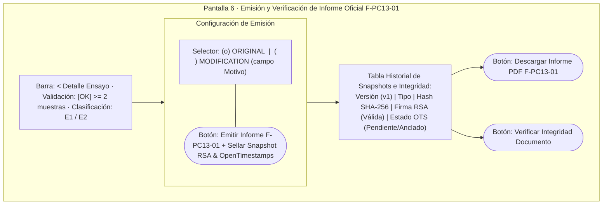
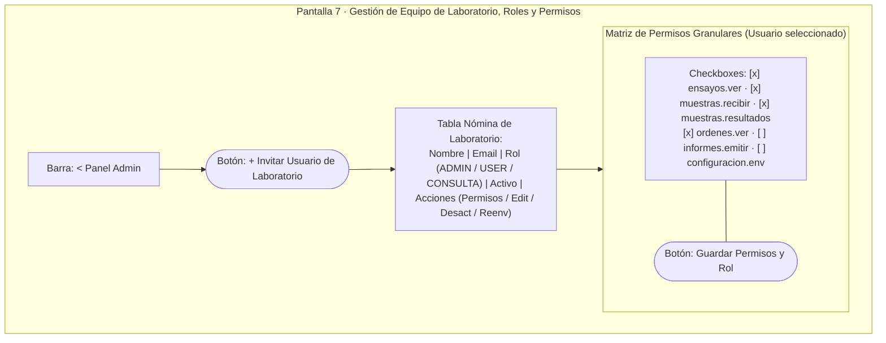

# Módulo III — Diseño Modular, Navegación Funcional, Mockups y Planificación

> **Correspondencia con lineamientos (`Módulo III.pdf`):** Cubre **Diseño modular del sistema**, **Jerarquía de módulos**, **Navegación funcional del sistema**, **Diseño de interfaz (mockups)**, **Plan de implementación**, **Plan de mantenimiento inicial** y **Revisión integral previa al desarrollo**.

---

## 1. Diseño Modular del Sistema

La plataforma `gestion.ctmueble.com.ar` se divide en **6 módulos funcionales y arquitectónicos** desacoplados, cada uno con objetivos, operaciones, tablas propias y perfiles de usuario claramente delimitados:

| Módulo | Objetivo | Operaciones que realiza | Tablas involucradas (de las 34) | Usuarios que lo utilizan |
| :--- | :--- | :--- | :--- | :--- |
| **1. Módulo Usuarios, Sesiones y Seguridad** | Gestionar identidades, autenticación segura, 2FA, permisos granulares, recuperación de clave, API keys y auditoría de seguridad. | Registro, login, refresh/logout, verificación OTP/link, forgot/reset password, setup/uso 2FA, revocar sesiones/dispositivos, ABM miembros de laboratorio y permisos, CRUD API keys. | `users`, `laboratories`, `laboratories_members`/`laboratory_members`, `laboratory_permissions`, `user_sessions`, `user_recovery_codes`, `user_trusted_devices`, `email_verifications`, `password_resets`, `system_api_keys`, `security_audit_logs`. | Todos los perfiles (`CLIENT` en su cuenta; `ADMIN` en administración de laboratorio y API keys). |
| **2. Módulo Empresas, Clientes, Personas y Autocompletado Opcional ARCA** | Mantener el padrón comercial unificado con carga manual autónoma y agenda compartida del laboratorio (más autocompletado auxiliar opcional con ARCA A13 si está habilitado). | Alta/edición manual de empresa y domicilios, consulta auxiliar opcional en WSAA/Padrón A13 (sin requerir activación), ABM personas, ABM clientes y contactos adicionales, agenda compartida de laboratorio. | `bussiness`, `bussiness_address`, `persons`, `clients`, `clients_contacts`. | `CLIENT` (solo sus clientes/personas) y `LABORATORY` (`ADMIN` / `USER` con permisos `clientes.*`, `CONSULTA` lectura). |
| **3. Módulo Ensayos y Plantillas (`F-PC13-02`)** | Gestionar el ciclo comercial-técnico de solicitudes de ensayo, términos, presupuestos y plantillas reutilizables. | Crear ensayo (`F-PC13-02`), calcular código diario atómico, guardar snapshot de cliente, actualizar cliente del ensayo, presupuestos (`essays_terms`), aceptar/rechazar/cancelar, acciones dinámicas y plantillas. | `essays`, `essays_elements`, `essays_terms`, `essays_billing`, `essays_client`, `essay_element_templates`, `essay_audit_logs`, `daily_sequence_counters`. | `CLIENT` (solicitar, aceptar/rechazar, cancelar propios) y `LABORATORY` (`ensayos.*`). |
| **4. Módulo Recepción, Órdenes de Trabajo y Muestras (`F-PC13-03`)** | Controlar el ingreso físico de probetas al laboratorio, emisión de OT y carga de resultados analíticos. | Recepción unificada de muestras, generación de OT con código diario, consulta de pendientes, transición de estados de OT, carga de mediciones y cálculo automático de `average_value`. | `work_orders`, `work_order_audit_logs`, `samples`, `daily_sequence_counters`. | Exclusivo `LABORATORY` (`ADMIN` y `USER` con `muestras.recibir`, `muestras.resultados`, `ordenes.*`; `CONSULTA` lectura). |
| **5. Módulo Documentos PDF, Notificaciones, Exportación e Integridad (`F-PC13-01`)** | Generar PDFs oficiales, emitir informes certificados, exportar planillas, notificar por email y garantizar integridad probatoria. | Emitir informe `ORIGINAL` / `MODIFICATION`, generar PDFs `F-PC13-01`/`02`/`03` vía Handlebars+Puppeteer+R2, exportar CSV/XLSX, enviar/desuscribir emails Resend, firmar snapshots RSA-SHA256 + OpenTimestamps. | `essays_documents`, `essay_document_snapshots`, más lectura consolidada sobre `essays`, `essays_client`, `samples`, `work_orders`. | `CLIENT` (descarga PDFs propios y preferencias de email) y `LABORATORY` (`informes.*`, `essays.export`, verificación). |
| **6. Módulo Configuración y Catálogos** | Proveer catálogos base normalizados y parametrización institucional/analítica en caliente sin redespliegue. | Listar países, distritos (incluyendo `numeric_id`), documentos y tipos de ensayo; consultar/editar variables `/env` (`UNCERTAINTY`, autoridades, CBU, etc.) protegiendo `hardcoded`. | `types_countries`, `types_districts`, `types_documents`, `types_essays`, `environment_variables`. | Consulta pública/autenticada para catálogos; `ADMIN` / `configuracion.env` para modificar variables `/env`. |

---

## 2. Jerarquía de Módulos (Dependencias de Construcción y Operación)

> **Criterio de ordenamiento:** Esta jerarquía dicta directamente el orden secuencial de desarrollo del Módulo IV: ningún módulo superior puede operar ni probarse sin los módulos base de los que depende. *(Nota: El autocompletado mediante ARCA en el Módulo 2 es un complemento auxiliar opcional y no bloquea ni es requisito para los módulos 3, 4 y 5; se habilita configurando `ARCA_CUIT` y certificado/clave `ARCA_*`.)*

---

## 3. Navegación Funcional del Sistema

El acceso al frontend SPA se adapta dinámicamente según el perfil autenticado (`CLIENT` vs `LABORATORY`) y los permisos efectivos del usuario:

### 3.1. Rutas Básicas y Control de Acceso en Navegación

| Ruta funcional SPA / API asociada | Permiso / Rol requerido | Submenús y acciones visibles |
| :--- | :--- | :--- |
| `/login`, `/register`, `/verify-email`, `/forgot-password` | Público | Inicio de sesión, ingreso OTP, recuperación de clave. |
| `/dashboard` | Autenticado (`CLIENT` / `LABORATORY`) | Resumen de estado de solicitudes pendientes o asignadas. |
| `/clients` y `/clients/scheduled` | `CLIENT` (propios) / `LABORATORY` (`clientes.ver`, `clientes.agendar`) | Alta manual, autocompletado auxiliar opcional de datos por CUIT (si ARCA está activo), edición, contactos y agenda compartida. |
| `/essays` y `/essays/:id` | `CLIENT` (propios) / `LABORATORY` (`ensayos.ver`) | Listado filtrable por fecha Argentina, creación `F-PC13-02`, presupuesto, acciones dinámicas, descarga PDF, exportación CSV/XLSX (`essays.export`). |
| `/work-orders` y `/samples` | Exclusivo `LABORATORY` (`ordenes.*`, `muestras.*`) | Recepción unificada (`F-PC13-03`), listado de pendientes, carga de resultados y promedios. |
| `/essays/:id/report` y `/snapshots/verify` | `LABORATORY` (`informes.emitir`) / Verificador | Emisión `F-PC13-01` (`ORIGINAL`/`MODIFICATION`), descarga PDF y verificación RSA/OTS. |
| `/admin/users`, `/admin/env`, `/admin/api-keys` | `LABORATORY` (`ADMIN` o permiso `usuarios.*`, `configuracion.env`) | ABM usuarios internos, matriz de permisos, variables institucionales y API keys. |
| `/account/security` | Autenticado (`CLIENT` / `LABORATORY`) | Configuración 2FA TOTP/Email, códigos de recuperación, dispositivos confiables y cierre de sesiones. |

---

## 4. Diseño de Interfaz — Mockups Estructurados de Pantallas

Los bocetos siguientes especifican los **campos principales**, **botones de acción**, **tablas** y **navegación básica** implementados entre frontend y contratos API:

### Pantalla 1: Login, Verificación 2FA y Recuperación de Contraseña

### Pantalla 2: Gestión de Clientes y Autocompletado Auxiliar Opcional por CUIT

### Pantalla 3: Solicitud de Servicio de Ensayo (`F-PC13-02`)

### Pantalla 4: Tablero Principal de Ensayos, Filtros y Exportación

### Pantalla 5: Recepción de Muestras, Orden de Trabajo (`F-PC13-03`) y Resultados

### Pantalla 6: Emisión de Informe (`F-PC13-01`) y Verificación Criptográfica

### Pantalla 7: Administración de Usuarios de Laboratorio y Permisos

---

## 5. Plan de Implementación (Cronograma por Etapas)

| Etapa / Ventana | Módulos y Entregables Técnicos | Dependencias cubiertas |
| :--- | :--- | :--- |
| **Semana 1 — Base de Datos, Infraestructura y Auth** | Configuración Neon PostgreSQL + Sequelize + migraciones base (`20260217`), catálogos `/types`, variables `/env`, registro, login, JWT y cookies `HttpOnly`/CSRF. | Módulo 6 y Módulo 1 |
| **Semana 2 — Seguridad Avanzada, Clientes y Autocompletado Opcional** | Verificación email, reseteo de clave, 2FA (TOTP/Email), sesiones/dispositivos confiables, roles de laboratorio + permisos granulares, alta manual de empresas/personas/agenda compartida y soporte auxiliar opcional ARCA A13 (no requerido para operar). | Módulo 1 y Módulo 2 |
| **Semana 3 — Núcleo Operativo de Ensayos, OT y Muestras** | Solicitudes `F-PC13-02`, generación atómica de códigos diarios (`daily_sequence_counters`), snapshot `essays_client`, plantillas, términos/presupuestos, recepción de muestras y Órdenes de Trabajo `F-PC13-03` + carga de resultados. | Módulo 3 y Módulo 4 |
| **Semana 4 — PDFs, Reportes, Integridad Criptográfica y QA** | Emisión `F-PC13-01`, Handlebars + Puppeteer + R2, notificaciones Resend, exportación CSV/XLSX segura, `CanonicalJson` + RSA-SHA256 + OpenTimestamps, API Keys AES-256-GCM, auditoría de seguridad y suite de 90 tests. | Módulo 5 y Hardening Integral |

---

## 6. Plan de Mantenimiento Inicial

| Eje de mantenimiento | Procedimiento operativo |
| :--- | :--- |
| **Copias de seguridad (Backups)** | Respaldos automáticos gestionados por Neon PostgreSQL (Point-in-Time Recovery / snapshots diarios), respaldo redundante de documentos PDF emitidos en Cloudflare R2 y exportación periódica de snapshots/auditorías. |
| **Actualización y gobierno de usuarios** | Revisión periódica de cuentas de laboratorio activas en `/laboratory/users`, desactivación inmediata de personal saliente (revocando sesiones activas) y principio de mínimo privilegio por permiso granular. |
| **Limpieza de datos y tokens expirados** | Depuración o expiración programada de OTPs vencidos (`email_verifications`, `password_resets`), sesiones revocadas antiguas (`user_sessions`) y rotación controlada de claves maestras (`MASTER_ENCRYPTION_KEY_V*`, `JWT_ACCESS_SECRET`, `JWT_REFRESH_SECRET`). |
| **Mejoras futuras controladas** | Cualquier evolución de esquema debe implementarse únicamente mediante nueva migración Umzug (`npm run migrate:up`), manteniendo retrocompatibilidad con `essays_client` y `essay_document_snapshots`, e incluyendo nuevas pruebas en `tests/`. |
| **Documentación técnica viva** | Mantener sincronizados los contratos de `/docs`, `README.md`, `docs/INDEX.md` y regenerar el documento maestro mediante `npm run build:docs-pdf` tras cambios estructurales. |

---

## 7. Revisión Integral Previa al Desarrollo — Checklist (Módulo III)

| Punto de verificación (`Módulo III.pdf`) | Resultado de la verificación | Estado |
| :--- | :--- | :--- |
| **¿La base de datos está correcta?** | Sí: 34 tablas definidas en `03-DISENO_LOGICO_DEFINITIVO_BASE_DE_DATOS.md` con PKs, FKs, índices y diagnóstico de normalización/desnormalización controlada. | **Verificado** |
| **¿Los módulos están claros?** | Sí: 6 módulos funcionales delimitados con tablas, operaciones, jerarquía y permisos asignados. | **Verificado** |
| **¿La arquitectura es viable?** | Sí: stack serverless desacoplado (Vercel + Neon + R2 + Redis) validado para costos, concurrencia y seguridad. | **Verificado** |
| **¿Las tecnologías son posibles?** | Sí: todas las librerías (`express`, `sequelize`, `puppeteer-core`, `node-forge`, `exceljs`, `ioredis`, `@aws-sdk/client-s3`) están instaladas en `package.json` y probadas. | **Verificado** |
| **¿El desarrollo tiene orden lógico?** | Sí: secuenciado desde Configuración/Seguridad → Clientes (+ autocompletado opcional ARCA) → Ensayos/OT → Informes/PDF/Integridad. | **Verificado** |
| **¿Todos entienden qué construir?** | Sí: mockups, rutas de navegación, contratos API y reglas de negocio dejan especificación unívoca para pasar al Módulo IV. | **Verificado** |
