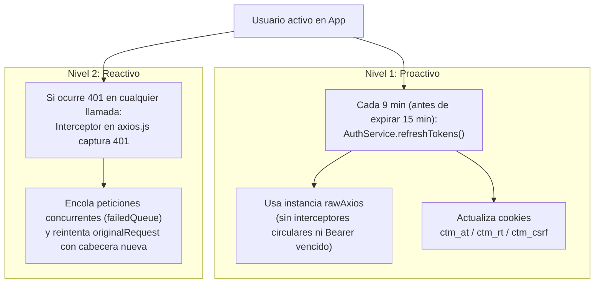

# Documentación de Seguridad, Autenticación, 2FA y Gestión de Sesiones

> **Centro Tecnológico del Mueble (CTM) - Oficina Virtual & Gestión**  
> **Fecha de actualización:** 12 de Noviembre de 2026  
> **Ámbito:** Backend (`gestion.ctmueble.com.ar`) y Frontend (`oficina.ctmueble.com.ar`)  
> **Estado:** Implementado, verificado y en producción

---

## 1. Resumen Ejecutivo y Objetivos

Esta documentación detalla la arquitectura, modelos de datos, flujos de seguridad y contratos de API implementados para la gestión integral de cuentas de usuario, doble factor de autenticación (2FA), dispositivos de confianza, códigos de recuperación de emergencia y administración de sesiones activas.

### Principales capacidades implementadas:
1. **Panel Centralizado de Configuración de Cuenta:** Accesible desde el menú de usuario del encabezado (removido del menú lateral para preservar la jerarquía visual).
2. **Seguridad y Autenticación Multifactor (2FA):**
   * Compatibilidad dual: **Google Authenticator / TOTP** (RFC 6238) y **OTP por Correo Electrónico**.
   * Gestión de activación, confirmación mediante código de prueba y desactivación protegida con validación de contraseña actual.
3. **Códigos de Recuperación de Emergencia (Códigos de Confianza):**
   * Lote de 8 códigos de respaldo generados en formato alfanumérico agrupado (`XXXX-XXXX`).
   * Almacenamiento con hash criptográfico unidireccional (SHA-256).
   * Uso único estricto (invalidación inmediata tras el primer canje exitoso).
   * Interfaz de entrega con descarga en archivo `.txt` y copia en un clic.
   * Flujo de acceso alternativo en el inicio de sesión si se extravía el dispositivo 2FA.
4. **Dispositivos de Confianza (Bypass de 2FA por 7 días):**
   * Identificación determinística del equipo mediante **fingerprinting no invasivo** en el cliente.
   * Validación automática en el login: si el dispositivo está reconocido y dentro del periodo de 7 días, se omite el desafío de 2FA.
   * Sección de visualización, auditoría y revocación de equipos en el panel de cuenta.
   * Revocación automática preventiva al cambiar contraseña o deshabilitar 2FA.
5. **Auditoría y Gestión de Sesiones Activas:**
   * Registro en base de datos (`user_sessions`) vinculado a la familia de tokens JWT (`sid`).
   * Detección de cliente, sistema operativo, dirección IP y última actividad.
   * Posibilidad de revocar sesiones remotas individuales o todas las demás sesiones en bloque.
   * Revocación atómica al cerrar sesión (`logout`).
6. **Persistencia de Sesión («No cerrar sesión» / Remember Me):**
   * Si está activo: Cookies persistentes por **30 días** y expiración de sesión en DB a 30 días.
   * Si está inactivo: **Session Cookies** (sin `maxAge`), eliminadas automáticamente por el navegador al cerrarse.
7. **Renovación Silenciosa e Ininterrumpida de Tokens (Proactive & Reactive Refresh):**
   * **Proactiva:** Temporizador de fondo que renueva el access token cada 9 minutos mientras el usuario navega la aplicación.
   * **Reactiva:** Interceptor 401 en Axios con cola de serialización (`failedQueue`) e instancia desacoplada (`rawAxios`) para reintentar peticiones transparentemente y sin errores visuales.

---

## 2. Modelado de Base de Datos y Migraciones

Se ejecutaron dos migraciones estructuradas mediante Umzug / Sequelize sobre PostgreSQL (Neon):

### Migración 1: `20261112000000-add-user-2fa-and-sessions.js`
1. **Campos incorporados a la tabla `users`:**
   * `two_factor_enabled` (`BOOLEAN`, default `false`).
   * `two_factor_method` (`VARCHAR(20)`, default `'NONE'`; valores: `'NONE'`, `'TOTP'`, `'EMAIL'`).
   * `two_factor_secret` (`TEXT`, nullable): Secreto Base32 para TOTP (protegido en scopes Sequelize `withTwoFactorSecret`).
   * `two_factor_temp_secret` (`TEXT`, nullable): Secreto provisorio durante el proceso de vinculación.
   * `two_factor_confirmed_at` (`TIMESTAMP WITH TIME ZONE`, nullable).
2. **Creación de la tabla `user_sessions`:**
   * `id` (`VARCHAR(64)` PRIMARY KEY): Identificador de familia de sesión (`sid` del JWT).
   * `user_id` (`UUID` NOT NULL, FK -> `users.id` ON DELETE CASCADE).
   * `ip_address` (`VARCHAR(45)`): Dirección IPv4 o IPv6 del cliente.
   * `user_agent` (`TEXT`): User-Agent crudo de la conexión.
   * `client_name` (`VARCHAR(100)`): Nombre legible generado por el parser (ej: `Chrome en Windows 10`).
   * `is_revoked` (`BOOLEAN`, default `false`).
   * `created_at` (`TIMESTAMP WITH TIME ZONE`).
   * `last_active_at` (`TIMESTAMP WITH TIME ZONE`).
   * `expires_at` (`TIMESTAMP WITH TIME ZONE`).
   * *Índices:* `idx_user_sessions_user_id`, `idx_user_sessions_lookup (user_id, is_revoked, expires_at)`.

### Migración 2: `20261112010000-add-recovery-codes-and-trusted-devices.js`
1. **Creación de la tabla `user_recovery_codes`:**
   * `id` (`UUID` PRIMARY KEY, default `gen_random_uuid()`).
   * `user_id` (`UUID` NOT NULL, FK -> `users.id` ON DELETE CASCADE).
   * `code_hash` (`VARCHAR(64)` NOT NULL): Hash SHA-256 del código alfanumérico.
   * `used` (`BOOLEAN`, default `false`).
   * `used_at` (`TIMESTAMP WITH TIME ZONE`, nullable).
   * `created_at` (`TIMESTAMP WITH TIME ZONE`).
   * *Índices:* `idx_user_recovery_codes_user_unused (user_id, used)`.
2. **Creación de la tabla `user_trusted_devices`:**
   * `id` (`UUID` PRIMARY KEY, default `gen_random_uuid()`).
   * `user_id` (`UUID` NOT NULL, FK -> `users.id` ON DELETE CASCADE).
   * `device_id` (`VARCHAR(64)` NOT NULL): Identificador único de hardware/cliente.
   * `device_name` (`VARCHAR(100)`): Nombre legible del dispositivo.
   * `device_fingerprint` (`VARCHAR(64)` NOT NULL): Hash SHA-256 de los componentes del navegador.
   * `ip_address` (`VARCHAR(45)`).
   * `trusted_until` (`TIMESTAMP WITH TIME ZONE` NOT NULL): Fecha de expiración de la confianza (7 días).
   * `last_used_at` (`TIMESTAMP WITH TIME ZONE`).
   * `created_at` (`TIMESTAMP WITH TIME ZONE`).
   * *Índices:* `idx_user_trusted_devices_lookup (user_id, device_id, trusted_until)`.

---

## 3. Seguridad y Doble Factor de Autenticación (2FA)

### 3.1 Flujo de Configuración TOTP (Google Authenticator)
1. **Solicitud de Setup (`POST /users/2fa/totp/setup`):**
   * El servicio genera un secreto criptográfico Base32 de 20 bytes (`otplib`).
   * Se almacena temporalmente en `user.two_factor_temp_secret`.
   * Se genera una URL `otpauth://totp/CTM%20Oficina%20Virtual:<mail>?secret=...&issuer=CTM` y su respectivo código QR en formato Data URL.
2. **Confirmación y Activación (`POST /users/2fa/totp/confirm`):**
   * El usuario envía el código de 6 dígitos mostrado en su app autenticadora.
   * Se valida con tolerancia temporal contra el secreto temporal.
   * Si es válido, se promueve el secreto a `two_factor_secret`, se limpia `temp_secret` y se marca `two_factor_enabled = true`.
   * Se genera automáticamente un lote de 8 códigos de recuperación de emergencia y se devuelven en la respuesta.

### 3.2 Flujo de Configuración OTP por Correo
1. **Solicitud de Setup (`POST /users/2fa/email/setup`):**
   * Se genera un código numérico aleatorio de 6 dígitos con expiración de 10 minutos en memoria/Redis (`MailingService`).
   * Se despacha un correo HTML normalizado institucional con el código.
2. **Confirmación y Activación (`POST /users/2fa/email/confirm`):**
   * Se valida el código recibido por correo.
   * Si coincide, se marca `two_factor_method = 'EMAIL'` y `two_factor_enabled = true`.
   * Se genera automáticamente el lote de 8 códigos de recuperación de emergencia.

### 3.3 Desactivación Protegida (`POST /users/2fa/disable`)
* Requiere obligatoriamente que el usuario ingrese su contraseña actual.
* Si la contraseña es válida:
  * Se establece `two_factor_enabled = false` y `two_factor_method = 'NONE'`.
  * Se eliminan los secretos TOTP.
  * Se revocan todos los dispositivos de confianza del usuario.
  * Se invalidan los códigos de recuperación restantes.

---

## 4. Códigos de Recuperación de Emergencia

### 4.1 Generación y Almacenamiento Seguro
* Cada código consiste en 8 caracteres hexadecimales/alfanuméricos agrupados (`XXXX-XXXX`).
* El backend nunca almacena los códigos en texto plano. Se calcula el hash SHA-256 de la versión normalizada:
  $$\text{Hash} = \text{SHA256}(\text{normalize}(\text{código}))$$
* La única oportunidad en que el usuario ve los códigos en claro es en el modal inmediato tras su generación.

### 4.2 Entrega al Usuario (Frontend)
* **Modal de visualización inmediata:** Grilla en dos columnas con fuentes monoespaciadas y contraste visual elevado.
* **Copia al portapapeles:** Copia los 8 códigos con un solo clic.
* **Descarga en archivo `.txt`:** Genera un archivo estándar descargable `CTM-codigos-recuperacion-<usuario>.txt` con saltos de línea `\r\n` compatibles con Windows y Unix.

### 4.3 Uso en Inicio de Sesión
* Ante el desafío de 2FA en el login, el usuario puede seleccionar *"¿Perdiste tu método 2FA? Usar un código de recuperación"*.
* Al enviar el código (`isRecoveryCode: true`), el backend verifica la existencia del hash con `used: false`.
* Si es válido, se marca `used: true`, `used_at = NOW()` y se emite la sesión de forma inmediata.

---

## 5. Dispositivos de Confianza (Bypass 2FA por 7 Días)

### 5.1 Estrategia de Fingerprinting de Cliente (`deviceFingerprint.js`)
Para identificar el equipo sin emplear permisos invasivos ni afectar la privacidad del usuario, se combinan atributos estables del entorno de ejecución:
1. `ctm_device_id`: Identificador persistente en `localStorage`.
2. `navigator.userAgent`: Cadena del navegador y motor.
3. `navigator.language` e idiomas preferidos.
4. `navigator.platform` y concurrencia de hardware (`hardwareConcurrency`).
5. `screen.width`, `screen.height`, `screen.colorDepth`.
6. Zona horaria del sistema (`Intl.DateTimeFormat().resolvedOptions().timeZone`).
7. **Canvas 2D Hash:** Renderizado en memoria de un texto y figuras con sombras para capturar variaciones en rasterización GPU/font-rendering.

Todos estos componentes se concatenan y se hashean mediante la API Web Crypto (`crypto.subtle.digest('SHA-256')`).

### 5.2 Lógica de Verificación y Vigencia
* **En el Login:**
  * Si el usuario tiene 2FA activo, el backend consulta `user_trusted_devices` buscando coincidencias del `userId` y `device_id`.
  * Se verifica que `device_fingerprint` coincida y que `trusted_until > NOW()`.
  * Si es válido, **se omite el 2FA** y se inicia la sesión directamente.
* **Activación:** Durante el desafío de 2FA, la casilla `[x] Confiar en este dispositivo por 7 días` envía `trustDevice: true`. El backend registra o actualiza el equipo con:
  $$\text{trusted\_until} = \text{NOW}() + 7 \text{ días}$$
* **Revocación:** El usuario puede listar sus dispositivos de confianza y revocar el acceso a cualquiera de ellos (o a todos) desde la pestaña *Seguridad y Autenticación*.

---

## 6. Sesiones Activas y Política de Persistencia

### 6.1 Identificación y Seguimiento de Sesiones
* Cada login emite un par de tokens JWT que comparten un identificador de sesión único (`sid`, UUID v4).
* El middleware `verifyJWT` ejecuta un método ligero de amortiguación en memoria (`touchSession`) para actualizar `last_active_at` en base de datos cada 5 minutos de actividad real.
* La ruta `GET /users/sessions` lista todas las sesiones activas, marcando con la etiqueta *"Esta sesión actual"* aquella que coincide con el `sid` de la petición.

### 6.2 Revocación Total en Logout
* Al invocar `POST /auth/logout`, se decodifica el token de acceso o refresco (incluso si estuviese recién expirado) para extraer el `sid`.
* Se invoca `UserSessionService.getInstance().revokeSessionBySid(sid)`, marcando en base de datos `is_revoked = true`.
* Esto garantiza que, al volver a iniciar sesión, las sesiones cerradas **nunca vuelvan a mostrarse como activas**.

### 6.3 Opción «No cerrar sesión» (Remember Me)
Controla el ciclo de vida de las cookies HttpOnly emitidas:
* **Marcado (`rememberMe: true`):**
  * La cookie `ctm_rt` (refresh token) y `ctm_csrf` se configuran con `maxAge = 30 días`.
  * El registro en `user_sessions` tiene `expires_at = NOW() + 30 días`.
  * La sesión sobrevive al cierre y reapertura del navegador.
* **Desmarcado (`rememberMe: false`):**
  * Las cookies se emiten como **Session Cookies** (sin `maxAge` ni `expires`).
  * El navegador las destruye automáticamente al cerrarse.
  * La sesión en base de datos se limita a 24 horas.

---

## 7. Estrategia de Renovación Silenciosa (Refresh Tokens)

Para evitar interrupciones de uso o cierres intempestivos de sesión cuando expira el token de acceso (TTL de 15 minutos), se implementó un sistema de dos niveles:

1. **Nivel Proactivo ([AuthContext.jsx](file:///c:/Users/Tomas/Desktop/CTM/oficina.ctmueble.com.ar/src/context/AuthContext.jsx)):**
   * Mientras el usuario permanece en la plataforma, un temporizador en segundo plano renueva los tokens cada 9 minutos. El usuario nunca llega a experimentar un vencimiento de token en pleno trabajo.
2. **Nivel Reactivo ([axios.js](file:///c:/Users/Tomas/Desktop/CTM/oficina.ctmueble.com.ar/src/services/axios.js)):**
   * Si el usuario suspende su equipo o deja la pestaña inactiva por más de 15 minutos, la primera petición que recibe un 401 activa el interceptor.
   * Se utiliza una instancia desacoplada (`rawAxios`) que envía el refresh token sin inyectar cabeceras obsoletas.
   * Las peticiones en paralelo se detienen en la cola `failedQueue`.
   * Al completarse la renovación, se actualizan las cabeceras `Authorization: Bearer <newAccessToken>` de la petición original y de todas las encoladas, re-ejecutándolas de forma transparente.

---

## 8. Matriz de Endpoints y Contratos de API

| Método | Endpoint | Middleware / Seguridad | Descripción |
| :--- | :--- | :--- | :--- |
| `POST` | `/auth/login` | Rate Limit, CSRF | Inicia sesión, valida huella de dispositivo y procesa `rememberMe`. |
| `POST` | `/auth/2fa/verify` | Rate Limit, CSRF | Completa login 2FA (código TOTP, email o recovery code). |
| `POST` | `/auth/2fa/resend` | Rate Limit | Reenvía código OTP por correo durante login 2FA. |
| `POST` | `/auth/refresh_token` | Rate Limit, CSRF | Renueva tokens access y refresh rotativos. |
| `POST` | `/auth/logout` | CSRF | Revoca la sesión en DB (`is_revoked = true`) y limpia cookies. |
| `GET` | `/auth/session` | `verifyJWT` | Valida validez de la sesión autenticada. |
| `POST` | `/users/change-password` | `verifyJWT`, CSRF | Modifica contraseña y revoca sesiones remotas. |
| `GET` | `/users/2fa/status` | `verifyJWT` | Consulta estado de 2FA y método activo. |
| `POST` | `/users/2fa/totp/setup` | `verifyJWT`, CSRF | Genera clave Base32 y QR para vincular Authenticator. |
| `POST` | `/users/2fa/totp/confirm`| `verifyJWT`, CSRF | Valida primer código TOTP y entrega códigos de recuperación. |
| `POST` | `/users/2fa/email/setup` | `verifyJWT`, CSRF | Envía código de prueba para activar OTP por mail. |
| `POST` | `/users/2fa/email/confirm`| `verifyJWT`, CSRF| Valida código de prueba y activa 2FA por mail. |
| `POST` | `/users/2fa/disable` | `verifyJWT`, CSRF | Desactiva 2FA previa validación de contraseña actual. |
| `GET` | `/users/2fa/recovery-codes` | `verifyJWT` | Consulta cantidad de códigos de emergencia disponibles. |
| `POST` | `/users/2fa/recovery-codes/generate` | `verifyJWT`, CSRF | Genera 8 nuevos códigos (invalida anteriores) con contraseña. |
| `GET` | `/users/trusted-devices` | `verifyJWT` | Lista dispositivos de confianza reconocidos. |
| `DELETE`| `/users/trusted-devices/:id`| `verifyJWT`, CSRF | Revoca la confianza de un dispositivo individual. |
| `DELETE`| `/users/trusted-devices/all`| `verifyJWT`, CSRF | Revoca todos los dispositivos de confianza. |
| `GET` | `/users/sessions` | `verifyJWT` | Lista sesiones activas del usuario. |
| `DELETE`| `/users/sessions/:id` | `verifyJWT`, CSRF | Revoca una sesión activa remota específica. |
| `DELETE`| `/users/sessions/other` | `verifyJWT`, CSRF | Revoca todas las demás sesiones remotas excepto la actual. |

---

## 9. Archivos Principales del Proyecto

### Backend (`gestion.ctmueble.com.ar`):
* `src/infrastructure/database/migrations/20261112000000-add-user-2fa-and-sessions.js`
* `src/infrastructure/database/migrations/20261112010000-add-recovery-codes-and-trusted-devices.js`
* `src/infrastructure/models/users/user_session.js`
* `src/infrastructure/models/users/user_recovery_code.js`
* `src/infrastructure/models/users/user_trusted_device.js`
* `src/infrastructure/auth/services/UserSessionService.js`
* `src/infrastructure/auth/services/RecoveryCodeService.js`
* `src/infrastructure/auth/services/TrustedDeviceService.js`
* `src/application/security/TwoFactorAuthService.js`
* `src/application/auth/services/AuthApplicationService.js`
* `src/application/users/services/UserAccountApplicationService.js`
* `src/presentation/controllers/auth.controller.js`
* `src/presentation/controllers/users.controller.js`
* `src/presentation/utils/authCookies.js`
* `tests/user_account_and_2fa.test.js`

### Frontend (`oficina.ctmueble.com.ar`):
* `src/pages/AccountSettings.jsx`: Vista completa con pestañas de *Seguridad y Autenticación* y *Sesiones Activas*.
* `src/pages/Login.jsx`: Flujo de inicio de sesión con Remember Me, 2FA, Trust Device y Recovery Codes.
* `src/services/AuthService.jsx`: Métodos de login, 2FA, refresh y logout con credenciales completas.
* `src/services/usersService.js`: Clientes de API para 2FA, dispositivos, códigos de emergencia y sesiones.
* `src/services/axios.js`: Instancia `rawAxios`, cola de reintentos y manejo de renovación transparente.
* `src/context/AuthContext.jsx`: Estado de autenticación y temporizador proactivo de fondo.
* `src/lib/deviceFingerprint.js`: Motor de huella digital criptográfica en navegador.
* `src/components/Header.jsx`: Enlace a Configuración de Cuenta y cierre de sesión.
* `src/components/Sidebar.jsx`: Navegación limpia de opciones no administrativas.
