# Verificación de Correo Electrónico y Recuperación de Contraseña

Este documento detalla la arquitectura, las medidas de seguridad, el modelado de datos y los contratos de API de los subsistemas de **verificación de correo electrónico** (registro e invitaciones de laboratorio) y **restablecimiento de contraseña** implementados en `gestion.ctmueble.com.ar`.

---

## 1. Arquitectura General y Flujos

Ambos subsistemas comparten principios criptográficos comunes: generación de secretos de alta entropía en memoria, almacenamiento exclusivo de hashes **SHA-256**, comparación en tiempo constante (`crypto.timingSafeEqual`), expiración corta (**15 minutos**) y limitación de intentos (**5 intentos**).

```mermaid
flowchart TD
    subgraph EmailVerif["Verificación de Correo e Invitaciones"]
        V_Req["POST /auth/send-verification<br/>o Alta de Usuario Lab"] --> V_Chk{"¿Mailing<br/>configurado?"}
        V_Chk -- "No" --> V_Bypass["Bypass elegante<br/>mailingRequired: false, verified: true"]
        V_Chk -- "Sí" --> V_Gen["Generar OTP 6 dígitos<br/>+ Token hex 32 bytes"]
        V_Gen --> V_Hash["Guardar SHA-256 en<br/>email_verifications (TTL 15 min)"]
        V_Hash --> V_Mail["Enviar email vía Resend<br/>(MailingService)"]
        V_Mail --> V_Val["POST /auth/verify-otp<br/>o GET/POST /auth/verify-link"]
        V_Val --> V_Pwd{"¿Incluye<br/>newPassword?"}
        V_Pwd -- "Sí (invitación)" --> V_SetPwd["Validar 12-64 chars<br/>y guardar hash bcrypt(12)"]
        V_Pwd -- "No" --> V_Done["Marcar verified_at = NOW()"]
        V_SetPwd --> V_Done
    end

    subgraph PassReset["Recuperación de Contraseña"]
        R_Req["POST /auth/forgot-password"] --> R_User{"¿Usuario<br/>existe?"}
        R_User -- "No" --> R_GenResp["Respuesta genérica 200<br/>(Anti-enumeración)"]
        R_User -- "Sí" --> R_Gen["Generar OTP 6 dígitos<br/>+ resetToken 32 bytes"]
        R_Gen --> R_Hash["Guardar SHA-256 en<br/>password_resets (TTL 15 min)"]
        R_Hash --> R_Mail["Enviar email vía Resend"]
        R_Mail --> R_GenResp
        R_Mail --> R_Check["POST /auth/verify-reset-code<br/>(Pre-validación sin consumo)"]
        R_Mail --> R_Reset["POST /auth/reset-password"]
        R_Reset --> R_Save["Validar 12-64 chars, bcrypt(12)<br/>y marcar used_at = NOW()"]
        R_Save --> R_Revoke["Revocar todas las sesiones<br/>y dispositivos de confianza"]
    end
```



---

## 2. Verificación de Correo Electrónico (`EmailVerificationService`)

Implementado en [`src/application/security/EmailVerificationService.js`](file:///c:/Users/Tomas/Desktop/CTM/gestion.ctmueble.com.ar/src/application/security/EmailVerificationService.js) y respaldado por el modelo Sequelize [`EmailVerification`](file:///c:/Users/Tomas/Desktop/CTM/gestion.ctmueble.com.ar/src/infrastructure/models/security/email_verification.js) sobre la tabla `email_verifications`.

### 2.1. Funcionamiento Dual (OTP + Enlace Mágico)
Al invocar `initiateVerification({ mail, name, userId, frontendUrl })`:
1. **Validación de configuración de correo:** Se consulta `this.mailingService.isConfigured()`. Si no hay una API Key activa de `MAILING`, el servicio **no bloquea el flujo** (ideal para desarrollo local sin credenciales Resend) y devuelve `{ mailingRequired: false, verified: true }`.
2. **Generación de credenciales efímeras:**
   - **Código OTP de 6 dígitos:** `crypto.randomInt(100000, 1000000).toString()`.
   - **Token de enlace mágico:** `crypto.randomBytes(32).toString('hex')` (64 caracteres hexadecimales).
3. **Almacenamiento seguro:** Solo se persisten los hashes `SHA-256` (`otp_code_hash` y `token_hash`), con expiración de **15 minutos** (`expirationMinutes = 15`) y `attempts = 0`.
4. **Invalidación previa y aislamiento de 2FA:** Antes de insertar un nuevo registro, se eliminan las verificaciones pendientes (`verified_at: null`) del mismo correo, filtrando explícitamente `token_hash NOT LIKE '2fa_otp_%'` para no interferir con los códigos OTP de doble factor de autenticación que reutilizan la tabla con ese prefijo.
5. **Despacho de correo:** `MailingService.sendVerificationEmail(...)` envía la plantilla HTML institucional validando previamente `frontendUrl` con `resolveSafeFrontendUrl` para prevenir inyección de dominios externos.

### 2.2. Validación de OTP, Enlace y Activación de Invitaciones
- **`verifyOtp({ mail, otpCode, newPassword = null })`:**
  - Limpia caracteres no numéricos y exige exactamente 6 dígitos (`INVALID_OTP_FORMAT`).
  - Recupera el registro pendiente más reciente del correo (excluyendo prefijo `2fa_otp_%`).
  - Valida existencia (`NO_PENDING_VERIFICATION`), vigencia (`OTP_EXPIRED`) y límite de 5 intentos (`MAX_ATTEMPTS_EXCEEDED`).
  - Incrementa `attempts` en base de datos **antes** de comparar con `crypto.timingSafeEqual` (si falla devuelve `INVALID_OTP_CODE` indicando los intentos restantes).
- **`verifyLinkToken(token, mail, { newPassword = null } = {})`:**
  - Hashea el `token` recibido con `SHA-256` y busca coincidencia exacta con `verified_at: null` (y `mail` opcional).
  - Si no existe o ya se usó responde `INVALID_OR_USED_TOKEN`; si expiró responde `TOKEN_EXPIRED`.
- **Contraseña inicial en invitaciones (`_applyInvitationPasswordIfProvided`):**
  - Cuando un usuario interno del laboratorio recibe una invitación y activa su cuenta enviando `newPassword`, el servicio exige entre **12 y 64 caracteres** (`WEAK_PASSWORD`), genera el hash con `bcryptjs` (cost `12`) y actualiza la contraseña en `users` antes de marcar `verified_at = new Date()`.

---

## 3. Recuperación de Contraseña (`PasswordResetService`)

Implementado en [`src/application/security/PasswordResetService.js`](file:///c:/Users/Tomas/Desktop/CTM/gestion.ctmueble.com.ar/src/application/security/PasswordResetService.js) y respaldado por el modelo [`PasswordReset`](file:///c:/Users/Tomas/Desktop/CTM/gestion.ctmueble.com.ar/src/infrastructure/models/security/password_reset.js) sobre la tabla `password_resets` (con FK `ON DELETE CASCADE` hacia `users.id` agregada en [`20261117120000-audit-remediation-fks-and-indexes.js`](file:///c:/Users/Tomas/Desktop/CTM/gestion.ctmueble.com.ar/src/infrastructure/migrations/20261117120000-audit-remediation-fks-and-indexes.js)).

### 3.1. Flujo y Controles de Seguridad
1. **Solicitud de restablecimiento (`requestPasswordReset({ mail, frontendUrl })`):**
   - Si el servicio de mailing no está configurado, rechaza con HTTP `503` (`MAILING_NOT_CONFIGURED`).
   - Valida el formato básico de email (`INVALID_EMAIL`, HTTP `400`).
   - **Anti-enumeración de cuentas:** Si el correo no pertenece a ningún usuario registrado, devuelve igualmente HTTP `200` con el mensaje genérico `"Si el correo está registrado, recibirás las instrucciones para restablecer tu contraseña."`.
   - Si el usuario existe, invalida solicitudes previas sin usar (`used_at: null`), genera un OTP de 6 dígitos y un `resetToken` de 32 bytes hex, almacena sus hashes `SHA-256` con TTL de **15 minutos**, y despacha el correo mediante `MailingService.sendPasswordResetEmail`.
2. **Pre-validación sin consumo (`verifyResetCode({ mail, otpCode, token })`):**
   - Permite que el frontend valide un código o enlace antes de mostrar el formulario de nueva contraseña, sin marcar `used_at`.
   - Exige `token` o el par (`mail`, `otpCode`) (`MISSING_RESET_CREDENTIALS`), verifica vigencia (`RESET_CODE_EXPIRED`), máximo de 5 intentos (`TOO_MANY_ATTEMPTS`, HTTP `429`), e incrementa `attempts` ante cualquier código/token incorrecto (`INVALID_RESET_CODE`).
3. **Restablecimiento y revocación global (`resetPassword({ mail, otpCode, token, newPassword })`):**
   - Valida que `newPassword` sea un string de entre **12 y 64 caracteres** (`WEAK_PASSWORD`, HTTP `400`).
   - Valida la credencial de reseteo y actualiza el password del usuario con `bcrypt` (cost `12`), marcando `used_at = new Date()`.
   - **Revocación automática post-reset:** Invoca `UserSessionService.getInstance().revokeOtherSessions(record.user_id, null)` y `TrustedDeviceService.getInstance().revokeAllDevices(record.user_id)` para invalidar de inmediato todas las sesiones activas y todos los dispositivos de confianza del usuario.
   - Tanto la solicitud (`AUTH_PASSWORD_RESET_REQUESTED`) como el cierre exitoso (`AUTH_PASSWORD_RESET_COMPLETED`) se registran en `security_audit_logs` con el correo enmascarado.

---

## 4. Endpoints y Modo de Uso (`/auth`)

Todas las rutas se montan bajo el prefijo `/auth` en [`src/presentation/routes/auth.routes.js`](file:///c:/Users/Tomas/Desktop/CTM/gestion.ctmueble.com.ar/src/presentation/routes/auth.routes.js). Con excepción de `GET /auth/mailing-status`, todas están protegidas por `authVerificationLimiter` (**20 solicitudes cada 15 minutos por IP**).

| Método | Endpoint | Parámetros / Body | Respuesta OK | Descripción |
| :--- | :--- | :--- | :--- | :--- |
| `GET` | `/auth/mailing-status` | — | `200` `{ "mailingRequired": boolean }` | Indica si el servicio de correo está activo y se requiere verificar email. |
| `POST` | `/auth/send-verification` | Body: `{ mail?, name?, frontendUrl? }` | `200` `{ mailingRequired, verified, mail?, expiresAt? }` | Envía OTP + enlace mágico de verificación. Si no se envía `mail`, toma `req.user?.mail`. |
| `POST` | `/auth/verify-otp` | Body: `{ mail?, otpCode, newPassword? }` | `200` `{ success: true, verified: true, mail, passwordUpdated }` | Valida OTP de 6 dígitos (y fija contraseña si es invitación). |
| `GET` | `/auth/verify-link` | Query: `token`, `mail?`, `newPassword?` | `200` `{ success: true, verified: true, mail, passwordUpdated }` | Verifica cuenta mediante enlace directo por query string. |
| `POST` | `/auth/verify-link` | Body: `{ token, mail?, newPassword? }` | `200` `{ success: true, verified: true, mail, passwordUpdated }` | Verifica cuenta mediante token en body (recomendado al enviar `newPassword`). |
| `POST` | `/auth/forgot-password` | Body: `{ mail, frontendUrl? }` | `200` `{ success: true, message }` | Inicia recuperación de contraseña sin revelar existencia de la cuenta. |
| `POST` | `/auth/verify-reset-code` | Body: `{ token }` o `{ mail, otpCode }` | `200` `{ valid: true, mail }` | Verifica validez del OTP o token sin consumirlo. |
| `POST` | `/auth/reset-password` | Body: `{ newPassword, token }` o `{ newPassword, mail, otpCode }` | `200` `{ success: true, message }` | Establece nueva contraseña, consume el token/OTP y revoca sesiones y dispositivos. |

### 4.1. Ejemplos de Payload

**Activar invitación o verificar correo por enlace (`POST /auth/verify-link`):**
```json
{
  "token": "9f8c...64-hex-chars",
  "mail": "tecnico@ctmueble.com.ar",
  "newPassword": "MiPasswordSegura2026!"
}
```

**Restablecer contraseña con OTP (`POST /auth/reset-password`):**
```json
{
  "mail": "usuario@empresa.com",
  "otpCode": "482915",
  "newPassword": "NuevaPasswordSegura2026!"
}
```

### 4.2. Códigos de Error Frecuentes

| Código | HTTP | Causa |
| :--- | :---: | :--- |
| `INVALID_OTP_FORMAT` | `400` | El código OTP no tiene exactamente 6 dígitos numéricos. |
| `NO_PENDING_VERIFICATION` | `400` | No existe verificación pendiente o ya fue utilizada. |
| `OTP_EXPIRED` / `TOKEN_EXPIRED` | `400` | Pasaron más de 15 minutos desde la emisión. |
| `MAX_ATTEMPTS_EXCEEDED` | `400` | Se alcanzaron los 5 intentos fallidos de verificación de email. |
| `INVALID_OTP_CODE` | `400` | OTP incorrecto (decrementa intentos restantes). |
| `INVALID_OR_USED_TOKEN` | `400` | El token del enlace mágico no existe o ya fue verificado. |
| `WEAK_PASSWORD` | `400` | La contraseña tiene menos de 12 o más de 64 caracteres. |
| `MISSING_RESET_CREDENTIALS` | `400` | Faltan `token` o el par `mail` + `otpCode`. |
| `INVALID_RESET_CODE` | `400` | Código o enlace de restablecimiento inexistente, usado o incorrecto. |
| `RESET_CODE_EXPIRED` | `400` | El código o enlace de reseteo superó los 15 minutos de vigencia. |
| `TOO_MANY_ATTEMPTS` | `429` | Se alcanzaron 5 intentos fallidos sobre el código de restablecimiento. |
| `MAILING_NOT_CONFIGURED` | `503` | No hay proveedor de correo configurado en `system_api_keys`. |
| `AUTH_VERIFY_RATE_LIMIT` | `429` | Se superó el límite de 20 peticiones cada 15 minutos por IP. |
