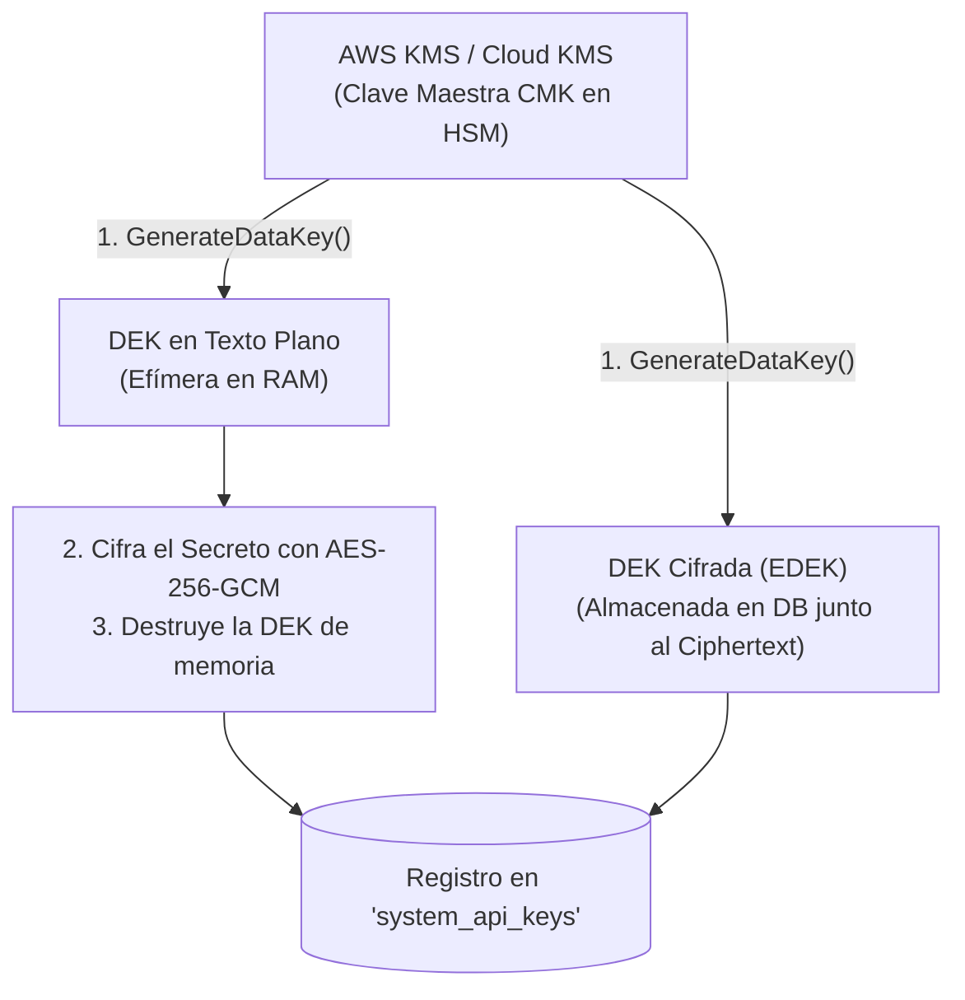

# Sistema de Cifrado de Credenciales y Gestión Segura de API Keys

Este documento detalla la arquitectura, el funcionamiento interno y la guía de configuración del subsistema de cifrado de secretos y API Keys de la plataforma **CTM Oficina Virtual**.

---

## 1. Objetivos y Principios de Diseño

El sistema está diseñado para cumplir con los estándares modernos de seguridad de la información (OWASP, NIST SP 800-38D):

1. **Confidencialidad en Reposo**: Ninguna clave de API (Resend, AFIP, pasarelas de pago, etc.) se almacena en texto plano en la base de datos.
2. **Cifrado Autenticado (AEAD)**: Se garantiza no solo el secreto de los datos, sino también su integridad y autenticidad, detectando cualquier intento de manipulación o corrupción del texto cifrado.
3. **Independencia y Multi-propósito**: El subsistema es agnóstico del servicio o proveedor. Puede utilizarse para `MAILING`, `AFIP`, `PAYMENTS`, `STORAGE` o cualquier integración futura.
4. **No Exposición de Secretos**: Los endpoints públicos y de administración nunca devuelven la clave en texto plano; únicamente exponen un *hint* enmascarado seguro (ej. `re_...8f2a`).
5. **Preparado para Envelope Encryption y KMS**: Arquitectura desacoplada que permite operar con claves maestras locales versionadas en variables de entorno o migrar transparentemente a **AWS KMS** o **Google Cloud KMS**.

---

## 2. Arquitectura Criptográfica

El subsistema se encuentra ubicado en `src/infrastructure/security/encryption/` y se compone de tres elementos principales:

```
src/infrastructure/security/encryption/
├── ISecretEncryptionProvider.js        # Contrato de interfaz
├── AesGcmEncryptionProvider.js         # Proveedor AES-256-GCM con claves versionadas
├── KmsEnvelopeEncryptionProvider.js    # Proveedor Envelope Encryption (KMS ready)
└── EncryptionProviderFactory.js        # Fábrica de selección de proveedor
```

### 2.1. Algoritmo: AES-256-GCM

- **Cifrador**: `aes-256-gcm` (Galois/Counter Mode con clave de 256 bits).
- **Vector de Inicialización (IV)**: 12 bytes (96 bits) criptográficamente aleatorios (`crypto.randomBytes(12)`) generados en cada operación. **Nunca se reutiliza un IV**.
- **Etiqueta de Autenticación (Auth Tag)**: 16 bytes (128 bits) generada por el algoritmo para verificar la integridad del ciphertext.
- **AAD (Additional Authenticated Data)**: Se utiliza el identificador del servicio y proveedor (`${service}:${provider}`) como datos autenticados adicionales. Esto previene ataques de transplante criptográfico (una clave cifrada para mailing no puede ser reutilizada fraudulentamente en otro módulo).

### 2.2. Versionado de Claves Maestras

Para permitir la rotación de claves sin caída de servicio ni migración forzada inmediata de registros existentes:
- Cada registro almacena la versión de la clave con la que fue cifrado (`key_version`, ej: `'v1'`).
- El descifrador selecciona dinámicamente la clave correspondiente a esa versión desde las variables de entorno.
- Los nuevos registros se cifran siempre con la versión activa (`ACTIVE_ENCRYPTION_KEY_VERSION`).

---

## 3. Envelope Encryption (KMS Ready)

La clase `KmsEnvelopeEncryptionProvider` implementa el patrón **Envelope Encryption**:



### Ventajas de Envelope Encryption:
- La clave maestra (CMK) nunca sale del Hardware Security Module (HSM) de KMS.
- Se reduce el impacto de latencia de red de KMS, ya que el cifrado de datos pesados se realiza localmente con la DEK efímera.
- Auditoría estricta de accesos mediante AWS CloudTrail.

---

## 4. Modelo de Datos (`system_api_keys`)

La tabla `system_api_keys` almacena los secretos cifrados de forma independiente:

| Columna | Tipo | Descripción |
| :--- | :--- | :--- |
| `id` | `UUID` (PK) | Identificador único del registro |
| `service` | `VARCHAR(50)` | Propósito del secreto (`MAILING`, `AFIP`, etc.) |
| `provider` | `VARCHAR(50)` | Nombre del proveedor (`RESEND`, `SENDGRID`, etc.) |
| `name` | `VARCHAR(100)` | Nombre descriptivo asignado |
| `encrypted_key` | `TEXT` | Texto cifrado en Base64 |
| `iv` | `VARCHAR(64)` | Vector de inicialización (Base64) |
| `tag` | `VARCHAR(64)` | Etiqueta de autenticación de 128 bits (Base64) |
| `key_version` | `VARCHAR(20)` | Versión de la clave maestra (`v1`, `v2`, etc.) |
| `algorithm` | `VARCHAR(30)` | Algoritmo empleado (`AES-256-GCM`) |
| `key_hint` | `VARCHAR(30)` | Enmascaramiento seguro para UI (ej: `re_...8f2a`) |
| `metadata` | `JSONB` | Configuración asociada (`fromEmail`, `fromName`, etc.) |
| `envelope` | `JSONB` | Metadata de Envelope Encryption (EDEK, Key ARN) |
| `is_active` | `BOOLEAN` | Si la clave se encuentra activa |
| `created_at` | `TIMESTAMP` | Fecha de creación |
| `updated_at` | `TIMESTAMP` | Fecha de última modificación |

---

## 5. Guía de Configuración y Variables de Entorno

### 5.1. Variables de Entorno Disponibles

Configurar en el archivo `.env` del backend (`gestion.ctmueble.com.ar`):

```bash
# ==============================================================================
# SEGURIDAD Y CIFRADO DE CREDENCIALES (AES-256-GCM)
# ==============================================================================

# Versión activa para nuevos cifrados (por defecto: v1)
ACTIVE_ENCRYPTION_KEY_VERSION=v1

# Clave maestra de 256 bits para la versión v1 (Hexadecimal de 64 caracteres)
MASTER_ENCRYPTION_KEY_V1=a1b2c3d4e5f60718293a4b5c6d7e8f90123456789abcdef0123456789abcdef0

# Clave maestra de la versión v2 (cuando se realice una rotación)
# MASTER_ENCRYPTION_KEY_V2=...

# ==============================================================================
# ENVELOPE ENCRYPTION CON AWS KMS (OPCIONAL / ENTORNO PRODUCTIVO)
# ==============================================================================
USE_KMS_ENVELOPE=false
# KMS_KEY_ARN=arn:aws:kms:us-east-1:123456789012:key/xxxx-xxxx-xxxx
# AWS_REGION=us-east-1
```

> [!NOTE]
> En entornos locales o de desarrollo, si no se especifica `MASTER_ENCRYPTION_KEY_V1`, el sistema genera de forma segura una clave derivada determinística mediante `crypto.scryptSync` utilizando `JWT_SECRET`, garantizando que el sistema siempre funcione sin errores de configuración inicial.

### 5.2. Cómo Generar una Clave Maestra de 256 Bits Segura

Para generar una clave criptográficamente segura de 64 caracteres hexadecimales (256 bits), ejecutar en la consola:

**Con OpenSSL:**
```bash
openssl rand -hex 32
```

**Con Node.js:**
```bash
node -e "console.log(require('crypto').randomBytes(32).toString('hex'))"
```

Copiar el resultado y asignarlo a `MASTER_ENCRYPTION_KEY_V1` en el entorno.

---

## 6. Procedimiento de Rotación de Claves (Zero-Downtime)

Para rotar la clave maestra sin interrumpir el funcionamiento ni invalidar claves existentes:

1. **Generar la nueva clave**:
   ```bash
   node -e "console.log(require('crypto').randomBytes(32).toString('hex'))"
   ```
2. **Agregar la nueva clave al entorno sin borrar la anterior**:
   ```bash
   MASTER_ENCRYPTION_KEY_V1=<clave_anterior>
   MASTER_ENCRYPTION_KEY_V2=<nueva_clave_generada>
   ```
3. **Actualizar la versión activa**:
   ```bash
   ACTIVE_ENCRYPTION_KEY_VERSION=v2
   ```
4. **Comportamiento**:
   - Los registros existentes cifrados con `v1` seguirán descifrándose correctamente utilizando `MASTER_ENCRYPTION_KEY_V1`.
   - Cualquier nueva clave o actualización se cifrará inmediatamente utilizando la clave de `v2`.

---

## 7. Uso en Código (Ejemplos para Desarrolladores)

### 7.1. Guardar una API Key (Cifrado Automático)

```javascript
const ApiKeyApplicationService = require('../application/security/ApiKeyApplicationService');
const apiKeyService = new ApiKeyApplicationService();

// Guarda la clave cifrada con AES-256-GCM y desactiva claves anteriores del mismo servicio
const result = await apiKeyService.saveApiKey({
  service: 'MAILING',
  provider: 'RESEND',
  name: 'Resend Producción',
  apiKey: 're_12345678_abcdef9876',
  metadata: {
    fromEmail: 'onboarding@resend.dev',
    fromName: 'CTM Oficina Virtual'
  }
});

console.log(result.keyHint); // "re_...9876" (la clave en texto plano nunca se retorna)
```

### 7.2. Consumir la API Key Descifrada (Uso Interno)

```javascript
const config = await apiKeyService.getActiveApiKey('MAILING');

if (config) {
  // `config.apiKey` contiene la clave en texto plano descifrada en memoria
  console.log(`Proveedor activo: ${config.provider}`);
  // Usar en cliente HTTP (ej. Axios con Resend)
  const client = axios.create({
    headers: { Authorization: `Bearer ${config.apiKey}` }
  });
}
```

### 7.3. Consultar Estado Público para la Interfaz

```javascript
// Retorna estado sin exponer secretos
const status = await apiKeyService.getServiceStatus('MAILING');
/*
{
  isConfigured: true,
  service: 'MAILING',
  provider: 'RESEND',
  name: 'Resend Producción',
  keyHint: 're_...9876',
  algorithm: 'AES-256-GCM',
  metadata: { fromEmail: 'onboarding@resend.dev', fromName: 'CTM Oficina Virtual' },
  updatedAt: '2026-11-11T12:00:00.000Z'
}
*/
```

---

## 8. Gestión desde la Interfaz Gráfica

Los usuarios con perfil `LABORATORY` pueden administrar la configuración de correo y credenciales directamente desde la Oficina Virtual:

1. Ingresar con perfil Laboratorio a **Configuración** (`/config`).
2. Seleccionar la pestaña **"Envío de correos"**.
3. Ingresar la API Key provista por el proveedor (ej. Resend) y el remitente.
4. Al hacer clic en **Guardar configuración**, la clave viaja protegida por HTTPS y se cifra inmediatamente en el backend antes de persistir.
5. Utilizar el botón **"Enviar correo de prueba"** para validar la entrega de correos en tiempo real.
