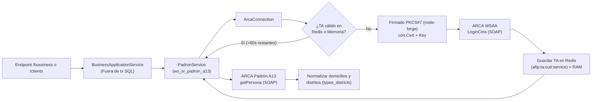

# Gestión de Empresas, Clientes, Personas y Autocompletado Auxiliar con ARCA (Opcional)

Este documento explica la gestión multi-tenant de **Empresas (`bussiness`)**, **Direcciones (`bussiness_address`)**, **Clientes (`clients`, `clients_contacts`)** y **Personas (`persons`)**, junto con el funcionamiento interno y la habilitación de la integración **auxiliar y opcional** con **ARCA/AFIP** (WSAA y Padrón A13) destinada exclusivamente al **autocompletado de datos de clientes/empresas** a partir de su CUIT.

> **Carácter opcional:** La activación de la integración con ARCA **no es necesaria** para utilizar la plataforma. El alta y la gestión completa de empresas, direcciones, contactos y clientes funcionan de forma totalmente autónoma mediante carga manual (`POST /bussiness/manual/`, `POST /clients/create`). Cuando las credenciales `ARCA_*` no están configuradas, el sistema omite el autocompletado externo sin afectar el circuito de ensayos.

---

## 1. Servicio Auxiliar de Autocompletado con ARCA / AFIP (Opcional)

La integración auxiliar se ubica en `src/infrastructure/arca/services/` y se compone de dos clases principales: `ArcaConnection` (autenticación WSAA y gestión de Tickets de Acceso) y `PadronService` (consulta de datos de contribuyentes al Padrón A13 para autocompletar razón social y domicilios). En [`src/shared/serviceFactory.js`](file:///c:/Users/Tomas/Desktop/CTM/gestion.ctmueble.com.ar/src/shared/serviceFactory.js), `getPadronService()` inicializa el servicio bajo demanda y devuelve `null` si no se encuentra habilitado, permitiendo operar normalmente sin ARCA.



### 1.1. Autenticación WSAA y Caché de Tickets de Acceso (`ArcaConnection`)
Implementada en [`src/infrastructure/arca/services/ArcaConnection.js`](file:///c:/Users/Tomas/Desktop/CTM/gestion.ctmueble.com.ar/src/infrastructure/arca/services/ArcaConnection.js):

- **Carga segura de credenciales:**
  - En producción / Vercel (o cuando están definidas), utiliza `ARCA_CERT_BASE64` y `ARCA_KEY_BASE64` decodificadas en memoria UTF-8 sin escribir archivos en disco.
  - En desarrollo local (`NODE_ENV !== 'production'` y sin `VERCEL`), permite leer archivos físicos mediante `ARCA_CERT_FILE` y `ARCA_KEY_FILE`. En producción nunca busca claves empaquetadas en el repositorio.
- **Generación y firma de TRA (`generateTA`):**
  - Construye el XML `loginTicketRequest` v1.0 con `uniqueId`, `generationTime` (`now - 60s`), `expirationTime` (`now + 12h`) y el servicio (`ARCA_SERVICE`, validado contra `/^[a-zA-Z0-9_.-]{1,64}$/`).
  - Firma el TRA en formato **CMS / PKCS#7** en memoria usando `node-forge` (algoritmo `SHA-256`, atributos autenticados `contentType`, `messageDigest` y `signingTime`) y lo envía por SOAP a `ARCA_WSAA_URL`.
- **Caché de dos niveles (`getTA`):**
  - AFIP/ARCA rechaza solicitudes repetidas de login dentro de la vigencia de un Ticket de Acceso (error `coe.alreadyAuthenticated`). En entornos serverless como Vercel, múltiples invocaciones comparten el mismo TA mediante:
    1. **Nivel 1 (Redis):** Clave `afip:ta:{cuit}:{service}` con TTL calculado hasta `expirationTime - 60s` (acotado entre `60s` y `11h`).
    2. **Nivel 2 (Memoria local):** `localTaCache` por instancia como respaldo ante ausencia o caída temporal de Redis.
  - Aplica un margen de seguridad de **60 segundos** antes del vencimiento para renovar el TA proactivamente.
- **Parseo XML seguro (`parseTA`):** Usa `fast-xml-parser` con `processEntities: false` para mitigar ataques XXE (*XML External Entity*).

### 1.2. Consulta al Padrón A13 (`PadronService`)
Implementada en [`src/infrastructure/arca/services/PadronService.js`](file:///c:/Users/Tomas/Desktop/CTM/gestion.ctmueble.com.ar/src/infrastructure/arca/services/PadronService.js):

- **Validación y sanitización:** Limpia el CUIT a dígitos y exige exactamente 11 dígitos (`/^\d{11}$/`, caso contrario lanza `400 INVALID_CUIT`). Escapa `token` y `sign` con `escapeXml` para evitar inyección XML/SOAP.
- **Consulta `getPersona`:** Invoca `ARCA_PADRON_URL` con timeout configurable (`ARCA_TIMEOUT_MS`, por defecto `8000` ms) y límite de respuesta de 2 MB.
- **Mapeo de resultados:**
  - Determina `type`: `'LEGAL'` si `tipoPersona === 'JURIDICA'`, o `'PHYSICAL'` en caso contrario.
  - Extrae `razonSocial` (o `nombre apellido`) y mapea cada `domicilio` a `{ address, location, province: domicilio.idProvincia, origin: 'PUBLIC' }`.
  - Devuelve `null` si el contribuyente no existe o si ARCA responde HTTP 500 por CUIT inexistente.

### 1.3. Variables de Entorno de ARCA (Solo si se Habilita el Autocompletado)

| Variable | Necesaria para operar | Valor por defecto / Formato | Uso |
| :--- | :---: | :--- | :--- |
| `ARCA_CUIT` | Solo si se habilita ARCA | 11 dígitos (ej. `30673878896`) | CUIT del titular que realiza consultas de autocompletado ante AFIP/ARCA. |
| `ARCA_CERT_BASE64` | Solo si se habilita en prod/Vercel | Certificado X.509 PEM en Base64 | Certificado público para firmar TRA en memoria (sin archivos en disco). |
| `ARCA_KEY_BASE64` | Solo si se habilita en prod/Vercel | Clave privada RSA PEM en Base64 | Clave privada para firmar CMS en memoria. |
| `ARCA_CERT_FILE` | Alternativa local | Ruta a `.crt` | Alternativa en archivo local cuando no se usa `ARCA_CERT_BASE64`. |
| `ARCA_KEY_FILE` | Alternativa local | Ruta a `.key` | Alternativa en archivo local cuando no se usa `ARCA_KEY_BASE64`. |
| `ARCA_SERVICE` | No (default fijo) | `ws_sr_padron_a13` | Nombre del web service WSAA a autenticar para consulta de padrón. |
| `ARCA_WSAA_URL` | No (default prod) | `https://wsaa.afip.gov.ar/ws/services/LoginCms` | Endpoint SOAP de autenticación WSAA. |
| `ARCA_PADRON_URL` | No (default prod) | `https://aws.afip.gov.ar/sr-padron/webservices/personaServiceA13` | Endpoint SOAP del Padrón A13. |
| `ARCA_TIMEOUT_MS` | No | `8000` | Timeout en milisegundos para llamadas SOAP a ARCA. |

### 1.4. Cómo Habilitar el Autocompletado Auxiliar con ARCA (Opcional)

Si el laboratorio desea activar el autocompletado automático de razón social y domicilio de clientes por CUIT (recordando que **no es obligatorio activarlo** para operar el sistema), debe realizar los siguientes pasos:

1. **Generar clave privada y certificado digital ante ARCA/AFIP:**
   - Generar una clave privada RSA (`private.key`) y solicitud CSR con OpenSSL.
   - Ingresar con Clave Fiscal en el portal de ARCA → *Administrador de Relaciones de Clave Fiscal* / *WSASS* → crear un nuevo alias/computador fiscal y subir el CSR para descargar el certificado emitido (`cert.crt`).
2. **Autorizar el servicio de Padrón A13 (`ws_sr_padron_a13`):**
   - Desde *Administrador de Relaciones de Clave Fiscal* en ARCA, delegar el web service **`ws_sr_padron_a13`** (Consulta a Padrón Alcance 13) al computador fiscal asociado al certificado creado.
3. **Configurar las credenciales en el entorno:**
   - **En desarrollo local (`NODE_ENV !== 'production'`):** guardar `cert.crt` y `private.key` localmente y definir en `.env`:
     ```env
     ARCA_CUIT=30XXXXXXXXX
     ARCA_CERT_FILE=./certs/arca/cert.crt
     ARCA_KEY_FILE=./certs/arca/private.key
     ```
   - **En producción / Vercel (serverless sin almacenamiento local persistente):** convertir ambos archivos a Base64 de una sola línea:
     ```bash
     base64 -w0 certs/arca/cert.crt
     base64 -w0 certs/arca/private.key
     ```
     *(o en PowerShell: `[Convert]::ToBase64String([IO.File]::ReadAllBytes("certs/arca/cert.crt"))`)*
     y cargar en las variables de entorno del despliegue:
     ```env
     ARCA_CUIT=30XXXXXXXXX
     ARCA_CERT_BASE64=<contenido_base64_cert>
     ARCA_KEY_BASE64=<contenido_base64_key>
     ```
4. **Verificar funcionamiento:** una vez configuradas las variables, las rutas auxiliares `/bussiness/padron/`, `/clients/padron/:cuit` y `/bussiness/sync/` devolverán datos autocompletados desde ARCA; si se dejan sin configurar, la plataforma sigue operando normalmente mediante el alta manual (`POST /bussiness/manual/` y `POST /clients/create`).

---

## 2. Gestión de Empresas y Direcciones (`BusinessApplicationService`)

Implementada en [`src/application/business/services/BusinessApplicationService.js`](file:///c:/Users/Tomas/Desktop/CTM/gestion.ctmueble.com.ar/src/application/business/services/BusinessApplicationService.js) y [`src/domain/business/services/AddressOriginService.js`](file:///c:/Users/Tomas/Desktop/CTM/gestion.ctmueble.com.ar/src/domain/business/services/AddressOriginService.js).

- **Desacoplamiento transaccional:** Cuando el autocompletado auxiliar ARCA se encuentra habilitado, `getBusiness`, `getBusinessForEssay` y `syncBusinessByCuit` realizan las llamadas SOAP **estrictamente fuera** de `withTransaction(...)` para evitar retener conexiones del pool de Neon mientras esperan respuesta externa. Si `padronService` no está activo o el contribuyente no figura, la carga manual sigue plenamente disponible.
- **Validación de Persona Jurídica al autocompletar:** Al importar datos desde el padrón en `getBusiness`, `getBusinessForEssay` o `syncBusinessByCuit`, si `padron.type !== 'LEGAL'` se rechaza con HTTP `400`.
- **Creación manual (flujo principal autónomo) vs Autocompletado opcional (`MANUAL` vs `PADRON`):**
  - `createBusinessManually({ cuit, name })`: permite dar de alta cualquier empresa directamente sin requerir ni consultar ARCA (devuelve `409` si el CUIT ya existe). Es el flujo autónomo base cuando ARCA no está activado.
  - `syncBusinessByCuit(cuit, user)`: utilidad opcional de autocompletado que actualiza razón social y agrega direcciones `PUBLIC` desde el padrón cuando la integración ARCA está habilitada.
- **Normalización geográfica (`normalizeAddresses`):** Mapea el código numérico de provincia retornado al autocompletar (`address.province`) contra `types_districts.numeric_id` para obtener el código ISO (`AR-B`, `AR-S`, etc.). Cuando el distrito corresponde a `AR-C`, asigna automáticamente `location = 'Capital Federal'`.
- **Visibilidad y origen de direcciones (`AddressOriginService` y `BusinessRepository.findAddresses`):**
  - `PUBLIC`: direcciones autocompletadas desde el padrón auxiliar ARCA, visibles para todos los usuarios.
  - `LABORATORY`: direcciones cargadas por personal del laboratorio, visibles solo para usuarios con `profile === 'LABORATORY'`.
  - `CLIENT`: direcciones cargadas por un cliente específico, visibles únicamente para su creador (`user === user.id`).
- **Contexto expandido para ensayos (`getBusinessForEssay`):** Devuelve en una única llamada empresa, `source`, `addresses` visibles, `clients` asociados y `representatives` deduplicados por `id`.

---

## 3. Gestión de Clientes, Agenda y Personas

### 3.1. Aislamiento Multi-Tenant y Clientes (`ClientApplicationService`)
Implementado en [`src/application/clients/services/ClientApplicationService.js`](file:///c:/Users/Tomas/Desktop/CTM/gestion.ctmueble.com.ar/src/application/clients/services/ClientApplicationService.js) y [`src/domain/clients/services/ClientOriginService.js`](file:///c:/Users/Tomas/Desktop/CTM/gestion.ctmueble.com.ar/src/domain/clients/services/ClientOriginService.js):

- **Separación por origen (`origin`):**
  - Un usuario `CLIENT` crea clientes con `origin = 'CLIENT'` y `user = user.id`. Solo puede consultar, modificar, eliminar o gestionar contactos de sus propios clientes (`client.userId === user.id && client.origin === 'CLIENT'`); ante cualquier intento sobre registros ajenos recibe `404 CLIENT_NOT_FOUND` (anti-enumeración IDOR).
  - El perfil `LABORATORY` opera sobre clientes con `origin = 'LABORATORY'`. En `getAllClients` y `getScheduledClients`, deduplica resultados por `cuit || id`, y únicamente permite eliminar clientes con `origin === 'LABORATORY'` (`403 CLIENT_FORBIDDEN` si intenta borrar un cliente propio de un usuario `CLIENT`).
  - Los usuarios internos con rol `CONSULTA` tienen bloqueadas las operaciones de escritura (`create`, `update`, `delete`, `addScheduled`, `addContact`, `removeContact`) con HTTP `403 LAB_PERMISSION_DENIED`.
- **Agenda de Clientes del Laboratorio (`/clients/scheduled*`):**
  - `getScheduledClients()`: lista la agenda de clientes del laboratorio (`origin = 'LABORATORY'`).
  - `addScheduledClient(params)`: agenda un cliente a partir de un `clientId` (de `clients` o de un snapshot `essays_client`), un `cuit` o un `updateData`. Si ya existe un cliente `LABORATORY` para ese CUIT, vincula el contacto indicado y actualiza los campos informados; si no existe, crea el registro `LABORATORY`, asigna automáticamente `representativeId = primaryContactId` cuando el CUIT comienza con `30`, `33` o `34` y no se envió representante, y vincula el contacto en `clients_contacts`.
  - `isClientScheduled({ clientId, cuit, contactId })`: verifica si un cliente/CUIT ya está agendado en el laboratorio y si un `contactId` específico figura vinculado en `clients_contacts`, devolviendo `{ scheduled, clientId, isContactLinked }`.
- **Contactos múltiples (`clients_contacts`):**
  - `getContactsByClient`, `addContactToClient` (acepta `contactId` existente o un objeto de persona nueva que crea con `isThirdParty: true`), y `removeContactFromClient`.

### 3.2. Gestión de Personas (`PersonApplicationService`)
Implementada en [`src/application/persons/services/PersonApplicationService.js`](file:///c:/Users/Tomas/Desktop/CTM/gestion.ctmueble.com.ar/src/application/persons/services/PersonApplicationService.js), [`src/domain/persons/services/PersonValidationService.js`](file:///c:/Users/Tomas/Desktop/CTM/gestion.ctmueble.com.ar/src/domain/persons/services/PersonValidationService.js) y [`src/infrastructure/repositories/persons/PersonRepository.js`](file:///c:/Users/Tomas/Desktop/CTM/gestion.ctmueble.com.ar/src/infrastructure/repositories/persons/PersonRepository.js):

- **Perfil propio vs Terceros:**
  - `PersonValidationService` impide que un usuario `CLIENT` cree más de una persona principal propia (`isThirdParty: false, origin: 'CLIENT'`).
  - Las personas creadas como representantes o contactos adicionales llevan `isThirdParty: true` y `userId: null` (`shouldAssignUserId`).
  - `GET /persons/me` devuelve la persona principal asociada al usuario autenticado (`user_id = user.id, is_third_party = false`).
- **Control de acceso anti-PII (`_assertUserCanAccessPerson`):** Un usuario `CLIENT` únicamente puede acceder a su propia persona o a personas vinculadas como `representative`, `contact` o en `clients_contacts` de clientes propios (`PersonRepository.isPersonAccessibleByUser`).
- **Sincronización con `users`:** Al modificar `name` o `dni` de una persona que tiene `userId` vinculado (`updatePerson`), el servicio actualiza también `name` y `dni` en el registro `users`.
- **Búsqueda parametrizada segura (`searchAvailable`):** Escapa comodines SQL (`\`, `%`, `_`) mediante [`escapeLike`](file:///c:/Users/Tomas/Desktop/CTM/gestion.ctmueble.com.ar/src/shared/sqlLike.js) para consultas `ILIKE` sobre `name`, `dni` y `mail`, aplica el filtro multi-tenant, puede excluir contactos ya vinculados a un `clientId` y limita el resultado a 50 filas (máximo 100).

---

## 4. Endpoints y Uso de API

Todos los endpoints requieren autenticación (`verifyJWT` + CSRF si usa cookie + `Idempotency-Key` opcional en `POST`/`PUT`). Los endpoints marcados con `padronLimiter` aplican un límite de **30 solicitudes cada 10 minutos por usuario** (`429 PADRON_RATE_LIMIT`).

### 4.1. Empresas (`/bussiness`)
Definidos en [`src/presentation/routes/bussiness.routes.js`](file:///c:/Users/Tomas/Desktop/CTM/gestion.ctmueble.com.ar/src/presentation/routes/bussiness.routes.js):

| Método | Ruta | Permiso / Límite | Parámetros / Body | Respuesta |
| :--- | :--- | :--- | :--- | :--- |
| `GET` | `/bussiness/get/` | JWT | Query: `cuit` | `BusinessDTO` (busca en BD; si ARCA está habilitado, intenta autocompletar). |
| `POST` | `/bussiness/manual/` | JWT | Body: `{ cuit, name }` | `BusinessDTO` creada manualmente (`409` si existe; no requiere ARCA). |
| `POST` | `/bussiness/sync/` | JWT + `padronLimiter` | Query: `cuit` | `BusinessDTO` autocompletada opcionalmente desde Padrón A13 (si ARCA está activo). |
| `GET` | `/bussiness/padron/` | JWT + `padronLimiter` | Query: `cuit` | Datos auxiliares de autocompletado (`{ name, cuit, type, addresses }`, requiere ARCA activo). |
| `GET` | `/bussiness/addresses/` | JWT | Query: `cuit` | `Address[]` visibles para el usuario. |
| `POST` | `/bussiness/addresses/` | JWT | Query: `cuit`; Body: `{ address, location, province, district? }` | Dirección creada con `origin` según perfil. |
| `PUT` | `/bussiness/addresses/` | JWT | Query: `id`; Body: `{ address?, location?, province?, district? }` | Dirección actualizada. |
| `DELETE` | `/bussiness/addresses/` | JWT | Query: `id` | `{ success: boolean }`. |
| `GET` | `/bussiness/representatives/` | JWT | Query: `cuit` | Representantes deduplicados asociados al CUIT. |
| `GET` | `/bussiness/for-essay/` | JWT | Query: `cuit` | `{ cuit, name, source, addresses, representatives, clients }`. |

### 4.2. Clientes (`/clients`)
Definidos en [`src/presentation/routes/clients.routes.js`](file:///c:/Users/Tomas/Desktop/CTM/gestion.ctmueble.com.ar/src/presentation/routes/clients.routes.js):

| Método | Ruta | Permiso / Límite | Parámetros / Body | Respuesta |
| :--- | :--- | :--- | :--- | :--- |
| `GET` | `/clients/fetch` | JWT | — | `ClientDTO[]` del usuario o agenda del laboratorio. |
| `GET` | `/clients/get` | JWT | Query: `id` | `ClientDTO`. |
| `GET` | `/clients/search` | JWT | Query: `search` (alias `term`, `name`, `cuit`) | `ClientDTO[]` filtrados en memoria por nombre/CUIT. |
| `GET` | `/clients/search-by-business` | JWT | Query: `search` | Alias de búsqueda por empresa/CUIT. |
| `GET` | `/clients/scheduled` | JWT + `LABORATORY` | — | `ClientDTO[]` agendados en el laboratorio. |
| `GET` | `/clients/scheduled/check` | JWT + `LABORATORY` | Query: `clientId` (o `id`) / `cuit`, `contactId?` | `{ scheduled, clientId, isContactLinked }`. |
| `POST` | `/clients/scheduled` | JWT + `LABORATORY` (no `CONSULTA`) | Body: `{ clientId?, cuit?, contactId?, ...updateData }` | `201` `{ success: true, client }`. |
| `POST` | `/clients/create` | JWT (no `CONSULTA`) | Body: `CreateClientDTO` | `ClientDTO` creado. |
| `POST` | `/clients/get-or-create-for-essay` | JWT | Body: `{ id? / clientId? }` o `CreateClientDTO` | `ClientDTO` existente o recién creado. |
| `PUT` | `/clients/update` | JWT (no `CONSULTA`) | Query: `id`; Body: `UpdateClientDTO` | `ClientDTO` actualizado. |
| `DELETE` | `/clients/delete` | JWT (no `CONSULTA`) | Query: `id` | `true`. |
| `GET` | `/clients/padron/:cuit` | JWT + `padronLimiter` | Path: `cuit` | Autocompletado auxiliar opcional de Padrón A13 (si ARCA está habilitado) o `null`. |
| `GET` | `/clients/:clientId/contacts` (y `/clients/contacts`) | JWT | Path/Query: `clientId` | `PersonDTO[]` vinculados al cliente. |
| `POST` | `/clients/:clientId/contacts` (y `/clients/contacts`) | JWT (no `CONSULTA`) | Path/Query: `clientId`; Body: `{ contactId }` o datos de persona | `201` `PersonDTO[]` actualizada. |
| `DELETE` | `/clients/:clientId/contacts` (y `/clients/contacts`) | JWT (no `CONSULTA`) | Path/Query: `clientId`, `contactId` (o `personId`) | `{ success: true }`. |

### 4.3. Personas (`/persons`)
Definidos en [`src/presentation/routes/persons.routes.js`](file:///c:/Users/Tomas/Desktop/CTM/gestion.ctmueble.com.ar/src/presentation/routes/persons.routes.js) (todas las rutas aceptan barra final `/` opcional):

| Método | Ruta | Permiso | Parámetros / Body | Respuesta |
| :--- | :--- | :--- | :--- | :--- |
| `GET` | `/persons/me` | JWT | — | `PersonDTO` del perfil principal del usuario. |
| `GET` | `/persons/get` | JWT | Query: `id` | `PersonDTO`. |
| `GET` | `/persons/fetch` | JWT | — | `PersonDTO[]` accesibles (máx. 200). |
| `GET` | `/persons/search-available` (y `/persons/search`) | JWT | Query: `search` (alias `term`, `q`) | `PersonDTO[]` accesibles coincidentes (máx. 50). |
| `GET` | `/persons/by-client/:clientId` | JWT | Path: `clientId` | `PersonDTO[]` vinculados al cliente. |
| `POST` | `/persons/create` | JWT | Body: `CreatePersonDTO` | `PersonDTO` creada. |
| `PUT` | `/persons/update` | JWT | Body: `{ id, data: UpdatePersonDTO }` | `PersonDTO` actualizada (y sincronizada con `users`). |
| `POST` | `/persons/link` | JWT | Body: `{ personId, clientId }` | `{ success: true }`. |
| `POST` | `/persons/unlink` | JWT | Body: `{ personId, clientId }` | `{ success: true }`. |
