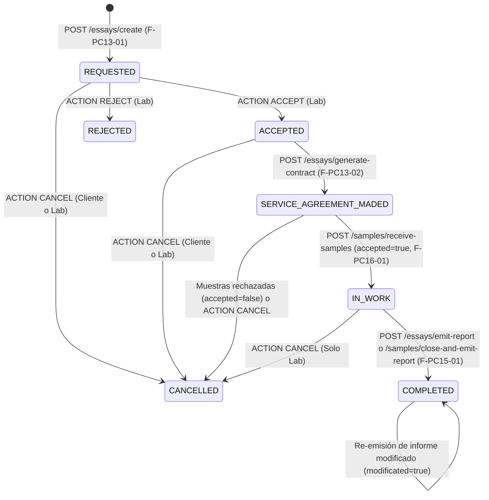

# Gestión de Ensayos, Órdenes de Trabajo, Muestras y Exportación

Este documento detalla el funcionamiento técnico, las reglas de negocio, la máquina de estados, el cálculo analítico, las plantillas de elementos y la exportación a planillas CSV/XLSX implementadas en `src/application/essays/` y `src/domain/essays/`.

---

## 1. Máquina de Estados del Ensayo y Acciones de Procedimiento

El ciclo de vida completo de un ensayo se modela mediante el Value Object [`EssayStatus`](file:///c:/Users/Tomas/Desktop/CTM/gestion.ctmueble.com.ar/src/domain/essays/value-objects/EssayStatus.js) y la entidad [`Essay`](file:///c:/Users/Tomas/Desktop/CTM/gestion.ctmueble.com.ar/src/domain/essays/entities/Essay.js).

### 1.1. Acciones en `POST /essays/procedure/actions?id=<essayId>`
Implementadas en [`essays.controller.js`](file:///c:/Users/Tomas/Desktop/CTM/gestion.ctmueble.com.ar/src/presentation/controllers/essays.controller.js) y [`EssayApplicationService.js`](file:///c:/Users/Tomas/Desktop/CTM/gestion.ctmueble.com.ar/src/application/essays/services/EssayApplicationService.js). El rol interno `CONSULTA` tiene bloqueada cualquier acción en este endpoint (`403 LAB_PERMISSION_DENIED`).

| Acción (`body.action`) | Perfil permitido | Estado requerido | Efecto y auditoría |
| :--- | :--- | :--- | :--- |
| `ACCEPT` | `LABORATORY` | `REQUESTED` | Cambia a `ACCEPTED`, registra `REQUEST_APPROVED` y notifica por correo al cliente. |
| `REJECT` | `LABORATORY` | `REQUESTED` | Adjunta `observations`, cambia a `REJECTED`, registra `REQUEST_REJECTED` y notifica al cliente. |
| `CANCEL` | `CLIENT` (antes de `IN_WORK`) o `LABORATORY` | Distinto de `COMPLETED`, `CANCELLED`, `REJECTED` | Adjunta `observations`/`reason`, cambia a `CANCELLED`, registra `ESSAY_CANCELLED` (`reason: 'manual_cancel'`) y notifica al cliente. Si un cliente intenta cancelar en `IN_WORK`, responde `403 CANCEL_FORBIDDEN`. |
| `REISSUE_REQUEST` / `REISSUE_FPC1301` | Propietario o `LABORATORY` | Distinto de `CANCELLED`, `REJECTED` | Registra nueva emisión de `F-PC13-01` con `modificated: true`, audita `REQUEST_MODIFIED` y captura una nueva snapshot firmada con sello OpenTimestamps. |

---

## 2. Creación de Solicitud, Códigos Atómicos y Snapshot de Cliente

### 2.1. Flujo de `POST /essays/create`
1. **Validación de entrada (`CreateEssayDTO`):** Exige `client` (o `isSelf: true`), `essay` (ID de `types_essays`), `elements.template` / `templateId` / `id` y `elements.date` (opcionalmente `elements.batch_number`, `observations`, `client_notifications_enabled`).
2. **Resolución de plantilla de elemento:** Obtiene `product`, `manufacturer` y `country` desde `EssayElementTemplateApplicationService.getElementTemplate`.
3. **Auto-resolución de cliente particular (`isSelf` / `CLIENT`):**
   - Si el usuario tiene perfil `CLIENT` e indica `isSelf: true` (o omite `client`), busca su perfil personal (`GET /persons/me`) y un cliente propio coincidente por DNI, contacto o nombre.
   - Si no tiene ninguno, crea un `Client` automáticamente convirtiendo su DNI en un CUIT válido mediante `dniToValidCuit(dni)` (probando prefijos `20`, `27`, `23`, `24` con dígito verificador módulo 11).
   - Además, por seguridad, si el usuario es `CLIENT`, elimina cualquier `billing.amount` enviado en el payload (`shouldRemoveBillingAmount`).
4. **Generación atómica de código corto (`getNextEssayCodeForDate`):**
   - Implementada en [`EssayRepository.js`](file:///c:/Users/Tomas/Desktop/CTM/gestion.ctmueble.com.ar/src/infrastructure/repositories/essays/EssayRepository.js).
   - Utiliza la tabla `daily_sequence_counters` (`scope = 'essay'`, `date_key = 'YYMMDD'`) mediante `INSERT ... ON CONFLICT (scope, date_key) DO UPDATE SET last_value = last_value + 1 RETURNING last_value` para garantizar atomicidad bajo concurrencia.
   - Convierte la secuencia numérica a letras (`1 -> A`, ..., `26 -> Z`, `27 -> AA`) mediante `sequenceNumberToLetters`, produciendo códigos como `261117A`, verifica que no exista colisión en `essays.code` y sincroniza el contador si es necesario. Si `daily_sequence_counters` no existiera, recurre a `pg_advisory_xact_lock`.
   - Para filtros por fecha (`dateFrom`/`dateTo`) en listados (`/essays/fetch`, `/essays/export*`), `EssayRepository` interpreta las fechas en la zona horaria `America/Argentina/Buenos_Aires`.
5. **Snapshot inmutable del cliente (`essays_client`) y post-commit:**
   - Dentro de `withTransaction`, persiste `essays`, `essays_elements`, `essays_client` (copia exacta de razón social, CUIT, domicilio, representante, contacto y facturación alternativa) y eventos `ESSAY_CLIENT_UPDATED` + `REQUEST_CREATED`.
   - Fuera de la transacción SQL: registra metadatos del documento `F-PC13-01` (`file = 'on-demand'`), captura la snapshot criptográfica con OTS (`SnapshotApplicationService`), y dispara notificaciones al laboratorio y al solicitante.

### 2.2. Actualización del Snapshot (`PUT /essays/:id/client`)
- Permite actualizar los datos congelados en `essays_client` mediante `EssayClient.fromClient(payload)`.
- Un usuario `CLIENT` solo puede modificarlos mientras `essay.status === 'REQUESTED'` (luego recibe `403 ESSAY_CLIENT_LOCKED`); además, se preserva su contacto original. El laboratorio puede actualizarlos en etapas posteriores y toda edición queda auditada con `ESSAY_CLIENT_UPDATED`.

### 2.3. Contrato de Servicio (`POST /essays/generate-contract`)
- Protegido por `requireLaboratory`, `requireLabPermission('essays.estados')` y `pdfGenerationLimiter`.
- Valida `SetTermsDTO`: `days_to_do > 0`, `price >= 0` y `samples_conservation_days > 0`.
- Requiere que el ensayo esté en `ACCEPTED`. Persiste `essays_terms`, cambia el estado a `SERVICE_AGREEMENT_MADED`, audita `CONTRACT_CREATED`, registra los metadatos de `F-PC13-02`, toma snapshot criptográfica con OTS y notifica al cliente.

---

## 3. Plantillas Reutilizables de Elementos (`EssayElementTemplateApplicationService`)

Implementadas en [`src/application/essays/services/EssayElementTemplateApplicationService.js`](file:///c:/Users/Tomas/Desktop/CTM/gestion.ctmueble.com.ar/src/application/essays/services/EssayElementTemplateApplicationService.js) sobre la tabla `essay_element_templates` (`product`, `manufacturer`, `country`, `origin`, `user_id`):

- **Aislamiento por perfil:**
  - Perfil `CLIENT`: cada usuario gestiona sus propias plantillas privadas (`origin = 'CLIENT'`, `user_id = user.id`).
  - Perfil `LABORATORY`: las plantillas pertenecen al ámbito compartido del laboratorio (`origin = 'LABORATORY'`, `user_id = null`), visibles y utilizables por todos los integrantes internos.
- **Endpoints:**
  - `GET /essays/element-templates`: lista las plantillas disponibles para el usuario/perfil actual.
  - `POST /essays/element-templates`: valida `CreateEssayElementTemplateDTO` (`product` y `manufacturer` obligatorios, `country` opcional) y devuelve `201` con la plantilla creada.
  - `DELETE /essays/element-templates/:id`: elimina una plantilla verificando pertenencia al usuario/perfil.

---

## 4. Órdenes de Trabajo y Recepción de Muestras

### 4.1. Estados de Orden de Trabajo y Muestras
- **Orden de Trabajo ([`WorkOrderStatus`](file:///c:/Users/Tomas/Desktop/CTM/gestion.ctmueble.com.ar/src/domain/essays/value-objects/WorkOrderStatus.js)):** `WAITING_SAMPLES`, `ANALYZING`, `COMPLETED`, `CANCELLED`.
- **Muestra ([`SampleStatus`](file:///c:/Users/Tomas/Desktop/CTM/gestion.ctmueble.com.ar/src/domain/essays/value-objects/SampleStatus.js)):** `PENDING`, `ANALYZED`, `REJECTED`, `SAVED`, `RETURNED` (el Value Object incluye también `RECEIVED`).

### 4.2. Recepción Unificada (`POST /samples/receive-samples` y `POST /essays/samples/load`)
Ambos endpoints requieren perfil `LABORATORY`, permiso `muestras.recepcionar` y `pdfGenerationLimiter`. Delegan en `EssayApplicationService.receiveSamples(essayId, data)`:

1. **Validación de estado y límites:** Exige que el ensayo esté en `SERVICE_AGREEMENT_MADED`. `ReceiveSamplesDTO` acota `samples_count` y `countersamples_count` a un máximo de **100 unidades por tipo** (y el servicio verifica total `<= 200`, exigiendo al menos 1 unidad cuando `accepted === true`).
2. **Caso de rechazo de muestras (`accepted: false`):**
   - Adjunta observaciones al ensayo, transiciona el estado a `CANCELLED`, audita `ESSAY_CANCELLED` (`reason: 'samples_not_accepted'`), notifica al cliente y responde `{ cancelled: true, essay }`.
3. **Caso de aceptación (`accepted: true`):**
   - Lee la variable de entorno de sistema `UNCERTAINTY` desde `EnvApplicationService` (sin abrir transacción aún).
   - Genera atómicamente el código de la orden en [`WorkOrderRepository.getNextWorkOrderCodeForDate`](file:///c:/Users/Tomas/Desktop/CTM/gestion.ctmueble.com.ar/src/infrastructure/repositories/essays/WorkOrderRepository.js) usando `daily_sequence_counters` (`scope = 'work_order'`, `date_key = 'YYMMDD'`), obteniendo formato `YYMMDD` + letra (ej. `261117A`).
   - Calcula `report_delivery_deadline = generatedAt + essay.terms.daysToDo` días.
   - Redondea dimensiones (`height`, `width`, `thickness` o `large`) a 1 decimal y genera `sample_dimensions` (`"alto × ancho × espesor cm"`).
   - Crea la `WorkOrder` con `status = 'ANALYZING'`.
   - Genera los códigos individuales de cada probeta y contramuestra con [`SampleService.generateSampleCode`](file:///c:/Users/Tomas/Desktop/CTM/gestion.ctmueble.com.ar/src/domain/essays/services/SampleService.js):
     - Muestra normal: `YY-MMDD[L]-CC` (ej. `26-1117A-01`).
     - Contramuestra (`countersample: true`): sufijo `C` (ej. `26-1117A-01C`).
   - Cambia el ensayo a `IN_WORK`, registra eventos `SAMPLES_RECEIVED` en `essay_audit_logs` y `work_order_audit_logs`, registra metadatos de `F-PC16-01` y notifica al cliente.

> **Nota de optimización de consultas:** `GET /samples/fetch` (`getAllWorkOrders`) carga las órdenes de trabajo y sus ensayos relacionados en **2 consultas SQL** usando `essayRepository.findByIds(...)` para evitar el problema N+1.

---

## 5. Carga de Resultados, Clasificación y Emisión de Informes

### 5.1. Carga de Resultados (`POST /essays/samples/load-result`)
Protegido por `requireLaboratory` y `requireLabPermission('ordenes.ensayar')`. Valida `LoadSampleResultsDTO` (máximo **200 muestras por lote**, valores numéricos finitos vía `Number.isFinite` o `null`):
1. Verifica que todas las muestras enviadas pertenezcan a la `workOrderId` indicada (`400 SAMPLE_MISMATCH`).
2. Actualiza cada muestra mediante `Sample.setResult(numericResult)`, lo cual asigna `status = 'ANALYZED'` cuando el resultado no es nulo.
3. Recalcula el promedio aritmético (`average_value`, redondeado a 4 decimales con `.toFixed(4)`) entre las muestras que tienen resultado cargado y actualiza `last_update` tanto en `work_orders` como en `essays`.
4. Audita `RESULTS_LOADED` en `essay_audit_logs` y `work_order_audit_logs`.

### 5.2. Emisión de Informe Final (`POST /essays/emit-report` y `POST /samples/:id/close-and-emit-report`)
Protegidos por `requireLaboratory`, `pdfGenerationLimiter` y los permisos `essays.informes` / `ordenes.cerrar` respectivamente:
1. **Validación mínima de probetas:** `WorkOrder.validateSamplesForReport()` y `EssayDomainService.validateCanEmitReport()` exigen **al menos 2 muestras con resultado numérico cargado** (`400 INSUFFICIENT_SAMPLE_RESULTS`).
2. **Emisión original vs Modificación (`Essay.generateReportConfig`):**
   - Si no existe un `F-PC15-01` previo, emite el **informe original**, cierra la orden (`status = 'COMPLETED'`, `closed_at = emittedAt`), finaliza el ensayo (`status = 'COMPLETED'`, `finishDate`, `lastReportGenerated`) y copia `average_value` e `uncertainty` al ensayo.
   - Si ya existe un informe previo, emite automáticamente una **modificación numerada** (`modificated: true`, encabezado `MODIFICACIÓN Nº X AL INFORME DE ENSAYO Nº ...`) y actualiza `lastReportGenerated` y `lastUpdate`.
3. **Auditoría y notificación:** Registra `REPORT_ISSUED` con `resultsSnapshot` en `metadata`, registra metadatos de `F-PC15-01` y notifica al cliente cuando es la emisión original (`COMPLETED`).
4. **Clasificación normativa (Formaldehído):** Al serializar en `EssayApplicationService.mapToDTO` y en la exportación (`enrichEssaysForExport`), para ensayos finalizados/emitidos con resultado numérico:
   - `result <= 3.5` → clasificación **`E1`**.
   - `3.5 < result <= 8.0` → clasificación **`E2`**.

---

## 6. Exportación a Planillas CSV y Excel (`essaySpreadsheetExport.js`)

Implementada en [`src/application/essays/export/essaySpreadsheetExport.js`](file:///c:/Users/Tomas/Desktop/CTM/gestion.ctmueble.com.ar/src/application/essays/export/essaySpreadsheetExport.js) y expuesta en `GET /essays/export/count` y `GET /essays/export` (con `exportLimiter`: **20 solicitudes cada 5 minutos**).

### 6.1. Filtros y Límite de Filas
Acepta los mismos parámetros query que `GET /essays/fetch`: `code`, `status`, `dateFrom` (o `date_from`), `dateTo` (o `date_to`). En exportación consulta hasta un tope de **1.000 ensayos** (`limit: 1000`), y en `GET /essays/fetch` acota `limit` a un máximo de **500**.

### 6.2. Protección contra Formula / CSV Injection
Todas las celdas pasan por `sanitizeFormulaValue(val)`:
- Si un texto (ignorando espacios/tabs/saltos iniciales) comienza con `=`, `+`, `-`, `@`, `\t` o `\r`, se prefija automáticamente con una comilla simple (`'`), neutralizando ejecución de fórmulas en Microsoft Excel, LibreOffice Calc y Google Sheets.
- Los números negativos puros (`/^-[0-9]+([.,][0-9]+)?$/`), números nativos y booleanos no se alteran.

### 6.3. Estructura de Formatos Soportados
- **Formato `csv` (`GET /essays/export?format=csv`):**
  - Descarga `solicitudes-ensayo-YYYY-MM-DD.csv` (`Content-Type: text/csv; charset=utf-8`) con **BOM UTF-8 (`\uFEFF`)** y separadores de línea `CRLF` (`\r\n`).
  - Exporta la tabla de **Solicitudes** (34 columnas: datos del ensayo, producto, términos, resultado/clasificación, cliente/contacto, facturación y datos de OT cuando corresponda).
- **Formato `xlsx` (`GET /essays/export?format=xlsx`):**
  - Genera un libro con **ExcelJS** (`solicitudes-ensayo-YYYY-MM-DD.xlsx`) compuesto por 3 hojas con primera fila congelada (`ySplit: 1`), encabezados en negrita y ajuste automático de ancho de columna (tope 52 caracteres):
    1. **`Solicitudes`**: las 34 columnas completas de cada ensayo.
    2. **`Ordenes de trabajo`**: 11 columnas con el detalle de las OT visibles.
    3. **`Clientes`**: 6 columnas (`cuit`, `razon_social`, `representante`, `contacto_nombre`, `contacto_mail`, `contacto_telefono`) deduplicadas por combinación `cuit|name|id`.
- **Regla de visibilidad en exportación:** Los datos de la orden de trabajo (`ot_*` y hoja `Ordenes de trabajo`) solo se incluyen cuando el usuario tiene perfil `LABORATORY` o cuando el ensayo ya alcanzó estado `COMPLETED`.
