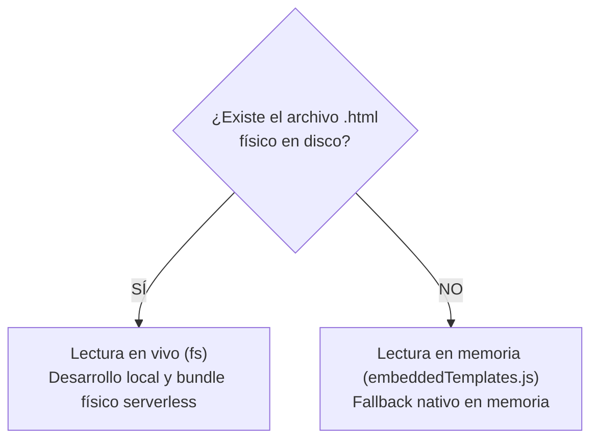

# Arquitectura y Funcionamiento de la Generación de Documentos PDF

Este documento detalla la arquitectura, el ciclo de vida, el motor de plantillas Handlebars, los helpers registrados, la estructura de datos inyectada y la operativa técnica del sistema de generación y descarga de documentos PDF (formularios normalizados del Laboratorio CTM).

---

## 1. Visión General y Filosofía de Diseño

El sistema opera bajo un modelo de **generación *On The Fly* (bajo demanda) sin almacenamiento persistente**:

* **Flujos de negocio rápidos y desacoplados:** Los procesos operativos (`receiveSamples`, `createEssay`, `agreeToTerms`, `emitReport`) completan sus transacciones en base de datos registrando únicamente los metadatos documentales correspondientes en milisegundos (`file = 'on-demand'`).
* **Generación en memoria al descargar:** Cuando el usuario hace clic en **"Descargar"** en la aplicación, el servidor compila la plantilla Handlebars con los datos en vivo del ensayo, genera el PDF en memoria mediante Chromium headless y lo transmite directamente al navegador como adjunto binario (`Content-Type: application/pdf`).
* **Sin almacenamiento intermedio:** Los documentos no se guardan en disco local ni en almacenamiento externo (R2), evitando saturación de almacenamiento y asegurando que cada descarga refleje siempre los datos más actualizados del ensayo.

---

## 2. Catálogo de Formularios y Plantillas

Cada tipo de documento está respaldado por una plantilla HTML Handlebars y registrado en la tabla `types_documents`:

| Código Formulario | Nombre del Documento | Plantilla HTML Base | Evento de Negocio Asociado |
|---|---|---|---|
| **F-PC13-01** | Solicitud de ensayo | `src/infrastructure/templates/essays_forms/fpc131.html` | Creación de la solicitud de ensayo (`POST /essays/create`) |
| **F-PC13-02** | Contrato de servicio / Acuerdo | `src/infrastructure/templates/essays_forms/fpc132.html` | Aceptación de términos y condiciones (`POST /essays/generate-contract`) |
| **F-PC16-01** | Registro de recepción de muestras | `src/infrastructure/templates/essays_forms/fpc161.html` | Recepción y aceptación de muestras en laboratorio (`POST /samples/receive-samples`) |
| **F-PC15-01** | Informe final de ensayo | `src/infrastructure/templates/essays_forms/fpc151.html` | Emisión final, copias o modificaciones de informe (`POST /essays/emit-report` o `/:id/close-and-emit-report`) |

---

## 3. Motor Handlebars, Compilación y Caché

El renderizado HTML se gestiona a través de la clase `HandlebarsService` (`src/infrastructure/templates/HandlebarsService.js`).

### 3.1. Caché en Memoria (`compiledTemplatesCache`)
Compilar una plantilla con `Handlebars.compile(templateString)` es una operación intensiva en CPU. Para maximizar el rendimiento:
* Las plantillas compiladas se almacenan en un `Map` en memoria (`compiledTemplatesCache`).
* La primera descarga de un formulario compila la plantilla; las siguientes solicitudes reutilizan directamente la función compilada desde memoria, tardando menos de 1 milisegundo en generar el HTML final.

### 3.2. Estrategia de Carga de Plantillas (Doble Capa)


1. **Lectura física prioritaria (`fs.existsSync`):** En desarrollo local, `HandlebarsService` lee directamente los archivos `.html` de `src/infrastructure/templates/essays_forms/`. Los cambios guardados se reflejan inmediatamente.
2. **Fallback en memoria (`embeddedTemplates.js`):** En entornos serverless donde no se empaquetan archivos estáticos, se recurre al diccionario JS en memoria, garantizando disponibilidad sin errores `ENOENT`.
3. **Sincronización:** El script `scripts/sync-templates.js` (vinculado a `npm run build:templates` y al hook `postinstall`) mantiene sincronizados los archivos `.html` con el módulo embebido en cada despliegue.

---

## 4. Helpers Registrados de Handlebars

Handlebars cuenta con una serie de helpers personalizados registrados globalmente para soportar lógica condicional, formateo de fechas en español, conversión de números y teléfonos:

### 4.1. Helpers Lógicos y Comparadores
Permiten evaluar condiciones complejas y subexpresiones anidadas:

| Helper | Descripción | Ejemplo de Uso en Plantilla |
|---|---|---|
| `and` | Retorna `true` si todos los argumentos son verdaderos. | `{{#if (and billing.cuit (ne billing.cuit client.cuit))}}` |
| `or` | Retorna `true` si al menos un argumento es verdadero. | `{{#if (or terms.price terms.days_to_do)}}` |
| `eq` | Igualdad estricta (`===`). | `{{#if (eq status "COMPLETED")}}` |
| `ne` | Desigualdad estricta (`!==`). | `{{#if (ne billing.cuit client.cuit)}}` |
| `gt` | Mayor que (`>`). | `{{#if (gt copy 0)}}` |
| `gte` | Mayor o igual (`>=`). | `{{#if (gte samples_count 10)}}` |
| `lt` | Menor que (`<`). | `{{#if (lt copy 2)}}` |
| `lte` | Menor o igual (`<=`). | `{{#if (lte price 0)}}` |
| `not` | Negación lógica (`!`). | `{{#if (not internal_aconditioning)}}` |

### 4.2. Helpers de Fechas y Tiempo
Formatean fechas de forma consistente en castellano:

* **`formatDate date format`:**
  * Parámetros: `date` (Date o string ISO) y `format` (patrón de salida).
  * Patrones soportados:
    * `'dd/MM/YYYY'` o `'dd/mm/yyyy'`: Ej. `13/11/2026`.
    * `'yyyy-mm-dd'`: Formato ISO plano (`2026-11-13`).
    * `'dd'`: Día de dos dígitos (`13`).
    * `'MM'`: Mes numérico de dos dígitos (`11`).
    * `'YYYY'` / `'yyyy'`: Año de cuatro dígitos (`2026`).
  * *Ejemplo:* `{{formatDate requestDate "dd/MM/YYYY"}}`
* **`monthName date`:**
  * Retorna el nombre completo del mes en mayúsculas en español (`ENERO`, `FEBRERO`, ..., `NOVIEMBRE`, `DICIEMBRE`).
  * *Ejemplo:* `{{monthName request_date}}`
* **`dateParts date`:**
  * Retorna un objeto `{ day, month, year }` con valores de dos y cuatro dígitos.

### 4.3. Helpers de Formato Numérico y Texto
* **`numeroATexto numero`:**
  * Convierte valores numéricos a palabras en castellano en mayúsculas (usando la biblioteca `written-number`).
  * *Ejemplo:* Si `terms.days_to_do` es `15`, `{{numeroATexto terms.days_to_do}}` produce `"QUINCE"`.
* **`formatearNumero numero`:**
  * Formatea números monetarios o de grandes cantidades con separadores de miles según la configuración regional argentina (`es-AR`).
  * *Ejemplo:* Si `terms.price` es `150000`, `{{formatearNumero terms.price}}` produce `"150.000"`.

### 4.4. Helper de Teléfonos
* **`formatPhoneNumber country_code number`:**
  * Normaliza y formatea teléfonos fijos o móviles:
    * Si tiene 10 dígitos: `+54 11 1234-5678`.
    * Si tiene 8 dígitos: `+54 1234-5678`.
  * *Ejemplo:* `{{formatPhoneNumber client.contact.country_code client.contact.phone}}`

---

## 5. Estructura de Datos (Payloads) por Formulario

Al invocar `DocumentApplicationService.generatePDFBuffer`, se construye un objeto de contexto que combina variables globales del laboratorio con la información específica de cada formulario.

### 5.1. Datos Globales Comunes (Todos los Formularios)
Todas las plantillas reciben de forma automática:
* **`headerImageDataUrl` (string):** Data URI en Base64 de la imagen institucional del Laboratorio CTM (`data:image/jpeg;base64,...`). Se inyecta en el tag `` sin requerir peticiones de red externas.
* **`env` (object):** Variables institucionales y de negocio activas:
  ```json
  {
    "SOCIAL_NAME": "Fundación para el Desarrollo de Cañada de Gómez (FU.DE.CA.)",
    "CUIT": "30-68194488-8",
    "LOCAL_ADDRESS": "Parque Industrial I, Lote N°9...",
    "LOCATION": "Cañada de Gómez",
    "PROVINCE": "Santa Fe",
    "PRESIDENT": "Nombre del Presidente",
    "PRESIDENT_DNI": "20.123.456",
    "LAB_DIRECTOR": "Director del Laboratorio",
    "LAB_PHONE": "+54 3471 123456",
    "LAB_MAIL": "info@ctmueble.com.ar",
    "BANK": "Banco Nación",
    "BANK_CC": "12345678/90",
    "BANK_CBU": "0110123400012345678901"
  }
  ```

---

### 5.2. Payload de F-PC13-01 (Solicitud de Ensayo)
Plantilla: `src/infrastructure/templates/essays_forms/fpc131.html`

Representa la solicitud inicial presentada por el comitente.

```json
{
  "code": "20261113A",
  "requestDate": "2026-11-13T10:00:00Z",
  "client": {
    "name": "Maderera San José S.A.",
    "cuit": "30-71234567-8",
    "contact": {
      "name": "Carlos González",
      "address": "Av. Libertador 1500",
      "location": "Rosario",
      "district": { "name": "Santa Fe" },
      "country_code": "54",
      "phone": "3411234567",
      "mail": "carlos@madererasanjose.com"
    }
  },
  "billing": {
    "cuit": "30-71234567-8",
    "address": "Av. Libertador 1500",
    "location": "Rosario",
    "district": "Santa Fe",
    "iva": "RESPONSABLE_INSCRIPTO"
  },
  "type": {
    "name": "Determinación de la emisión de formaldehído según IT17-01"
  },
  "elements": {
    "product": "Tableros de partículas de madera (MDF)",
    "manufacturer": "Fábrica Norte",
    "date": "2026-11-10",
    "batch_number": "L-2026-B1",
    "country": { "name": "Argentina" }
  },
  "observations": "Muestras embaladas en film termocontraíble según instrucciones.",
  "env": { "..." : "..." },
  "headerImageDataUrl": "data:image/jpeg;base64,..."
}
```

---

### 5.3. Payload de F-PC13-02 (Contrato de Servicio)
Plantilla: `src/infrastructure/templates/essays_forms/fpc132.html`

Representa el acuerdo legal entre FU.DE.CA. y el cliente:

```json
{
  "code": "20261113A",
  "request_date": "2026-11-13T10:00:00Z",
  "client": {
    "name": "Maderera San José S.A.",
    "cuit": "30-71234567-8",
    "address": {
      "address": "Av. Libertador 1500",
      "location": "Rosario"
    },
    "representative": {
      "name": "Carlos González",
      "dni": "28.987.654"
    }
  },
  "type": {
    "name": "Determinación de la emisión de formaldehído según IT17-01"
  },
  "terms": {
    "price": 185000,
    "days_to_do": 15,
    "samples_conservation_days": 30
  },
  "env": { "..." : "..." },
  "headerImageDataUrl": "data:image/jpeg;base64,..."
}
```

---

### 5.4. Payload de F-PC16-01 (Registro de Recepción de Muestras)
Plantilla: `src/infrastructure/templates/essays_forms/fpc161.html`

Representa la constancia de recepción física de probetas en el laboratorio:

```json
{
  "code": "OT-20261113-01",
  "essay_track_code": "20261113A",
  "generated_at": "2026-11-13T11:00:00Z",
  "element_to_essay": "Tableros de partículas de madera (MDF)",
  "samples_count": 6,
  "observations": "Muestras recibidas en perfecto estado, rotuladas correlativamente.",
  "internal_aconditioning": true,
  "sample_dimensions": "20 x 20 x 1.5 cm",
  "env": { "..." : "..." },
  "headerImageDataUrl": "data:image/jpeg;base64,..."
}
```

---

### 5.5. Payload de F-PC15-01 (Informe Final de Ensayo)
Plantilla: `src/infrastructure/templates/essays_forms/fpc151.html`

Representa el informe técnico emitido por el laboratorio con los resultados analíticos:

```json
{
  "code": "20261113A",
  "headerTitle": "INFORME DE ENSAYO",
  "lastReportGenerated": "2026-11-20T16:00:00Z",
  "finishDate": "2026-11-20",
  "client": {
    "name": "Maderera San José S.A.",
    "cuit": "30-71234567-8",
    "address": { "address": "Av. Libertador 1500", "location": "Rosario", "province": "Santa Fe" },
    "contact": { "name": "Carlos González", "mail": "carlos@madererasanjose.com", "phone": "3411234567" }
  },
  "elements": {
    "product": "Tableros de partículas de madera (MDF)",
    "manufacturer": "Fábrica Norte",
    "batch_number": "L-2026-B1",
    "country": { "name": "Argentina" }
  },
  "type": {
    "name": "Determinación de la emisión de formaldehído según IT17-01"
  },
  "workOrder": {
    "code": "OT-20261113-01",
    "samples_received_at": "2026-11-13T11:00:00Z",
    "sample_dimensions": "20 x 20 x 1.5 cm",
    "internal_aconditioning": true,
    "average_value": "0.12",
    "uncertainty": "0.02",
    "samples": [
      { "code": "20261113-01-01", "result": "0.11" },
      { "code": "20261113-01-02", "result": "0.13" },
      { "code": "20261113-01-03", "result": "0.12" }
    ]
  },
  "copy": 0,
  "modificated": false,
  "isCopy": false,
  "isModificated": false,
  "env": { "..." : "..." },
  "headerImageDataUrl": "data:image/jpeg;base64,..."
}
```

---

## 6. Endpoints de Descarga y Resolución de Documentos

### 6.1. Descarga por Tipo de Documento
* **Endpoint:** `GET /essays/download-document-by-type`
* **Parámetros Query:**
  * `essayId` (UUID): Identificador del ensayo.
  * `type` (string): Código del formulario deseado (`F-PC13-01`, `F-PC13-02`, `F-PC16-01`, `F-PC15-01`).
* **Funcionamiento:** Valida permisos y genera el documento On The Fly a partir del estado actual del ensayo.

### 6.2. Descarga por ID
* **Endpoint:** `GET /essays/download-document`
* **Parámetros Query:**
  * `id` (UUID): Identificador del documento, de la orden de trabajo o del ensayo.
* **Resolución inteligente:**
  1. Si `id` pertenece a un registro en `essays_documents`, recupera sus metadatos (copia, modificación, tipo) y genera el PDF On The Fly.
  2. Si `id` coincide con el identificador de una orden de trabajo, genera automáticamente el comprobante de recepción `F-PC16-01`.
  3. Si `id` coincide con el identificador de un ensayo, genera el informe `F-PC15-01` (si está finalizado) o la solicitud `F-PC13-01`.

---

## 7. Seguridad y Concurrencia

* **Prevención de IDOR (Insecure Direct Object Reference):** `_assertEssayOwnership` valida en cada descarga que el usuario pertenezca al perfil `LABORATORY` o sea el titular legítimo del ensayo. Cualquier petición no autorizada recibe `404 DOCUMENT_NOT_FOUND` para evitar enumeración.
* **Aislamiento SSRF en Chromium:** Durante la generación del PDF se habilita `setRequestInterception(true)`, bloqueando cualquier llamada externa HTTP/HTTPS o accesos locales `file://` dentro de las plantillas. Solo se autorizan esquemas de datos seguros (`data:`, `about:`, `blob:`).
* **Control de concurrencia y memoria:** Se implementa un semáforo de ejecución (`PDF_MAX_CONCURRENCY`) con cola de espera y timeout para evitar sobreconsumo de memoria RAM en entornos concurrentes.
* **Rate Limiting:** Los endpoints de descarga están protegidos por el middleware `pdfGenerationLimiter` contra solicitudes masivas repetitivas.

---

## 8. Guía de Modificación de Plantillas para Desarrolladores

Para editar cualquiera de las plantillas:

1. Modifica directamente el archivo `.html` en `src/infrastructure/templates/essays_forms/`:
   * **F-PC13-01:** `fpc131.html`
   * **F-PC13-02:** `fpc132.html`
   * **F-PC15-01:** `fpc151.html`
   * **F-PC16-01:** `fpc161.html`
2. Puedes emplear cualquiera de los helpers detallados en la Sección 4 (`formatDate`, `numeroATexto`, `formatearNumero`, `formatPhoneNumber`, `and`, `or`, `eq`, etc.).
3. *(Opcional)* Ejecuta en la terminal para sincronizar el módulo embebido localmente:
   ```bash
   npm run build:templates
   ```
4. Guarda y sube los cambios mediante git (`git commit` y `git push`). El proceso de despliegue en Vercel sincronizará automáticamente las plantillas.
