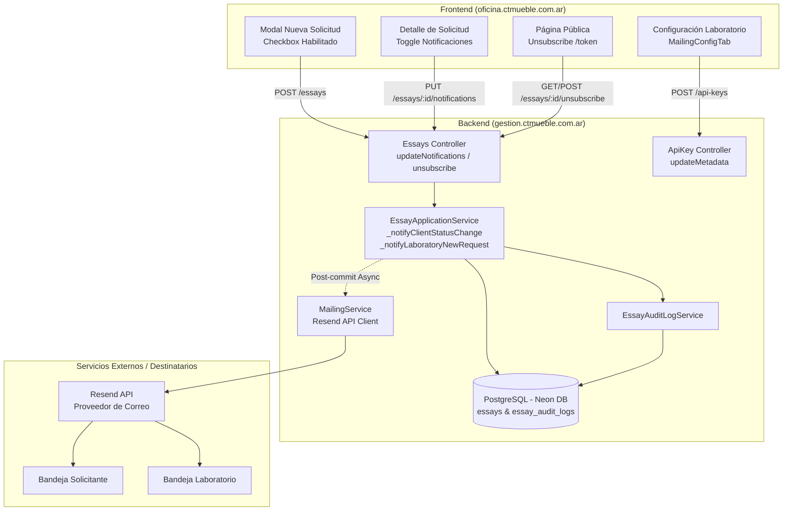

# Sistema de Notificaciones por Correo Electrónico

## 1. Resumen Ejecutivo y Objetivos

El sistema de notificaciones por correo electrónico de **CTM Gestión** tiene como propósito mantener informados tanto a los clientes solicitantes como al equipo técnico del laboratorio sobre el ciclo de vida y los cambios de estado de las solicitudes de ensayo.

### Objetivos Clave
1. **Notificación en tiempo real al solicitante:** Cada cambio en el estado de una solicitud (`REQUESTED`, `ACCEPTED`, `REJECTED`, `SERVICE_AGREEMENT_MADED`, `IN_WORK`, `COMPLETED`, `CANCELLED`) envía automáticamente un correo con el mismo título y mensaje explicativo que se visualiza en la interfaz de usuario (`ClientEssayStatusBanner`).
2. **Consentimiento explícito y control de privacidad:** En el formulario de creación de la solicitud, el cliente cuenta con un selector de activación de notificaciones (habilitado por defecto). Además, cada correo enviado aclara expresamente que se recibe por autorización del solicitante e incluye un enlace directo con token único para darse de baja sin requerir inicio de sesión.
3. **Gestión desde el sistema y auditoría completa:** Tanto el solicitante como el personal del laboratorio pueden activar o desactivar las notificaciones directamente desde el detalle de la solicitud en la plataforma. Toda modificación queda registrada de forma inmutable en el historial (`essay_audit_logs`).
4. **Alerta de nueva solicitud para el laboratorio:** Posibilidad de configurar desde los ajustes del laboratorio si se desean recibir correos de aviso ante cada nueva solicitud ingresada, personalizando la casilla de destino.
5. **Seguridad y sanitización de errores:** Ningún fallo interno, consulta SQL ni excepción de infraestructura es expuesta al cliente. El envío de correos se ejecuta de forma desacoplada y fuera de las transacciones de base de datos para garantizar la integridad transaccional.

---

## 2. Arquitectura del Sistema



---

## 3. Modelo de Datos y Migraciones

### 3.1. Campos agregados a la tabla `essays`
Migración: `src/infrastructure/migrations/20261113000000-add-essay-client-notifications.js`

| Columna | Tipo | Nulo | Valor por defecto | Descripción |
| :--- | :--- | :---: | :---: | :--- |
| `client_notifications_enabled` | `BOOLEAN` | NO | `true` | Indica si el solicitante recibe notificaciones para este ensayo. |
| `notification_token` | `UUID` | SI | `gen_random_uuid()` | Token único para desuscripción con 1 clic desde el correo. |

- **Índice:** `idx_essays_notification_token` sobre `notification_token` para búsquedas eficientes en la ruta pública de desuscripción.

### 3.2. Eventos de Auditoría (`essay_audit_logs`)
Valores incorporados en `EssayAuditEvent`:
- `NOTIFICATIONS_ENABLED`: Registrado cuando un usuario (cliente o personal de laboratorio) activa las alertas por correo.
- `NOTIFICATIONS_DISABLED`: Registrado cuando se desactivan las alertas, ya sea desde el sistema o mediante el enlace de desuscripción del correo (`source: 'UNSUBSCRIBE_LINK'`).

---

## 4. Mensajes y Estados Notificados al Solicitante

El correo electrónico replica exactamente los textos informativos presentados en el banner superior (`ClientEssayStatusBanner`) de la plataforma:

| Estado (`status`) | Título en el Correo | Descripción en el Correo |
| :--- | :--- | :--- |
| `REQUESTED` | Esperando respuesta del laboratorio acerca de tu solicitud | Tu solicitud de ensayo fue enviada exitosamente. El equipo del laboratorio está revisando la viabilidad técnica para aceptarla. |
| `ACCEPTED` | La solicitud fue aceptada | El laboratorio aceptó tu solicitud. En este momento se están formalizando los términos del contrato de servicio. |
| `REJECTED` | La solicitud fue rechazada | El laboratorio no pudo aceptar esta solicitud. Motivo indicado: *[observaciones]* (o mensaje estándar si no se especificaron). |
| `SERVICE_AGREEMENT_MADED` | Esperando recepción de muestras | El acuerdo de servicio está definido. El laboratorio aguarda la llegada de las muestras y contramuestras físicas para dar inicio a los análisis. |
| `IN_WORK` | El laboratorio está analizando las muestras | Las muestras fueron recibidas de conformidad. El equipo técnico del laboratorio se encuentra ejecutando los ensayos correspondientes. |
| `COMPLETED` | Informe emitido | El ensayo ha finalizado exitosamente. El informe formal técnico ya está emitido y listo para su consulta y descarga. |
| `CANCELLED` | El ensayo fue cancelado | El ensayo fue cancelado. Motivo: *[observaciones]* |

---

## 5. Notificación de Nuevas Solicitudes al Laboratorio

Desde la pestaña de configuración del laboratorio (**Configuración > Credenciales > Mailing**):
- El administrador puede tildar **"Notificar al laboratorio cuando entre una nueva solicitud de ensayo"**.
- Se puede definir un correo de notificación específico (o utilizar por defecto el configurado en la entidad del laboratorio).
- El correo incluye:
  - Código del ensayo (`#YYMMDDX`).
  - Nombre de la empresa solicitante.
  - Nombre del contacto solicitante.
  - Producto y fabricante a ensayar.
  - Fecha de ingreso y observaciones.
  - Botón directo para abrir y gestionar la solicitud en la plataforma.

---

## 6. Mecanismo de Desuscripción (Opt-Out)

Cada correo enviado al cliente incluye al pie un bloque legal y funcional de desuscripción:
> *"Recibís este correo porque autorizaste las notificaciones sobre el estado de esta solicitud. Si ya no deseás recibir actualizaciones por correo electrónico para esta solicitud, podés [darte de baja aquí]."*

### Flujo de Desuscripción:
1. El usuario hace clic en el enlace `https://oficina.ctmueble.com.ar/unsubscribe?essayId=...&token=...`.
2. La vista `Unsubscribe.jsx` muestra un estado de carga y consume el endpoint público `POST /essays/:id/unsubscribe?token=...`.
3. El backend verifica la concordancia del token UUID con el ensayo correspondiente.
4. Se conmuta `client_notifications_enabled = false` y se registra el evento `NOTIFICATIONS_DISABLED` con metadatos `{ source: 'UNSUBSCRIBE_LINK' }`.
5. Si el usuario vuelve a hacer clic, la operación es **idempotente** e informa cordialmente que ya se encontraba desuscripto.
6. El solicitante o el laboratorio pueden reactivar las alertas en cualquier momento desde el botón en la cabecera del detalle del ensayo.

---

## 7. Políticas de Seguridad y Concurrencia Transaccional

### 7.1. Aislamiento Post-Commit
Para evitar la excepción de Sequelize `commit has been called on this transaction, you can no longer use it`:
- Toda notificación asincrónica (`_notifyClientStatusChange`, `_notifyLaboratoryNewRequest`) se invoca **estrictamente después** de que la transacción de base de datos haya ejecutado su `commit` exitoso.
- Las consultas de lectura de datos requeridas para generar los correos utilizan una instancia limpia de `EssayRepository` con `transaction: null`.

### 7.2. Sanitización Estricta de Errores
- La función utilitaria `handleControllerError` y el helper `isTechnicalOrDatabaseError` interceptan errores de base de datos (Postgres/Sequelize), fallos de sintaxis, `ReferenceError` y códigos HTTP 5xx.
- La respuesta HTTP enviada al cliente siempre devuelve mensajes genéricos y seguros (`"Ocurrió un error inesperado al procesar la solicitud. Por favor, intente nuevamente más tarde."`), garantizando que ninguna traza de base de datos, nombre de tabla o excepción interna sea expuesta en toasts o pantallas del cliente.
- El frontend filtra igualmente cualquier cadena técnica residual mediante la función `getCleanErrorMessage`.

---

## 8. Endpoints API

### 8.1. Actualizar Preferencia de Notificaciones
- **Ruta:** `PUT /essays/:id/notifications`
- **Seguridad:** Requiere autenticación JWT + CSRF Token + Idempotency-Key.
- **Body:**
  ```json
  {
    "enabled": false
  }
  ```
- **Respuesta (200 OK):** Objeto DTO del ensayo actualizado conteniendo `client_notifications_enabled: false`.

### 8.2. Desuscripción Pública por Token
- **Rutas:** `GET /essays/:id/unsubscribe`, `POST /essays/:id/unsubscribe` (o `.../notifications/unsubscribe`)
- **Seguridad:** Pública (validada mediante el parámetro de consulta o cuerpo `token`).
- **Respuesta (200 OK):**
  ```json
  {
    "success": true,
    "message": "Te has dado de baja correctamente de las notificaciones de esta solicitud",
    "essayCode": "260314A"
  }
  ```
