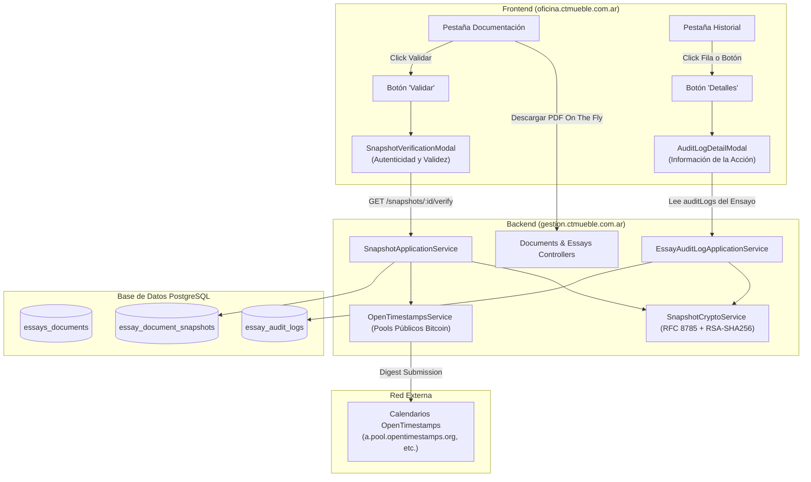

# Sistema de Auditoría, Integridad Criptográfica y Fecha Cierta (OpenTimestamps)

Este documento detalla la arquitectura, el diseño técnico y los flujos operativos del sistema de **auditoría inmutable, verificación de integridad y certificación de fecha cierta** implementado para la plataforma de gestión de ensayos del CTM (**gestion.ctmueble.com.ar** y **oficina.ctmueble.com.ar**).

---

## 1. Motivación y Contexto

Debido a que la documentación oficial (`F-PC13-01` Solicitud, `F-PC13-02` Contrato, `F-PC15-01` Informe, `F-PC16-01` Hoja de Ruta) se genera dinámicamente **On The Fly** en formato PDF sin almacenar archivos estáticos en almacenamiento de objetos (R2/S3) o disco, surgió la necesidad crítica de:

1. **Garantizar la inmutabilidad de los datos históricos**: Proteger el estado de la solicitud, contrato e informe tal como fueron emitidos en cada momento.
2. **Detección de manipulación de Base de Datos (*Tampering Detection*)**: Comprobar criptográficamente que los registros en la base de datos PostgreSQL no hayan sido modificados de forma arbitraria o malintencionada por accesos directos de administradores de BD.
3. **Fecha cierta legal con OpenTimestamps (OTS)**: Anclar el hash criptográfico del documento en calendarios públicos y en la blockchain de Bitcoin para demostrar que el documento existía en un estado exacto en un momento temporal determinado.
4. **Auditoría de operaciones con huella de dispositivo**: Vincular cada evento del ciclo de vida del ensayo con el usuario, sesión, navegador, sistema operativo y dirección IP de origen, con encadenamiento criptográfico de registros.
5. **Gestión controlada de modificaciones y re-emisiones**: Permitir la reemisión manual de documentos modificados, marcándolos inequívocamente (`modificated: true`) y capturando una nueva snapshot versionada.
6. **Experiencia de usuario accesible y segmentada**: Ofrecer a los clientes una verificación comprensible sobre la autenticidad del documento sin tecnicismos abrumadores, reservando la evidencia técnica avanzada (hashes, firmas RSA, pools OTS e IPs) al personal del laboratorio.

---

## 2. Arquitectura General



---

## 3. Componentes Criptográficos e Integridad

### 3.1. Serialización Canónica (RFC 8785 / JCS)
Para que un hash SHA-256 sea determinista e idéntico sin importar el orden en que los motores de JavaScript o PostgreSQL devuelvan las claves de un objeto JSON, se implementó `CanonicalJson.stringify()` siguiendo el estándar **RFC 8785 (JSON Canonicalization Scheme - JCS)**:
- Ordenamiento lexicográfico estricto de claves por código Unicode UTF-16.
- Tratamiento canónico de números y normalización de fechas a ISO 8601 UTC.
- Eliminación de espacios en blanco y caracteres de formateo.

### 3.2. Firmado y Verificación Asimétrica (RSA-SHA256)
En `SnapshotCryptoService.js`:
- **Cálculo de Hash**: Se genera `canonicalHash = SHA256(canonicalPayload)`.
- **Firma Digital**: Se firma el hash canónico mediante la clave privada del sistema (o HMAC como respaldo si no hay par de claves configurado).
- **Verificación contra Manipulación (Tampering)**:
  1. Se reconstruye el payload canónico a partir de los datos actuales almacenados en `snapshot_data`.
  2. Se recalcula el hash SHA-256.
  3. Se compara el hash recalculado contra `canonical_hash`. Si no coinciden, se detecta alteración inmediata en los datos.
  4. Se verifica la firma criptográfica con la clave pública del sistema. Si los datos fueron editados en la base de datos, la firma queda invalidada.

---

## 4. Certificación de Fecha Cierta con OpenTimestamps (OTS)

En `OpenTimestampsService.js`:

### 4.1. Protocolo de Sellado
1. Al capturarse la snapshot o registrarse el evento, el hash canónico SHA-256 (32 bytes binarios) se envía mediante petición HTTP POST `application/x-www-form-urlencoded` o binaria al endpoint `/digest` de los calendarios distribuidos de OpenTimestamps:
   - `https://a.pool.opentimestamps.org/digest`
   - `https://b.pool.opentimestamps.org/digest`
   - `https://ots.btc.catallaxy.com/digest`
2. El calendario responde con las operaciones criptográficas del árbol de Merkle parcial del calendario.
3. El servicio ensambla el archivo de prueba `.ots` agregando la cabecera mágica oficial del estándar OpenTimestamps:
   `\x00OpenTimestamps\x00\x00Proof\x00\xbf\x89e\xa8\xdb$/`
4. El comprobante binario resultante se persiste en base64 en la columna `ots_proof` de la tabla `essay_document_snapshots`.

### 4.2. Descarga y Verificación Independiente
Los usuarios pueden descargar el archivo `.ots` y validarlo de forma completamente independiente de este software utilizando el cliente oficial de OpenTimestamps:
```bash
ots verify F-PC13-01_v1.ots
```
Lo que demuestra fehacientemente ante cualquier auditor, perito o tribunal que el documento existía en esa fecha exacta y no ha sido alterado.

---

## 5. Auditoría de Operaciones con Huella de Dispositivo

En `deviceInfo.js` y `EssayAuditLogRepository.js`:

Cada acción realizada en un ensayo registra:
- **Usuario**: ID (`userId`), nombre (`userName`) y perfil.
- **Evento**: Código estandarizado (`REQUEST_CREATED`, `REQUEST_MODIFIED`, `CONTRACT_CREATED`, `SAMPLES_RECEIVED`, `RESULTS_LOADED`, `REPORT_ISSUED`, `ESSAY_CLIENT_UPDATED`, etc.).
- **Dispositivo**: Nombre amigable del cliente obtenido de las cabeceras (ej. *"Google Chrome en Windows"*).
- **Red y Sesión**: Dirección IP del cliente, `session_id`, `device_id` y cadena completa de `user_agent`.
- **Integridad del Registro**:
  - `record_hash`: Hash SHA-256 canónico del contenido del registro.
  - `signature`: Firma digital RSA del registro.
  - `previous_hash`: Enlace al hash del registro anterior, formando una cadena verificable (*blockchain-like hash chain*).
- **Metadatos específicos**: Objeto JSON con los motivos de cambios, parámetros o diferencias.

---

## 6. Ciclo de Vida: Re-emisiones y Modificaciones

Para cumplir con las normas de gestión de calidad del laboratorio:
1. **Emisión Original**:
   - `F-PC13-01` se genera al crear la solicitud (`modificated: false`, `copy: 0`, snapshot `v1`).
   - `F-PC15-01` se genera al emitir el primer informe (`modificated: false`, `copy: 0`).
2. **Modificación de Solicitud**:
   - Los datos pueden modificarse en la ficha del ensayo.
   - La nueva versión **no se emite de forma automática**, sino manual desde la pestaña **"Documentación"** mediante el botón **"Re-emitir solicitud (F-PC13-01)"**.
   - Al re-emitir, se registra el motivo de la modificación, se marca el documento con `modificated: true`, se actualiza el PDF generado On The Fly y se toma una nueva snapshot inmutable (`v2`, `v3`, etc.) anclada con OpenTimestamps.
3. **Modificación de Informe**:
   - Si se modifican valores de muestras después de emitido el informe, el sistema detecta la discrepancia.
   - Desde la pestaña **"Resultados"**, el laboratorio re-emite el informe con el motivo del cambio.
   - Toda emisión posterior a la original queda permanentemente categorizada como `MODIFICATION` (`modificated: true`).

---

## 7. Experiencia de Usuario y Segmentación de Perfiles

Se rediseñó la interfaz para evitar jerga excesivamente técnica para clientes y mantener el rigor técnico para el laboratorio:

| Sección | Vista de Clientes | Vista de Laboratorio |
| :--- | :--- | :--- |
| **Tabla de Documentos** | Columna con botón **"Descargar"** y botón **"Validar"**. | Misma tabla, con botón **"Re-emitir solicitud"** habilitado. |
| **Modal de Validación** | - **"Documento auténtico y verificado"**<br/>- *"Contenido: Original y sin alteraciones"*<br/>- *"Firma digital del laboratorio: Válida y confirmada"*<br/>- *"Fecha y hora oficial (Fecha Cierta): Certificada"* con fecha y hora legible. | Misma información amigable, más sección desplegable:<br/>- Hash Canónico SHA-256<br/>- Algoritmo de firma<br/>- Servidor de calendario OTS<br/>- Botón **"Descargar comprobante (.ots)"**. |
| **Modal de Historial** | - Nombre de la acción y fecha legible.<br/>- Responsable y dispositivo.<br/>- Detalles amigables de la operación.<br/>- Confirmación de registro inalterable. | Misma información, más sección técnica desplegable:<br/>- Dirección IP y ID de Sesión<br/>- User Agent completo<br/>- Hash SHA-256 y Firma RSA del registro<br/>- Metadatos JSON completos. |

---

## 8. Resumen de Modelos y Rutas de API

### Modelos de Base de Datos
- **`essay_document_snapshots`**:
  `id`, `essay_id`, `document_type`, `version`, `event_code`, `snapshot_data` (JSONB), `canonical_hash`, `signature`, `signature_algorithm`, `ots_status`, `ots_proof`, `ots_calendar_url`, `ots_stamped_at`, `ots_error`, `user_id`, `session_id`, `device_id`, `client_name`, `ip_address`, `user_agent`, `created_at`.
- **`essay_audit_logs`**:
  `id`, `essay`, `user_id`, `event_code`, `timestamp`, `metadata` (JSONB), `client_name`, `ip_address`, `user_agent`, `session_id`, `device_id`, `record_hash`, `signature`, `previous_hash`.

### Endpoints Clave
- `GET /api/essays/:id/snapshots`: Lista las snapshots del ensayo con hashes y sellos.
- `GET /api/essays/snapshots/:snapshotId/verify`: Ejecuta la verificación en tiempo real de firma, integridad DB y OTS.
- `GET /api/essays/snapshots/:snapshotId/ots-proof`: Descarga directa del archivo binario `.ots`.
- `POST /api/essays/:id/reissue-request`: Reemisión manual de la solicitud con motivo, `modificated: true` y nueva snapshot.
- `GET /api/essays/audit-logs`: Obtiene la bitácora completa con datos de dispositivo y evidencia criptográfica.
