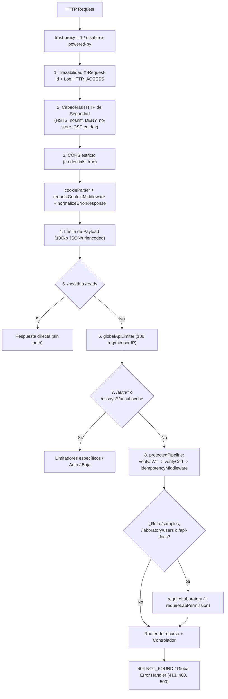

# Pipeline HTTP, Middlewares, Idempotencia, Redis y Auditoría de Seguridad

Este documento describe en detalle el funcionamiento del pipeline HTTP de Express en [`src/app.js`](file:///c:/Users/Tomas/Desktop/CTM/gestion.ctmueble.com.ar/src/app.js), los middlewares de seguridad y resiliencia, la integración con Redis, el manejo de transacciones SQL en Neon y el subsistema de auditoría de seguridad.

---

## 1. Arquitectura del Pipeline HTTP (`src/app.js`)

Cada petición entrante atraviesa una secuencia estricta de capas antes de llegar a los controladores:



### 1.1. Trazabilidad, Observabilidad y Límites Base
- **Trazabilidad (`X-Request-Id`):** Valida el header entrante `x-request-id` contra `/^[a-zA-Z0-9._-]{8,64}$/` o genera un `crypto.randomUUID()`. Emite `X-Request-Id` en la respuesta y registra un JSON estructurado `HTTP_ACCESS` al finalizar la respuesta (omitiendo query strings para no filtrar tokens ni PII en logs).
- **Cabeceras de seguridad:** `Strict-Transport-Security` (2 años, `includeSubDomains`, `preload`), `X-Content-Type-Options: nosniff`, `X-Frame-Options: DENY`, `Referrer-Policy: no-referrer`, `Permissions-Policy` restrictiva y `Cache-Control: private, no-store, max-age=0`. En rutas `/api-docs` fuera de producción aplica una Content Security Policy (CSP) específica para Swagger UI.
- **Límite de tamaño de payload:** `express.json({ limit: '100kb' })` y `express.urlencoded({ extended: false, limit: '100kb' })`. Las solicitudes que superen 100 KB reciben `413 PAYLOAD_TOO_LARGE`, y un JSON malformado recibe `400 INVALID_JSON`.
- **Health y Readiness checks:**
  - `GET /health`: responde `200 { status: 'ok', timestamp }` sin tocar base de datos.
  - `GET /ready`: ejecuta `SELECT 1` contra PostgreSQL con un timeout máximo de `2000ms` e informa estado de DB y Redis (`200 { status: 'ready', db: 'up', redis: 'configured'|'disabled' }`, o `503 SERVICE_UNAVAILABLE` si falla o vence el timeout).
- **Graceful Shutdown:** Cuando corre como servidor persistente (`require.main === module`), captura `SIGTERM` y `SIGINT` para cerrar ordenadamente el servidor HTTP, el pool de Sequelize y la conexión de Redis (con un timeout límite de 10 segundos).

---

## 2. Protección CSRF y Lista Blanca de Orígenes (`csrf.js`)

Implementada en [`src/presentation/middlewares/csrf.js`](file:///c:/Users/Tomas/Desktop/CTM/gestion.ctmueble.com.ar/src/presentation/middlewares/csrf.js):

### 2.1. Lista Blanca de Orígenes (`isOriginAllowed` y `getAllowedOrigins`)
Permite exclusivamente:
- Orígenes base: `https://oficina.ctmueble.com.ar` (y en no-producción `http://localhost:3000`, `http://localhost:5173`, `http://localhost:*`, `http://127.0.0.1:*`).
- Orígenes adicionales declarados en `CORS_ORIGINS` (separados por coma).
- Subdominios HTTPS institucionales (`ctmueble.com.ar` y `*.ctmueble.com.ar`).
- Previews HTTPS propios del proyecto en Vercel (`/^(?:[a-z0-9-]+-)?(?:oficina|gestion|tarechaga15)[a-z0-9-]*\.vercel\.app$/i`).

### 2.2. Validación Double-Submit Cookie
- **`verifyCsrf`:** Se ejecuta después de `verifyJWT` en todas las rutas protegidas.
  - Permite métodos seguros (`GET`, `HEAD`, `OPTIONS`).
  - Solo exige validación CSRF cuando `req.authSource === 'cookie'` (en desarrollo local usando `Authorization: Bearer` omite el chequeo para facilitar pruebas con Swagger/curl).
  - Si existe cabecera `Origin`, valida con `isOriginAllowed(origin)` (si falla devuelve `403 CSRF_ORIGIN_FORBIDDEN`).
  - Compara la cookie `ctm_csrf` contra el header `X-CSRF-Token` en tiempo constante mediante `crypto.timingSafeEqual` (si no coinciden o faltan devuelve `403 CSRF_TOKEN_INVALID`).
- **`verifyAuthCookieCsrf`:** Protege `POST /auth/logout` y `POST /auth/refresh_token` cuando la autenticación proviene de cookies `ctm_rt`/`ctm_at` (en desarrollo permite omitirlo si se envía `refreshToken` o `token` explícitamente en el body sin cookies).
- **Protección contra Host/URL Injection (`resolveSafeFrontendUrl`):** Valida cualquier `frontendUrl` enviada en flujos de correo (verificación, invitación o reseteo de contraseña) contra `isOriginAllowed`. Si la URL pertenece a un dominio externo no autorizado, vuelve al fallback seguro (`FRONTEND_URL` / `APP_URL` / `https://oficina.ctmueble.com.ar`).

---

## 3. Middleware de Idempotencia (`idempotency.js`)

Implementado en [`src/presentation/middlewares/idempotency.js`](file:///c:/Users/Tomas/Desktop/CTM/gestion.ctmueble.com.ar/src/presentation/middlewares/idempotency.js) e integrado en `protectedPipeline`.

### 3.1. Funcionamiento y Aislamiento Multi-Tenant
1. Se aplica únicamente a peticiones `POST` y `PUT` que incluyan la cabecera `Idempotency-Key`.
2. Valida longitud máxima de **128 caracteres** (`400 INVALID_IDEMPOTENCY_KEY` si la supera).
3. Construye una clave aislada por actor, método, ruta sin query string, hash del body y clave cliente:
   ```text
   ctm:idem:<u:userId | ip:addr>:<METHOD>:<cleanUrl>:<sha256(body)[0..16]>:<Idempotency-Key>
   ```
   Esto impide colisiones o filtraciones de respuestas cacheadas entre distintos usuarios o payloads diferentes.

### 3.2. Control de Concurrencia y Caché
- **Bloqueo en vuelo (`IN_PROGRESS`):** Al iniciar la petición, adquiere un lock atómico de **60 segundos** (`redis.setNxPx` cuando Redis está configurado, o `memoryStore` local). Si llega una petición concurrente idéntica mientras la primera sigue procesándose, responde `409 IDEMPOTENCY_IN_PROGRESS`.
- **Reproducción de respuestas exitosas (`COMPLETED`):**
  - Intercepta `res.json` y cachea **únicamente respuestas `2xx`** (TTL **24 horas** en Redis; **15 minutos** y tope de **2.000 entradas** en memoria).
  - Ante reintentos posteriores con la misma clave, devuelve directamente el payload cacheado con su código original y la cabecera `X-Idempotent-Replayed: true`.
- **Limpieza ante fallos:** Si la operación responde `4xx`/`5xx` o el cliente cierra la conexión antes de responder (`res.once('close')`), elimina la entrada `IN_PROGRESS` para permitir reintentos legítimos.

---

## 4. Rate Limiting Distribuido (`rateLimit.js`)

Implementado en [`src/presentation/middlewares/rateLimit.js`](file:///c:/Users/Tomas/Desktop/CTM/gestion.ctmueble.com.ar/src/presentation/middlewares/rateLimit.js).

- **Resolución segura de IP (`resolveClientIp`):**
  - En Vercel (`process.env.VERCEL`), prioriza `x-vercel-forwarded-for` (inyectado por el edge de Vercel, resistente a spoofing).
  - En Express tradicional, utiliza `req.ip` respetando `trust proxy = 1`.
- **Agrupación de buckets:** Por IP (`ip:<addr>`) o por usuario autenticado (`usr:<userId>`) cuando se configura `keyByUser: true`.
- **Backend dual (Redis + Memoria):** Cuando Redis está habilitado (fuera de tests), usa la operación atómica `RedisClient.incrWithWindow` (`MULTI INCR + PTTL + PEXPIRE`). Si Redis no está configurado o falla, degrada de forma transparente a un `Map` en memoria acotado a **10.000 buckets** con limpieza periódica.
- **Respuesta al exceder:** Devuelve HTTP `429` con cabecera `Retry-After` (en segundos) y el formato estándar `{ code, message }`, registrando además el evento `RATE_LIMIT_EXCEEDED` en `security_audit_logs`.

### 4.1. Catálogo de Limitadores Configurados

| Código (`code`) | Ventana | Máximo | Clave | Endpoints protegidos |
| :--- | :---: | :---: | :--- | :--- |
| `GLOBAL_RATE_LIMIT` | 1 min | 180 | IP | Toda la API (`src/app.js`) |
| `AUTH_REGISTER_RATE_LIMIT` | 15 min | 10 | IP | `POST /auth/register` |
| `AUTH_RATE_LIMIT` | 15 min | 15 | IP | `POST /auth/login` |
| `AUTH_REFRESH_RATE_LIMIT` | 15 min | 40 | IP | `POST /auth/refresh_token` |
| `AUTH_VERIFY_RATE_LIMIT` | 15 min | 20 | IP | `/auth/2fa/*`, `/auth/send-verification`, `/auth/verify-*`, `/auth/*-password` |
| `DOWNLOAD_RATE_LIMIT` | 10 min | 60 | Usuario | `GET /essays/download-document`, `GET /essays/download-document-by-type` |
| `PDF_RATE_LIMIT` | 10 min | 25 | IP | `/essays/create`, `debug/generate-document`, `generate-contract`, `samples/load`, `emit-report`, `reissue-request` |
| `EXPORT_RATE_LIMIT` | 5 min | 20 | IP | `GET /essays/export` |
| `PDF_GENERATION_RATE_LIMIT` | 5 min | 15 | Usuario | `POST /samples/receive-samples`, `POST /samples/:id/close-and-emit-report` |
| `PADRON_RATE_LIMIT` | 10 min | 30 | Usuario | Autocompletado auxiliar opcional ARCA (`POST /bussiness/sync/`, `GET /bussiness/padron/`, `GET /clients/padron/:cuit`) |

---

## 5. Cliente Redis Resiliente (`RedisClient.js`) y Revocación de Sesiones

### 5.1. `RedisClient` (`src/infrastructure/redis/RedisClient.js`)
Cliente singleton construido sobre `ioredis` diseñado para entornos serverless y locales:
- **Configuración:** Se activa si existe `REDIS_URL` o `REDIS_HOST` (`REDIS_PORT` default `6379`, `REDIS_PASS`, `REDIS_DB` default `0`, `REDIS_TLS='true'`, `REDIS_TLS_REJECT_UNAUTHORIZED`).
- **Estrategia *Fail-Fast*:** Opera con `lazyConnect: true`, `connectTimeout: 2500ms`, `commandTimeout: 2000ms`, `maxRetriesPerRequest: 1`, `enableOfflineQueue: false` y máximo 3 reintentos. Todos los métodos (`get`, `set`, `setNxPx`, `del`, `incrWithWindow`, etc.) capturan errores y devuelven `null`/`0` para evitar que una caída de Redis bloquee la API.

### 5.2. `SessionRevocationService` (`src/infrastructure/auth/services/SessionRevocationService.js`)
Gestiona listas de revocación y detección de reuso de tokens combinando memoria local (máx. 10.000 entradas) y Redis:
- **`revokeToken(jti, ttl)`** (`auth:rev:jti:<jti>`) y **`revokeSession(sid, ttl)`** (`auth:rev:sid:<sid>`): revocación inmediata en logout, cierre remoto o cambio de contraseña.
- **`consumeRefreshToken(jti, sid, ttl)`** (`auth:used:rt:<jti>`): garantiza uso único de cada refresh token; si detecta reuso (`count > 1` o existencia previa), revoca automáticamente toda la familia de sesión `sid`.
- **`incrementAttempt(key, ttl)`:** Contador de intentos fallidos para desafíos 2FA (`auth:2fa:att:<jti>` en `AuthApplicationService`, límite 5 intentos).
- **Fallback en PostgreSQL (`verifyJWT`):** En [`jwt.verify.js`](file:///c:/Users/Tomas/Desktop/CTM/gestion.ctmueble.com.ar/src/presentation/middlewares/jwt.verify.js), cuando Redis no está configurado, consulta `user_sessions` en PostgreSQL para asegurar que una sesión revocada no siga aceptándose en instancias serverless frías.

---

## 6. Transacciones SQL y Contexto de Request (`transaction.js` y `db.js`)

- **`requestContextMiddleware` ([`src/presentation/middlewares/transaction.js`](file:///c:/Users/Tomas/Desktop/CTM/gestion.ctmueble.com.ar/src/presentation/middlewares/transaction.js)):** Inicializa `req.transaction = null` y `req.context` sin abrir transacciones SQL globales ni mantener conexiones abiertas antes de autenticar. Limpia `req.context` en eventos `finish` y `close`.
- **`sequelize.withTransaction(workFn)` ([`src/infrastructure/config/db.js`](file:///c:/Users/Tomas/Desktop/CTM/gestion.ctmueble.com.ar/src/infrastructure/config/db.js)):**
  - Emplea un adaptador CLS basado en `AsyncLocalStorage` (`Sequelize.useCLS`). Si ya existe una transacción activa no finalizada en el contexto asíncrono, la reutiliza para evitar deadlocks en pools serverless reducidos (`DB_POOL_MAX` = 2 en serverless, 10 en servidor tradicional).
  - Aplica timeouts defensivos en Postgres (`statement_timeout`: 15s, `idle_in_transaction_session_timeout`: 10s, `query_timeout`: 15s, `connectionTimeoutMillis`: 5s) y recomienda usar el endpoint `-pooler` de Neon en producción/serverless.
  - Todas las operaciones lentas externas (autocompletado auxiliar ARCA SOAP si está activo, Puppeteer, Cloudflare R2, OpenTimestamps, envío de emails con Resend) se ejecutan estrictamente **fuera** de `withTransaction`.

---

## 7. Normalización de Errores y Auditoría de Seguridad

### 7.1. Normalización y Sanitización (`normalizeErrorResponse.js`, `controllerError.js`, `securityResponse.js`)
- [`normalizeErrorResponse.js`](file:///c:/Users/Tomas/Desktop/CTM/gestion.ctmueble.com.ar/src/presentation/middlewares/normalizeErrorResponse.js): Intercepta `res.json` para cualquier respuesta con `statusCode >= 400`, asegurando el formato uniforme `{ code, message, details? }`.
- [`controllerError.js`](file:///c:/Users/Tomas/Desktop/CTM/gestion.ctmueble.com.ar/src/presentation/utils/controllerError.js): `handleControllerError` mapea errores de negocio y DTOs a códigos 4xx apropiados e intercepta excepciones técnicas (`TypeError`, `ReferenceError`, errores `Sequelize*`, violaciones SQL) devolviendo HTTP `500` con mensaje genérico seguro sin exponer trazas ni nombres de tablas.
- [`securityResponse.js`](file:///c:/Users/Tomas/Desktop/CTM/gestion.ctmueble.com.ar/src/presentation/middlewares/securityResponse.js): `sendSecurityError` responde `{ code, message }` y ante cualquier código `401`, `403` o `429` registra automáticamente un evento `AUTH_DENIED`, `ACCESS_FORBIDDEN` o `RATE_LIMIT_EXCEEDED` en `SecurityAuditService`.

### 7.2. Auditoría de Seguridad Append-Only (`SecurityAuditService.js`)
Implementada en [`src/application/security/SecurityAuditService.js`](file:///c:/Users/Tomas/Desktop/CTM/gestion.ctmueble.com.ar/src/application/security/SecurityAuditService.js) sobre la tabla `security_audit_logs` (protegida a nivel de PostgreSQL por el trigger `trg_security_audit_logs_immutable` que impide `UPDATE` y `DELETE`):

1. **Redacción automática de secretos (`redact`):** Recorre recursivamente los metadatos (hasta profundidad 4, arrays truncados a 25 elementos, strings a 512 chars) reemplazando por `'[REDACTED]'` cualquier propiedad que coincida con `/password|pass|secret|token|cookie|authorization|registerkey|csrf|privatekey|cert|apikey|api_key|otp|tempToken|signature|twoFactorSecret/i`.
2. **Captura de huella de dispositivo:** Mediante [`extractDeviceInfo`](file:///c:/Users/Tomas/Desktop/CTM/gestion.ctmueble.com.ar/src/infrastructure/auth/utils/deviceInfo.js) recopila `ipAddress`, `userAgent`, `clientName`, `deviceId`, `deviceFingerprint` y `sessionId`.
3. **Integridad criptográfica:** Calcula `record_hash` canónico (`SnapshotCryptoService.hashCanonical`) y `signature` antes de insertar.
4. **Aislamiento de transacciones (`transaction: null`):** Persiste siempre fuera de transacciones de negocio para que los eventos de auditoría (incluidos fallos 401/403 o rollbacks) nunca se pierdan. Si la base de datos falla, degrada a un log JSON `SECURITY_AUDIT_FALLBACK`.
