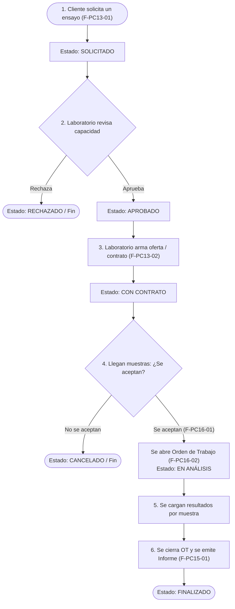

# Manual de Usuario — Guía Práctica del Sistema CTM

Esta guía práctica explica, con lenguaje claro y paso a paso, cómo utilizar la plataforma del **Centro Tecnológico del Mueble (CTM)** (`oficina.ctmueble.com.ar` conectado a `gestion.ctmueble.com.ar`) para gestionar empresas, clientes, solicitudes de ensayo, contratos, recepción de muestras, carga de resultados e informes finales.

No requiere conocimientos informáticos avanzados: cada capítulo indica qué pantalla abrir, qué datos completar y qué resultado debería obtenerse al confirmar.

---

## Capítulo 1 — Conozca el Sistema

### 1.1. Para qué sirve esta guía

Esta guía acompaña de punta a punta el recorrido operativo de un ensayo de laboratorio: desde que un cliente solicita el análisis de un producto o tablero hasta que el laboratorio emite el informe técnico oficial, pasando por la revisión técnica, el contrato de servicio, la recepción física de las muestras, la orden de trabajo y la carga de resultados analíticos.

### 1.2. Tipos de usuario

| Perfil | Qué puede hacer en el sistema |
| :--- | :--- |
| **Cliente (`CLIENT`)** | Registrar y administrar sus propias empresas, domicilios y contactos; solicitar ensayos; revisar y confirmar contratos/términos; consultar el estado de sus trámites y descargar los documentos PDF que le correspondan. |
| **Personal de Laboratorio (`LABORATORY`)** | Revisar y aprobar o rechazar solicitudes; generar ofertas/contratos de servicio; administrar la agenda compartida de clientes; recibir muestras y abrir órdenes de trabajo; cargar mediciones analíticas; emitir y rectificar informes oficiales; configurar parámetros institucionales del laboratorio y consultar el historial completo de auditoría. |

> [!NOTE]
> Si su cuenta posee permisos tanto de cliente como de laboratorio, el sistema le permitirá alternar entre **modo cliente** y **modo laboratorio** según la tarea que necesite realizar.

### 1.3. Recorrido de un ensayo de punta a punta

Un trámite también puede pasar a **Cancelado** si el solicitante o el laboratorio deciden detenerlo antes de su finalización, o si las muestras recibidas no cumplen las condiciones técnicas requeridas.

### 1.4. Documentos que genera el sistema

| Formulario | Nombre del documento | Cuándo se genera |
| :--- | :--- | :--- |
| `F-PC13-01` | **Solicitud de ensayo** | Al confirmar el pedido inicial del ensayo |
| `F-PC13-02` | **Contrato de servicio / Oferta** | Al fijar costos, plazos y condiciones del servicio |
| `F-PC16-01` | **Registro de recepción de muestras** | Al registrar y aceptar físicamente las probetas ingresadas |
| `F-PC16-02` | **Orden de trabajo** | Durante la etapa interna de ejecución analítica en laboratorio |
| `F-PC15-01` | **Informe de ensayo** | Al cerrar la orden de trabajo y emitir los resultados oficiales |

Todos estos documentos pueden consultarse y descargarse en formato PDF desde el detalle de cada ensayo (ver **Capítulo 11**).

---

## Capítulo 2 — Cómo Ingresar al Sistema

### 2.1. Qué necesita antes de empezar

- Un **usuario (correo electrónico) y contraseña** activos (registrados como cliente o habilitados por el administrador del laboratorio).
- Conexión a **internet**.
- Un navegador web actualizado (Google Chrome, Mozilla Firefox o Microsoft Edge).
- Acceso a la dirección web del sistema: `oficina.ctmueble.com.ar`.

### 2.2. Iniciar sesión

1. Abra la aplicación en su navegador e ingrese a la pantalla de **Inicio de sesión**.
2. Escriba su **correo electrónico** y su **contraseña**.
3. Haga clic en **Ingresar**.
4. Si su cuenta tiene **verificación en dos pasos (2FA)** activada, ingrese el código temporal de 6 dígitos (de su aplicación autenticadora o correo) o un código de recuperación.

**Resultado esperado:** Accederá al panel principal del sistema con los menús habilitados según su perfil activo.

### 2.3. Elegir laboratorio y tipo de acceso

Si su usuario pertenece a más de un laboratorio o cuenta con acceso dual (cliente y laboratorio):

1. Diríjase a su perfil de usuario o al selector de contexto en la barra superior/lateral.
2. Elija el **laboratorio** activo con el que trabajará durante la sesión.
3. Si corresponde, cambie entre **modo cliente** y **modo laboratorio**.

> [!NOTE]
> Las acciones de revisión de solicitudes, armado de contratos, recepción de muestras, carga de resultados, emisión de informes y configuración institucional del laboratorio solo están disponibles en **modo laboratorio**.

### 2.4. Cerrar sesión

Cuando finalice sus tareas, utilice la opción **Salir / Cerrar sesión** del menú de usuario para revocar las credenciales activas en ese equipo. Si el sistema detecta inactividad prolongada o expiración de sesión, deberá volver a ingresar con su correo y contraseña.

### 2.5. Si no puede ingresar (problemas habituales de acceso)

| Qué le ocurre | Qué puede estar pasando | Qué hacer |
| :--- | :--- | :--- |
| Usuario o contraseña incorrectos | Error de tipeo o bloqueo de mayúsculas activado | Verifique los datos y vuelva a intentar; si olvidó su clave, utilice la opción **Recuperar contraseña**. |
| Mensaje de demasiados intentos | Se superó el límite temporal de seguridad (`rate limit`) | Aguarde unos minutos antes de reintentar el ingreso. |
| Falta verificación de correo | Cuenta recién creada o invitada aún no validada | Revise su bandeja de entrada e ingrese el código OTP o haga clic en el enlace de activación. |
| No ve menús técnicos | Se encuentra operando en **modo cliente** | Cambie al **modo laboratorio** desde el selector de perfil si dispone del permiso. |
| La sesión se cierra automáticamente | Expiró el tiempo máximo de sesión | Vuelva a iniciar sesión con sus credenciales. |

---

## Capítulo 3 — Configuración General del Laboratorio

### 3.1. Qué datos se pueden configurar

El sistema almacena los **datos institucionales del laboratorio** que se imprimen automáticamente en solicitudes, contratos e informes oficiales: razón social, CUIT, domicilio legal, localidad, provincia, datos de presidencia, director técnico/de laboratorio, datos bancarios para pagos e incertidumbre declarada de medición (`UNCERTAINTY`), entre otros.

Estos parámetros pertenecen al **CTM / laboratorio emisor**, no a las empresas clientes.

> [!NOTE]
> Solo el **personal de laboratorio** con permiso habilitado puede consultar y modificar esta configuración.

### 3.2. Dónde encontrar la configuración

1. Ingrese con su usuario en **modo laboratorio**.
2. Acceda al menú **Configuración** y seleccione la sección de **Datos del laboratorio / Variables del sistema**.

### 3.3. Ver los datos actuales

En pantalla visualizará la lista completa de variables institucionales con su descripción, tipo de dato (texto, número, decimal o fecha) y valor vigente. Es recomendable revisarlos periódicamente antes de emitir contratos o informes finales.

### 3.4. Modificar un dato

1. Seleccione la variable que necesita actualizar (por ejemplo, teléfono, CBU, director o incertidumbre).
2. Ingrese el **nuevo valor** respetando el formato correspondiente (texto, entero, decimal o timestamp).
3. Guarde los cambios.

**Resultado esperado:** Todos los documentos PDF generados *a partir de ese momento* mostrarán el valor actualizado. Los documentos ya emitidos y firmados anteriormente conservan sus datos originales sin alterarse.

### 3.5. Agregar un dato nuevo

Si su rol lo permite, puede crear una variable adicional definiendo un identificador, una etiqueta descriptiva, el tipo de dato y su valor inicial. Utilice esta funcionalidad únicamente cuando el procedimiento del laboratorio lo requiera.

### 3.6. Quitar un dato personalizado

Solo pueden eliminarse variables personalizadas creadas por usuarios (`hardcoded = false`). Las variables base obligatorias del laboratorio (como razón social, CUIT, domicilio, autoridades, banco y director) están protegidas y el sistema impide borrarlas.

### 3.7. Listado de datos institucionales base

| Variable / Dato | Uso principal en el sistema |
| :--- | :--- |
| **Razón social del laboratorio** (`SOCIAL_NAME`) | Encabezados y membresía oficial de formularios PDF |
| **CUIT del laboratorio** (`CUIT`) | Contratos de servicio e informes de ensayo |
| **Domicilio, localidad y provincia** (`LOCAL_ADDRESS`, `LOCATION`, `PROVINCE`) | Pie y cabecera de documentos oficiales |
| **Presidente y DNI** (`PRESIDENT`, `PRESIDENT_DNI`) | Firma contractual institucional en `F-PC13-02` |
| **Banco, cuenta corriente y CBU** (`BANK`, `BANK_CC`, `BANK_CBU`) | Condiciones e instrucciones de pago |
| **Director del laboratorio** (`LAB_DIRECTOR`) | Aprobación y firma de informes oficiales `F-PC15-01` |
| **Incertidumbre de medición** (`UNCERTAINTY`) | Cálculo e información analítica en órdenes e informes |
| **Teléfono y correo del laboratorio** (`LAB_PHONE`, `LAB_MAIL`) | Datos de contacto institucional en formularios |

### 3.8. Cómo afectan los cambios a los documentos

Cada documento oficial emitido toma la información puntual del ensayo combinada con los valores vigentes de estas variables del laboratorio en ese instante. Por ello, verifique que se encuentren al día antes de emitir contratos o informes.

---

## Capítulo 4 — Clientes y Empresas

> [!IMPORTANT]
> Para solicitar un ensayo (**Capítulo 5**) es necesario tener cargado un cliente válido. Si aún no existe, complete primero los pasos de este capítulo (o hágalo durante el asistente de creación).

### 4.1. Conceptos básicos

| Término | Significado operativo en el sistema |
| :--- | :--- |
| **Empresa** | Persona jurídica o entidad identificada de manera única por su **CUIT** (11 dígitos) y razón social. |
| **Dirección** | Domicilio físico de operaciones o facturación (calle/número, localidad, provincia/distrito y país). Una empresa puede tener múltiples domicilios. |
| **Persona** | Individuo con nombre completo, DNI, correo y teléfono: puede actuar como **representante legal** o **contacto** del ensayo. |
| **Cliente** | Combinación operativa de **Empresa + Dirección + Representante/Contacto + Datos de facturación**, lista para solicitar ensayos. |
| **Snapshot / Registro histórico** | Al confirmar un ensayo, el sistema guarda una copia inmutable de los datos del cliente tal como estaban ese día; si luego se actualiza el cliente, los ensayos históricos no se alteran retroactivamente. |

### 4.2. Buscar una empresa por CUIT

1. Ingrese al módulo de **Empresas** o **Clientes**.
2. Escriba el **CUIT** de 11 dígitos (sin guiones ni espacios) o parte de la razón social.
3. Presione **Buscar**.

Si la empresa ya existe en la plataforma, visualizará su razón social, direcciones registradas y fichas de cliente asociadas.

### 4.3. Autocompletado auxiliar opcional desde Padrón A13 de ARCA/AFIP

> [!NOTE]
> La conexión con **ARCA/AFIP (Padrón A13)** es **exclusivamente un servicio auxiliar opcional para el autocompletado de datos de clientes**. **No es necesario tenerlo activado** para operar el sistema: si no se encuentra habilitado, siempre es posible registrar y editar empresas y clientes de manera completamente manual (ver **sección 4.4**).

Cuando este servicio auxiliar esté activado por el administrador del sistema (mediante la variable `ARCA_CUIT` y el certificado/clave privada delegados para `ws_sr_padron_a13` en `ARCA_CERT_BASE64`/`ARCA_KEY_BASE64` o `ARCA_CERT_FILE`/`ARCA_KEY_FILE`):

1. Ingrese el **CUIT** en el buscador de empresas.
2. Seleccione la opción **Sincronizar / Autocompletar desde ARCA (Padrón A13)**.
3. El sistema consultará el padrón oficial y completará automáticamente la razón social y el domicilio fiscal disponible para agilizar la carga.

Si el servicio opcional no está habilitado o si el CUIT no devuelve datos fiscales automáticos, utilice sin inconvenientes el alta manual descrita a continuación.

### 4.4. Cargar una empresa a mano

1. Seleccione **Crear empresa** / **Carga manual**.
2. Ingrese el **CUIT** (11 dígitos) y la **razón social**.
3. Confirme para guardar la empresa en el sistema.

### 4.5. Administrar direcciones

Con la empresa seleccionada, puede:

- **Agregar** una dirección nueva (domicilio/calle, localidad, provincia y país).
- **Modificar** una dirección existente si la empresa cambió de sede o planta.
- **Quitar** una dirección en desuso cuando no esté comprometida por trámites activos.

### 4.6. Representantes y contactos

- **Representante legal (opcional según caso):** Persona autorizada que suscribe acuerdos en nombre de la empresa.
- **Contacto del ensayo (obligatorio al solicitar ensayos):** Persona con la cual el laboratorio mantendrá comunicación operativa y recibirá notificaciones del trámite.

Para gestionarlos:

1. Complete nombre completo, DNI, correo electrónico y teléfono (con código de país).
2. Si la persona ya fue cargada previamente, búsquela y selecciónela para evitar duplicados.
3. Si necesita vincular contactos adicionales al cliente, agréguelos desde la ficha del cliente.

### 4.7. Dar de alta un cliente completo

1. Indique el **CUIT** de la empresa (buscándola previamente o creándola en forma manual / con autocompletado auxiliar ARCA si está activo).
2. Elija la **dirección** operativa correspondiente.
3. Asocie al **representante legal**, si aplica.
4. Asocie al **contacto principal**.
5. Revise o complete los **datos de facturación** (ver **sección 4.8**).
6. Presione **Guardar cliente**.

**Resultado esperado:** El cliente queda listo para ser seleccionado en cualquier nueva solicitud de ensayo.

### 4.8. Datos de facturación distintos

Cuando la facturación deba emitirse a un CUIT o domicilio distinto al de la sede operativa del solicitante, cargue en la ficha:

- **CUIT de facturación** alternativo.
- **Dirección, localidad y provincia de facturación**.
- Condición frente al **IVA** (si tributa IVA o no).

Estos datos podrán reutilizarse automáticamente al generar nuevas solicitudes de ensayo.

### 4.9. Buscar, modificar o quitar clientes

- **Buscar:** Filtre por razón social, CUIT, nombre de fantasía o correo en el listado de clientes.
- **Modificar:** Ingrese al detalle del cliente, actualice domicilio, contactos o facturación y guarde.
- **Quitar / Desvincular:** Solo permitido cuando las reglas del sistema validan que no se afecta la integridad de trámites en curso.

### 4.10. Clientes agendados (favoritos del laboratorio)

El personal en **modo laboratorio** puede agregar clientes frecuentes a la **agenda compartida del laboratorio** para localizarlos con un clic al crear solicitudes o presupuestos en nombre de terceros.

---

## Capítulo 5 — Pedir un Ensayo

### 5.1. Quién puede pedir un ensayo

Tanto un **Cliente (`CLIENT`)** como el **Personal de Laboratorio (`LABORATORY`)** pueden iniciar una solicitud. El cliente debe estar previamente cargado (ver **Capítulo 4**) o crearse durante el asistente. Al confirmar el envío, el trámite toma el estado **Solicitado** y genera el comprobante **`F-PC13-01` — Solicitud de ensayo**.

### 5.2. Paso 1: Entrar al área de ensayos

1. En el menú principal, haga clic en **Ensayos**.
2. Utilice los filtros por código diario, estado, cliente o rango de fechas para consultar trámites existentes.

### 5.3. Paso 2: Comenzar una solicitud nueva

Presione el botón **Nueva solicitud** o **Crear ensayo** para abrir el formulario guiado de alta.

### 5.4. Paso 3: Indicar el cliente

- **Si el cliente ya está registrado:** Busque por CUIT o nombre de empresa y selecciónelo de la lista.
- **Si el cliente aún no existe:** Ingrese el CUIT, cree la empresa manualmente (o use el autocompletado auxiliar ARCA A13 si se encuentra habilitado), complete dirección, contacto y datos de facturación y continúe.

> [!NOTE]
> Al confirmar la solicitud, el sistema captura una **copia histórica (snapshot)** de los datos del cliente y de su representante en ese momento, garantizando que el documento emitido no cambie si la ficha del cliente se edita en el futuro.

### 5.5. Paso 4: Elegir con quién hablará el laboratorio

1. Seleccione la **persona de contacto** asignada para este ensayo (o marque que el contacto adicional asume el seguimiento).
2. Verifique que el correo electrónico y número telefónico estén actualizados, ya que allí llegarán los avisos automáticos de avance.

### 5.6. Paso 5: Elegir qué tipo de ensayo se necesita

1. Despliegue el catálogo de **Tipos de ensayo**.
2. Seleccione el análisis técnico requerido (por ejemplo: *Determinación de emisión de formaldehído según instrucción IT17-01*).

### 5.7. Paso 6: Describir el producto o material

Complete los datos de los elementos/tableros a ensayar (puede seleccionar o reutilizar **plantillas de elementos** guardadas):

| Campo | Obligatorio | Descripción |
| :--- | :---: | :--- |
| **Producto o material** | Sí | Denominación, fabricante/productor, tipo de tablero y país de origen. |
| **Fecha del producto** | Sí | Fecha de fabricación o referencia del lote presentado. |
| **Cantidad estimada de muestras** | Sí | Cantidad estimada de probetas que se enviarán al laboratorio. |
| **Número de lote** | No | Código de lote o partida de fabricación, si aplica. |

### 5.8. Paso 7: Escribir observaciones

Utilice el campo de observaciones para registrar aclaraciones técnicas o comerciales relevantes: condiciones especiales de manipuleo, urgencias, referencias internas del cliente o acuerdos previos.

### 5.9. Paso 8: Completar datos de facturación

| Dato | Obligatorio | Detalle |
| :--- | :---: | :--- |
| **CUIT / Razón social a facturar** | Sí | Empresa válida cargada en el sistema. |
| **Dirección de facturación** | Según caso | Se precarga de la ficha del cliente si ya estaba definida. |
| **Importe / Presupuesto** | No | No lo fija el cliente: lo establece el laboratorio al preparar el contrato (`F-PC13-02`). |
| **¿Tributa IVA?** | Sí | Indique si corresponde tributar IVA en la facturación. |

### 5.10. Paso 9: Revisar y confirmar

1. Revise el resumen completo de cliente, contacto, elementos y facturación.
2. Si detecta algún error, regrese al paso correspondiente y corríjalo.
3. Presione **Confirmar / Enviar solicitud**.

### 5.11. Qué obtiene al finalizar

- El ensayo queda en estado **Solicitado** pendiente de revisión técnica del laboratorio.
- El sistema asigna automáticamente un **código diario atómico único** (formato fecha Argentina + sufijo alfabético secuencial, por ejemplo `20261119A`) para seguimiento y trazabilidad.
- Queda disponible para descarga el PDF **`F-PC13-01` — Solicitud de ensayo**.

---

## Capítulo 6 — Revisar y Decidir Sobre la Solicitud

*Este capítulo aplica al **Personal de Laboratorio (`LABORATORY`)**.*

### 6.1. Cuándo puede evaluarse una solicitud

Solo las solicitudes en estado **Solicitado** (pendientes de revisión de capacidad y recursos) pueden ser aprobadas o rechazadas.

### 6.2. Aprobar la solicitud

1. Abra la solicitud desde la bandeja de **Ensayos**.
2. Verifique cliente, contacto, tipo de ensayo, elementos declarados y datos de facturación.
3. Presione **Aprobar**.

**Resultado esperado:** El ensayo avanza al estado **Aprobado / En condiciones de cotizar**, habilitando la generación del presupuesto/contrato (ver **Capítulo 7**).

### 6.3. Rechazar la solicitud

1. Abra la solicitud pendiente.
2. Registre claramente el **motivo técnico o de capacidad** en las observaciones.
3. Presione **Rechazar**.

**Resultado esperado:** El ensayo pasa a estado **Rechazado**, se notifica según configuración y el trámite finaliza sin avanzar a contrato ni laboratorio.

### 6.4. Cancelar un trámite

Si posteriormente se resuelve discontinuar un ensayo ya iniciado o aceptado, el usuario autorizado puede ejecutar la acción de **Cancelación** indicando el motivo correspondiente. El estado pasará a **Cancelado** con registro obligatorio en la auditoría.

---

## Capítulo 7 — Armar el Contrato de Servicio

*Esta etapa formaliza el presupuesto y acuerdo comercial antes del envío de muestras.*

### 7.1. Qué se necesita antes

- La solicitud debe haber sido **aprobada**.
- Debe operar en **modo laboratorio** con el permiso habilitado.

### 7.2. Paso 1: Abrir la solicitud aprobada

1. Ingrese a **Ensayos** y filtre las solicitudes listas para presupuestar/contratar.
2. Abra el detalle del ensayo correspondiente.

### 7.3. Paso 2: Completar plazos y precio

| Parámetro contractual | Qué representa |
| :--- | :--- |
| **Plazo de ejecución (días)** | Cantidad de días corridos/hábiles comprometidos para ejecutar el ensayo y emitir el informe tras la recepción. |
| **Precio / Costo del servicio** | Importe económico acordado con el solicitante. |
| **Fecha o plazo de pago** | Condición de vencimiento de pago del servicio. |
| **Días de conservación de muestras** | Tiempo durante el cual el laboratorio custodiará muestras/contramuestras tras finalizar el análisis. |

### 7.4. Paso 3: Generar el contrato

1. Verifique que todos los importes y plazos cargados sean correctos.
2. Presione **Generar oferta / contrato**.
3. El cliente podrá visualizar las condiciones y confirmar su aceptación (pasando a **Contrato aceptado / Con contrato**).

### 7.5. Paso 4: Comprobar que quedó registrado

- El sistema genera automáticamente el documento **`F-PC13-02` — Contrato / Condiciones de servicio**.
- El PDF del contrato queda disponible para visualización y descarga en el detalle del ensayo.
- Queda habilitada la instancia física de **recepción de muestras** (**Capítulo 8**).

---

## Capítulo 8 — Recibir las Muestras en el Laboratorio

### 8.1. Qué se necesita antes

- Contrato de servicio aceptado y vigente (**Con contrato**).
- Lote físico de probetas/tableros recibido en el laboratorio.
- Usuario en **modo laboratorio**.

### 8.2. Paso 1: Encontrar el ensayo correspondiente

Busque el trámite en **Ensayos** utilizando el código diario de seguimiento, nombre de la empresa o CUIT.

### 8.3. Paso 2: Abrir la pantalla de recepción

Dentro del detalle del ensayo, seleccione la acción **Recepcionar muestras**.

### 8.4. Paso 3: Decidir si se aceptan o no

Inspeccione físicamente las probetas (identificación, embalaje, integridad de bordes, dimensiones mínimas y cantidad acorde a la instrucción técnica `IT16-01`) e indique si **se aceptan** o **no se aceptan**.

### 8.5. Paso 4a: Si no se aceptan las muestras

1. Seleccione **No se aceptan (`accepted = false`)**.
2. Escriba detalladamente el **motivo del rechazo físico** en las observaciones (muestras dañadas, humedad excesiva, cantidad insuficiente, falta de identificación).
3. Confirme la operación.

> [!WARNING]
> Si las muestras no son aceptadas, el ensayo queda automáticamente **Cancelado** y no se crea ninguna Orden de Trabajo ni se cargan muestras analizables.

### 8.6. Paso 4b: Si se aceptan — cuántas hay

| Campo | Qué indicar |
| :--- | :--- |
| **Cantidad de muestras** | Número de probetas que ingresarán al ensayo técnico principal. |
| **Cantidad de contramuestras** | Número de probetas que quedarán en reserva sin ensayar en primera instancia (puede ser `0`). |

Debe registrarse **al menos una muestra o una contramuestra** aceptada.

### 8.7. Paso 5: Medidas y observaciones

Si el procedimiento del ensayo lo requiere, complete:

- **Dimensiones físicas:** alto, ancho y espesor de las piezas (en centímetros).
- **Acondicionamiento:** si las probetas requieren acondicionamiento previo especial.
- **Observaciones de recepción:** cualquier anomalía menor o nota registrada al abrir el paquete.

### 8.8. Paso 6: Confirmar la recepción

Revise las cantidades y observaciones ingresadas y presione **Confirmar recepción**.

### 8.9. Qué hace el sistema automáticamente

Al confirmar una recepción aceptada, el sistema ejecuta de forma atómica:

1. Crea la **Orden de Trabajo** con su código diario único (`F-PC16-02`).
2. Calcula la **fecha límite de entrega del informe** sumando los días comprometidos en el contrato.
3. Genera e identifica correlativamente cada **muestra** y **contramuestra**.
4. Cambia el estado del ensayo a **En trabajo / En análisis**.
5. Habilita la descarga del comprobante PDF **`F-PC16-01` — Registro de recepción de muestras**.
6. Registra el evento en la auditoría inmutable del ensayo y de la orden de trabajo.

---

## Capítulo 9 — Cargar los Resultados del Ensayo

### 9.1. Qué se necesita antes

- Orden de Trabajo creada con sus muestras registradas.
- Ensayo en estado **En análisis / En trabajo**.
- Usuario en **modo laboratorio**.

### 9.2. Paso 1: Abrir la orden de trabajo

1. Ingrese al menú **Órdenes de trabajo** (o acceda desde el ensayo vinculado).
2. Busque por código de orden o código de ensayo.
3. Abra el detalle de la orden.

### 9.3. Paso 2: Ver las muestras recibidas

Visualizará la grilla de muestras asociadas con su código interno identificatorio, indicación de si es contramuestra, dimensiones cargadas y estado actual (*pendiente* o *analizada*).

### 9.4. Paso 3: Escribir el resultado de cada muestra

1. Para cada muestra ya medida en el banco de ensayo, ingrese el **valor numérico del resultado** obtenido.
2. Complete tantas muestras como hayan sido analizadas hasta ese momento.

> [!TIP]
> Puede guardar resultados de forma parcial por tandas y completar el resto de las muestras más adelante, siempre antes de cerrar la orden y emitir el informe.

### 9.5. Paso 4: Guardar los resultados

1. Verifique los valores numéricos ingresados.
2. Presione **Guardar resultados**.

**Resultado esperado:** El sistema registra el resultado de cada muestra, calcula automáticamente el **promedio analítico** de la orden de trabajo (junto con el cálculo de incertidumbre/clasificación aplicable) y deja traza en el historial de auditoría.

### 9.6. Qué controles realiza el sistema

- Solo admite cargar resultados en muestras pertenecientes a esa Orden de Trabajo y que no hayan sido bloqueadas por cierre definitivo.
- Valida estrictamente que los valores sean numéricos válidos.
- Restringe la operación exclusivamente al personal de laboratorio autorizado.

---

## Capítulo 10 — Emitir el Informe Final

### 10.1. Qué se necesita antes

- Tener cargados resultados válidos en **al menos dos muestras** dentro de la orden de trabajo (requisito mínimo de validación analítica del laboratorio).
- Haber revisado el promedio, las observaciones técnicas y los datos institucionales del **Capítulo 3**.
- Operar en **modo laboratorio** con permiso de emisión.

### 10.2. Paso 1: Revisar que todo esté completo

1. Abra la Orden de Trabajo o el detalle del ensayo.
2. Compruebe que todas las muestras requeridas cuenten con su resultado.
3. Verifique las notas técnicas, clasificación (`E1`/`E2` cuando aplique) y las variables de firma (`LAB_DIRECTOR`).

### 10.3. Paso 2: Cerrar la orden y emitir el informe

1. Presione **Cerrar orden / Emitir informe** desde la Orden de Trabajo o desde el detalle del ensayo.
2. Confirme la operación definitiva.

**Resultado esperado:** El sistema genera el informe oficial **`F-PC15-01` — Informe de ensayo**, sella criptográficamente el **snapshot de integridad** (`RSA-SHA256` + OpenTimestamps), cierra la orden, pasa el ensayo a estado **Finalizado / Completado** y notifica al cliente según sus preferencias.

### 10.4. Paso 3: Descargar el informe

Acceda a la pestaña o sección **Documentos** del ensayo para visualizar y descargar el PDF del informe emitido (**Capítulo 11**).

### 10.5. Si hay que volver a emitir o hacer una copia

- **Copia certificada:** Permite descargar o emitir copias identificadas del informe oficial vigente.
- **Modificación / Fe de erratas (`MODIFICATION`):** Cuando deba corregirse algún dato posterior a la emisión inicial, la reemisión controlada genera una nueva versión trazada y rotulada expresamente como informe modificado/reemitido, conservando el historial de versiones previas.

---

## Capítulo 11 — Documentos y Descargas

### 11.1. Qué documentos puede encontrar

| Código | Documento | Etapa en la que aparece |
| :--- | :--- | :--- |
| `F-PC13-01` | Solicitud de ensayo | Solicitud inicial |
| `F-PC13-02` | Contrato / Acuerdo de servicio | Presupuestación y aceptación |
| `F-PC16-01` | Registro de recepción de muestras | Ingreso físico aceptado |
| `F-PC16-02` | Orden de trabajo | Trabajo interno de laboratorio |
| `F-PC15-01` | Informe de ensayo | Emisión final / rectificación |

### 11.2. Ver los papeles de un ensayo

1. Abra el ensayo desde el listado general.
2. Ingrese a la pestaña o bloque **Documentos**.
3. Visualizará el listado de documentos disponibles junto con su tipo, fecha/hora de generación, versión y botón de descarga.

### 11.3. Descargar un documento

1. Haga clic en **Descargar** sobre el documento deseado.
2. El navegador descargará automáticamente el archivo PDF generado.

> [!NOTE]
> Por seguridad y control de carga, el sistema aplica un límite de descargas reiteradas en intervalos cortos (`rate limit`). Si alcanza dicho tope, aguarde unos minutos antes de volver a descargar.

### 11.4. Buscar un documento por su tipo

Desde las acciones rápidas del ensayo o los filtros de descarga puede solicitar directamente un tipo específico de formulario (por ejemplo, **Descargar Informe** o **Descargar Contrato**) sin tener que buscar en toda la lista.

### 11.5. Dónde se guardan los archivos

Los documentos se generan dinámicamente bajo demanda (*on-the-fly*) con la plantilla oficial vigente y pueden resguardarse en el almacenamiento en la nube (**Cloudflare R2**) o almacenamiento configurado del laboratorio, estando siempre accesibles para usuarios autorizados desde el detalle del ensayo.

### 11.6. Vista previa antes de imprimir

El personal de laboratorio puede previsualizar el renderizado del formulario antes de consolidar la emisión definitiva para revisar encabezados, firma institucional y tabla de resultados.

---

## Capítulo 12 — Historial y Seguimiento

### 12.1. Ver qué pasó con un ensayo

1. Ingrese al detalle del ensayo.
2. Seleccione la sección **Historial / Auditoría**.
3. Consultará la línea cronológica completa con usuario responsable, acción ejecutada, fecha/hora exacta (zona horaria Argentina) y observaciones registradas.

### 12.2. Ver qué pasó con una orden de trabajo

Dentro del detalle de cada Orden de Trabajo existe un historial equivalente centrado en la recepción de probetas, carga y ajuste de mediciones por muestra y cierre técnico de la orden.

### 12.3. Acciones que quedan registradas

| Acción auditada | Qué refleja |
| :--- | :--- |
| **Solicitud creada** | Alta del pedido de ensayo y snapshot inicial de datos del cliente |
| **Solicitud aprobada / rechazada** | Decisión técnica de capacidad del laboratorio |
| **Contrato generado / aceptado** | Fijación de precio/plazos y aceptación contractual |
| **Muestras recepcionadas / rechazadas** | Ingreso físico, dimensiones, cantidades o motivo de rechazo |
| **Resultados cargados** | Registro o actualización de mediciones numéricas y promedio |
| **Informe emitido / modificado** | Emisión definitiva `F-PC15-01` y generación de snapshot firmado |
| **Ensayo cancelado** | Detención formal del trámite con motivo asentado |
| **Cambio de cliente asociado** | Actualización controlada del cliente vinculado al ensayo |

---

## Capítulo 13 — Problemas Frecuentes

| Qué le ocurre | Por qué puede pasar | Qué hacer |
| :--- | :--- | :--- |
| No puede realizar una acción técnica | Su cuenta está operando en modo cliente o falta un permiso granular | Cambie al **modo laboratorio** o solicite al administrador la asignación del permiso en `/laboratory/users`. |
| No encuentra una empresa por CUIT | Aún no fue cargada en el sistema o no está activo el autocompletado auxiliar ARCA | Cárguela manualmente (**sección 4.4**) o utilice la sincronización ARCA si está habilitada. |
| No puede crear el ensayo | No seleccionó un cliente ni completó uno nuevo en el asistente | Complete primero los datos de empresa, dirección y contacto (**sección 4.7**). |
| No puede generar el contrato | La solicitud aún no fue aprobada | Apruebe primero la solicitud pendiente (**Capítulo 6**). |
| No puede recepcionar muestras | Todavía no existe un contrato vigente/aceptado | Genere y confirme el contrato de servicio (**Capítulo 7**). |
| No puede emitir el informe final | Hay menos de dos muestras con resultado cargado | Cargue resultados numéricos válidos en al menos dos muestras (**Capítulo 9**). |
| El sistema solicita aguardar | Límite temporal de seguridad (`rate limit`) por peticiones seguidas | Espere unos minutos antes de reintentar la operación o descarga. |
| Un nuevo PDF muestra datos viejos del laboratorio | Las variables institucionales del laboratorio no se actualizaron | Actualice la configuración en **Datos del laboratorio** (**Capítulo 3**) antes de emitir. |

---

## Capítulo 14 — Glosario de Palabras del Sistema

| Término | Significado práctico |
| :--- | :--- |
| **CUIT** | Clave Única de Identificación Tributaria de 11 dígitos que identifica a cada empresa u organización. |
| **Ensayo** | Trámite completo de evaluación técnica ante el laboratorio, desde la solicitud hasta el informe final. |
| **Solicitud** | Pedido formal inicial de ensayo registrado mediante `F-PC13-01`. |
| **Orden de Trabajo (OT)** | Instancia interna de ejecución operativa abierta en laboratorio al aceptar muestras (`F-PC16-02`). |
| **Muestra** | Unidad física o probeta enviada por el cliente sobre la que se ejecuta el ensayo analítico. |
| **Contramuestra** | Unidad física reservada y custodiada como respaldo sin ser ensayada en la instancia inicial. |
| **Código de seguimiento** | Código diario único secuencial (fecha Argentina + letras, ej. `20261119A`) asignado automáticamente. |
| **Snapshot** | Registro histórico congelado (datos de cliente al solicitar o prueba criptográfica `RSA-SHA256` del informe). |
| **Historial / Auditoría** | Registro cronológico e inmutable que detalla quién ejecutó cada acción, cuándo y con qué observaciones. |

---

## Capítulo 15 — Listas de Control Rápido

### Al dar de alta un cliente
- [ ] CUIT de 11 dígitos verificado (carga manual o autocompletado auxiliar ARCA si está activo)
- [ ] Dirección operativa cargada (calle, localidad, provincia y país)
- [ ] Representante legal y contacto principal revisados (email y teléfono correctos)
- [ ] Datos de facturación y condición frente al IVA confirmados

### Al pedir un ensayo
- [ ] Cliente seleccionado o creado correctamente
- [ ] Persona de contacto para el seguimiento elegida
- [ ] Tipo de ensayo y datos del producto/lote completados
- [ ] Observaciones y datos de facturación revisados
- [ ] Comprobante `F-PC13-01` descargado o verificado

### Contrato y recepción de muestras
- [ ] Solicitud evaluada y aprobada por el laboratorio
- [ ] Contrato `F-PC13-02` generado y aceptado (precio, plazo y días de conservación)
- [ ] Muestras físicas inspeccionadas y recepcionadas (`F-PC16-01` y Orden de Trabajo `F-PC16-02`)

### Carga de resultados e informe final
- [ ] Resultados numéricos cargados en todas las muestras requeridas (mínimo 2)
- [ ] Promedio e incertidumbre revisados
- [ ] Orden de trabajo cerrada e Informe Final `F-PC15-01` emitido y descargado
