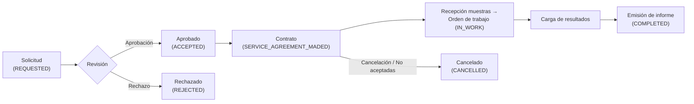

# Manual de usuario exhaustivo — Sistema de Gestión de Ensayos CTM

**Versión:** 1.0  
**Plataforma:** oficina.ctmueble.com.ar (frontend) + gestion.ctmueble.com.ar (backend)  
**Audiencia:** usuarios administrativos, clientes y personal de laboratorio

---

## Índice general

### Capítulo 1 — Introducción y alcance
- [1.1 Objetivo del manual](#11-objetivo-del-manual)
- [1.2 Perfiles de usuario](#12-perfiles-de-usuario)
- [1.3 Flujo general del ensayo](#13-flujo-general-del-ensayo)
- [1.4 Documentos generados por el sistema](#14-documentos-generados-por-el-sistema)

### Capítulo 2 — Inicio de sesión
- [2.1 Requisitos previos](#21-requisitos-previos)
- [2.2 Acceder al sistema](#22-acceder-al-sistema)
- [2.3 Selección de laboratorio y perfil](#23-selección-de-laboratorio-y-perfil)
- [2.4 Cierre de sesión y renovación de token](#24-cierre-de-sesión-y-renovación-de-token)
- [2.5 Problemas frecuentes de acceso](#25-problemas-frecuentes-de-acceso)

### Capítulo 3 — Configuración del sistema (variables de entorno)
- [3.1 Qué son las variables de entorno del sistema](#31-qué-son-las-variables-de-entorno-del-sistema)
- [3.2 Acceder al módulo de configuración](#32-acceder-al-módulo-de-configuración)
- [3.3 Consultar variables existentes](#33-consultar-variables-existentes)
- [3.4 Modificar una variable](#34-modificar-una-variable)
- [3.5 Agregar una variable personalizada](#35-agregar-una-variable-personalizada)
- [3.6 Eliminar una variable](#36-eliminar-una-variable)
- [3.7 Catálogo de variables predefinidas](#37-catálogo-de-variables-predefinidas)
- [3.8 Impacto en documentos PDF](#38-impacto-en-documentos-pdf)

### Capítulo 4 — Sistema de clientes y empresas
- [4.1 Conceptos: empresa, cliente, persona y snapshot](#41-conceptos-empresa-cliente-persona-y-snapshot)
- [4.2 Buscar empresa por CUIT](#42-buscar-empresa-por-cuit)
- [4.3 Autocompletado opcional de datos desde ARCA/AFIP](#43-autocompletado-opcional-de-datos-desde-arcaafip)
- [4.4 Crear empresa manualmente](#44-crear-empresa-manualmente)
- [4.5 Gestionar direcciones de la empresa](#45-gestionar-direcciones-de-la-empresa)
- [4.6 Gestionar representantes y contactos](#46-gestionar-representantes-y-contactos)
- [4.7 Alta de cliente completo](#47-alta-de-cliente-completo)
- [4.8 Datos de facturación alternativa](#48-datos-de-facturación-alternativa)
- [4.9 Buscar, editar y eliminar clientes](#49-buscar-editar-y-eliminar-clientes)
- [4.10 Clientes agendados (laboratorio)](#410-clientes-agendados-laboratorio)

### Capítulo 5 — Solicitud de ensayo
- [5.1 Cuándo y quién puede crear una solicitud](#51-cuándo-y-quién-puede-crear-una-solicitud)
- [5.2 Paso 1: Ingresar al módulo de ensayos](#52-paso-1-ingresar-al-módulo-de-ensayos)
- [5.3 Paso 2: Iniciar nueva solicitud](#53-paso-2-iniciar-nueva-solicitud)
- [5.4 Paso 3: Seleccionar o cargar el cliente](#54-paso-3-seleccionar-o-cargar-el-cliente)
- [5.5 Paso 4: Seleccionar contacto del ensayo](#55-paso-4-seleccionar-contacto-del-ensayo)
- [5.6 Paso 5: Elegir tipo de ensayo](#56-paso-5-elegir-tipo-de-ensayo)
- [5.7 Paso 6: Cargar datos del producto/material](#57-paso-6-cargar-datos-del-productomaterial)
- [5.8 Paso 7: Observaciones](#58-paso-7-observaciones)
- [5.9 Paso 8: Datos de facturación del ensayo](#59-paso-8-datos-de-facturación-del-ensayo)
- [5.10 Paso 9: Confirmar y generar solicitud](#510-paso-9-confirmar-y-generar-solicitud)
- [5.11 Resultado esperado y código de seguimiento](#511-resultado-esperado-y-código-de-seguimiento)

### Capítulo 6 — Evaluación de la solicitud (laboratorio)
- [6.1 Estados iniciales de la solicitud](#61-estados-iniciales-de-la-solicitud)
- [6.2 Aprobar una solicitud (ACCEPT)](#62-aprobar-una-solicitud-accept)
- [6.3 Rechazar una solicitud (REJECT)](#63-rechazar-una-solicitud-reject)
- [6.4 Cancelar un ensayo (CANCEL)](#64-cancelar-un-ensayo-cancel)

### Capítulo 7 — Generación de contrato
- [7.1 Requisitos previos](#71-requisitos-previos)
- [7.2 Paso 1: Abrir ensayo aprobado](#72-paso-1-abrir-ensayo-aprobado)
- [7.3 Paso 2: Definir términos del servicio](#73-paso-2-definir-términos-del-servicio)
- [7.4 Paso 3: Generar contrato F-PC13-02](#74-paso-3-generar-contrato-f-pc13-02)
- [7.5 Paso 4: Verificar estado y documento](#75-paso-4-verificar-estado-y-documento)

### Capítulo 8 — Recepción de muestras
- [8.1 Requisitos previos](#81-requisitos-previos)
- [8.2 Paso 1: Localizar el ensayo con contrato vigente](#82-paso-1-localizar-el-ensayo-con-contrato-vigente)
- [8.3 Paso 2: Ingresar a recepción de muestras](#83-paso-2-ingresar-a-recepción-de-muestras)
- [8.4 Paso 3: Decidir aceptación o rechazo](#84-paso-3-decidir-aceptación-o-rechazo)
- [8.5 Paso 4a: Si se rechazan — cancelación del ensayo](#85-paso-4a-si-se-rechazan--cancelación-del-ensayo)
- [8.6 Paso 4b: Si se aceptan — registrar cantidades](#86-paso-4b-si-se-aceptan--registrar-cantidades)
- [8.7 Paso 5: Dimensiones y acondicionamiento](#87-paso-5-dimensiones-y-acondicionamiento)
- [8.8 Paso 6: Confirmar recepción](#88-paso-6-confirmar-recepción)
- [8.9 Resultados automáticos del sistema](#89-resultados-automáticos-del-sistema)

### Capítulo 9 — Carga de resultados
- [9.1 Requisitos previos](#91-requisitos-previos)
- [9.2 Paso 1: Abrir la orden de trabajo](#92-paso-1-abrir-la-orden-de-trabajo)
- [9.3 Paso 2: Visualizar muestras registradas](#93-paso-2-visualizar-muestras-registradas)
- [9.4 Paso 3: Ingresar resultado por muestra](#94-paso-3-ingresar-resultado-por-muestra)
- [9.5 Paso 4: Guardar resultados](#95-paso-4-guardar-resultados)
- [9.6 Validaciones del sistema](#96-validaciones-del-sistema)

### Capítulo 10 — Emisión de informe
- [10.1 Requisitos previos](#101-requisitos-previos)
- [10.2 Paso 1: Verificar completitud de la orden](#102-paso-1-verificar-completitud-de-la-orden)
- [10.3 Paso 2: Cerrar orden y emitir informe](#103-paso-2-cerrar-orden-y-emitir-informe)
- [10.4 Paso 3: Descargar informe F-PC15-01](#104-paso-3-descargar-informe-f-pc15-01)
- [10.5 Emisiones posteriores: copias y modificaciones](#105-emisiones-posteriores-copias-y-modificaciones)

### Capítulo 11 — Gestión documental
- [11.1 Tipos de documento del sistema](#111-tipos-de-documento-del-sistema)
- [11.2 Consultar documentos de un ensayo](#112-consultar-documentos-de-un-ensayo)
- [11.3 Descargar un documento por ID](#113-descargar-un-documento-por-id)
- [11.4 Descargar documento por tipo](#114-descargar-documento-por-tipo)
- [11.5 Almacenamiento: local y Cloudflare R2](#115-almacenamiento-local-y-cloudflare-r2)
- [11.6 Previsualización de plantillas (laboratorio)](#116-previsualización-de-plantillas-laboratorio)

### Capítulo 12 — Auditoría y trazabilidad
- [12.1 Auditoría de ensayos](#121-auditoría-de-ensayos)
- [12.2 Auditoría de órdenes de trabajo](#122-auditoría-de-órdenes-de-trabajo)
- [12.3 Eventos principales registrados](#123-eventos-principales-registrados)

### Capítulo 13 — Errores frecuentes y resolución
### Capítulo 14 — Glosario
### Capítulo 15 — Checklist operativo por proceso

---

## Capítulo 1 — Introducción y alcance

### 1.1 Objetivo del manual

Este manual describe, paso a paso y con el detalle necesario para operar en producción, el **Sistema de Gestión de Ensayos del CTM** (Centro Tecnológico del Mueble). Cubre desde el ingreso al sistema hasta la emisión de informes y la gestión de documentos PDF asociados a cada ensayo.

### 1.2 Perfiles de usuario

| Perfil | Código | Operaciones principales |
|--------|--------|-------------------------|
| Cliente | `CLIENT` | Alta de clientes propios, solicitud de ensayos, consulta de estado y descarga de documentos autorizados |
| Laboratorio | `LABORATORY` | Aprobación/rechazo de solicitudes, contratos, recepción de muestras, carga de resultados, emisión de informes, configuración del sistema |

> **Nota:** Algunas pantallas requieren además seleccionar un **laboratorio activo** cuando el usuario pertenece a más de uno.

### 1.3 Flujo general del ensayo



Estados terminales alternativos: `REJECTED` (solicitud rechazada), `CANCELLED` (cancelación explícita o muestras no aceptadas).

### 1.4 Documentos generados por el sistema

| Código | Nombre | Momento de generación |
|--------|--------|------------------------|
| F-PC13-01 | Solicitud de ensayo | Al crear la solicitud |
| F-PC13-02 | Contrato de servicio | Al generar el contrato |
| F-PC16-01 | Registro de recepción de muestras | Al aceptar muestras |
| F-PC16-02 | Orden de trabajo | Según flujo operativo de laboratorio |
| F-PC15-01 | Informe de ensayo | Al emitir el informe |

---

## Capítulo 2 — Inicio de sesión

### 2.1 Requisitos previos

1. Contar con **usuario y contraseña** activos en el sistema.
2. Tener **acceso a internet** y un navegador actualizado (Chrome, Firefox o Edge recomendados).
3. Conocer la URL de la aplicación: **oficina.ctmueble.com.ar** (entorno productivo).

### 2.2 Acceder al sistema

1. Abrir la pantalla de **Inicio de sesión**.
2. Ingresar el **correo electrónico** registrado en el sistema.
3. Ingresar la **contraseña**.
4. Presionar **Ingresar** / **Confirmar**.

**Resultado esperado:** el sistema devuelve un token de acceso (JWT) y redirige al panel principal con los módulos habilitados según el perfil.

### 2.3 Selección de laboratorio y perfil

Si el usuario tiene acceso a más de un laboratorio o puede operar con distintos perfiles:

1. Ir a **Configuración de usuario** o al selector de laboratorio en la barra superior.
2. Elegir el **laboratorio activo** con el que se operará.
3. Si corresponde, usar **Cambiar perfil** (`CLIENT` / `LABORATORY`) según la tarea a realizar.

> Las operaciones de laboratorio (muestras, contratos, configuración) requieren perfil `LABORATORY`.

### 2.4 Cierre de sesión y renovación de token

- **Cerrar sesión:** usar la opción **Salir** del menú de usuario. El token de acceso queda invalidado.
- **Sesión expirada:** si aparece error de autenticación, cerrar sesión e ingresar nuevamente. El sistema también puede renovar el token automáticamente mediante *refresh token* si la sesión aún es válida.

### 2.5 Problemas frecuentes de acceso

| Situación | Causa probable | Acción |
|-----------|----------------|--------|
| Credenciales incorrectas | Usuario o contraseña erróneos | Verificar datos; solicitar restablecimiento al administrador |
| Demasiados intentos | Rate limit en login | Esperar unos minutos e intentar de nuevo |
| Acceso denegado a módulo | Perfil incorrecto | Cambiar a perfil `LABORATORY` o solicitar permisos |
| Token inválido | Sesión vencida | Cerrar sesión e ingresar nuevamente |

---

## Capítulo 3 — Configuración del sistema (variables de entorno)

### 3.1 Qué son las variables de entorno del sistema

Además de la configuración técnica del servidor (archivo `.env` del backend), el sistema mantiene **variables de entorno de negocio** en la base de datos (`environment_variables`). Estos valores se inyectan automáticamente en las **plantillas PDF** (contratos, informes, solicitudes) y definen datos institucionales del laboratorio.

**Ejemplos:** razón social, CUIT del laboratorio, domicilio, director, datos bancarios, incertidumbre de medición.

> Solo usuarios con perfil **LABORATORY** pueden consultar y modificar estas variables.

### 3.2 Acceder al módulo de configuración

1. Iniciar sesión con perfil **LABORATORY**.
2. Ir al módulo **Configuración** → **Variables de entorno** (equivalente API: `GET /env/fetch`).

### 3.3 Consultar variables existentes

1. En el listado de variables, revisar **identificador**, **etiqueta**, **tipo** y **valor actual**.
2. Para ver una variable puntual, seleccionarla o usar la búsqueda por ID (API: `GET /env/get?id=...`).

### 3.4 Modificar una variable

1. Seleccionar la variable a editar.
2. Ingresar el **nuevo valor** respetando el tipo de dato:
   - `TEXT` — texto libre
   - `NUMBER` — número entero
   - `DECIMAL` — número con decimales
   - `TIMESTAMP` — fecha y hora
3. Guardar cambios (API: `PUT /env/update?id=...` con body `{ "value": "..." }`).

**Resultado esperado:** los documentos generados **a partir de ese momento** incluirán el valor actualizado.

### 3.5 Agregar una variable personalizada

1. Presionar **Agregar variable**.
2. Completar: **ID** (identificador único), **etiqueta**, **tipo** y **valor inicial**.
3. Confirmar (API: `POST /env/add`).

> Las variables marcadas como `hardcoded: true` en el sistema no pueden eliminarse.

### 3.6 Eliminar una variable

1. Seleccionar la variable (debe ser **no hardcoded**).
2. Confirmar eliminación (API: `DELETE /env/delete?id=...`).

### 3.7 Catálogo de variables predefinidas

| ID | Etiqueta | Tipo | Uso |
|----|----------|------|-----|
| `SOCIAL_NAME` | Razón social del Laboratorio | TEXT | Encabezados de documentos |
| `CUIT` | CUIT del Laboratorio | TEXT | Contratos e informes |
| `LOCAL_ADDRESS` | Domicilio del laboratorio | TEXT | Pie de documentos |
| `LOCATION` | Localidad | TEXT | Datos institucionales |
| `PROVINCE` | Provincia | TEXT | Datos institucionales |
| `PRESIDENT` | Presidente de la institución | TEXT | Firmas y contratos |
| `PRESIDENT_DNI` | DNI del Presidente | TEXT | Contratos |
| `BANK` | Entidad bancaria | TEXT | Contratos |
| `BANK_CC` | Cuenta corriente | TEXT | Contratos |
| `BANK_CBU` | CBU | TEXT | Contratos |
| `UNCERTAINTY` | Incertidumbre | DECIMAL | Informes de ensayo |
| `LAB_DIRECTOR` | Director del Laboratorio | TEXT | Informes |
| `LAB_PHONE` | Teléfono del laboratorio | TEXT | Documentos |
| `LAB_MAIL` | Correo del laboratorio | TEXT | Documentos |

### 3.8 Impacto en documentos PDF

Al generar cualquier formulario (F-PC13-01, F-PC13-02, F-PC16-01, F-PC15-01, etc.), el sistema:

1. Obtiene todas las variables de entorno en modo `DATA`.
2. Las fusiona con los datos del ensayo en la plantilla Handlebars.
3. Renderiza el HTML y lo convierte a PDF.

**Recomendación:** validar los datos institucionales antes de emitir el primer contrato o informe del período.

---

## Capítulo 4 — Sistema de clientes y empresas

> **Referencia cruzada:** este capítulo debe consultarse durante la **carga de solicitud de ensayo** (Capítulo 5, pasos 3 y 4) cuando el cliente aún no existe o debe actualizarse.

### 4.1 Conceptos: empresa, cliente, persona y snapshot

| Concepto | Descripción |
|----------|-------------|
| **Empresa** (`bussiness`) | Entidad fiscal identificada por **CUIT** y razón social |
| **Dirección** (`bussiness_address`) | Domicilio operativo de la empresa; puede haber varias por CUIT |
| **Persona** (`persons`) | Representante legal, contacto o tercero con DNI, mail y teléfono |
| **Cliente** (`clients`) | Vínculo operativo: empresa + dirección + representante + contacto + facturación |
| **Snapshot** (`essays_client`) | Copia de los datos del cliente al momento de crear el ensayo; no se altera si el cliente cambia después |

### 4.2 Buscar empresa por CUIT

1. Ir a **Empresas / Clientes**.
2. Ingresar el **CUIT** (11 dígitos, con o sin guiones según la pantalla).
3. Presionar **Buscar**.

**Resultado esperado:** si la empresa existe, se muestran razón social, direcciones y clientes asociados.

### 4.3 Autocompletado opcional de datos desde ARCA/AFIP

> **Nota importante:** La conexión con ARCA/AFIP es un **sistema auxiliar opcional** destinado exclusivamente al autocompletado rápido de datos de clientes/empresas (razón social y domicilio). **No es necesaria su activación** para operar la plataforma: siempre es posible crear empresas y clientes manualmente (Cap. 4.4).

Si el laboratorio habilitó el autocompletado (configurando `ARCA_CUIT` y los certificados X.509 `ARCA_CERT_BASE64`/`ARCA_KEY_BASE64` en Vercel o `ARCA_CERT_FILE`/`ARCA_KEY_FILE` en local con el servicio `ws_sr_padron_a13` delegado):

1. Buscar por CUIT.
2. Seleccionar **Sincronizar desde padrón** (API: `POST /bussiness/sync/?cuit=...`).
3. El sistema consulta ARCA y autocompleta la empresa con razón social y domicilio registrados.

> Solo se admiten CUIT de **personas jurídicas** para este autocompletado auxiliar. Si el servicio ARCA no está activado o no arroja datos, usar **Crear empresa manual** (Cap. 4.4).

### 4.4 Crear empresa manualmente

Si no hay datos en padrón o se requiere carga anticipada:

1. Seleccionar **Crear empresa manual**.
2. Completar **CUIT** y **razón social**.
3. Guardar (API: `POST /bussiness/manual/`).

### 4.5 Gestionar direcciones de la empresa

1. Con la empresa seleccionada, ir a **Direcciones**.
2. Para **agregar:** calle y número, localidad, provincia, distrito (opcional).
3. Para **editar o eliminar:** seleccionar la dirección existente.

Cada dirección tiene un **origen** (`CLIENT`, `LABORATORY`, `PUBLIC`) que determina visibilidad según el usuario.

### 4.6 Gestionar representantes y contactos

**Representante legal (opcional):**
- Nombre completo, DNI, mail, teléfono, domicilio.

**Contacto del ensayo (obligatorio en la solicitud):**
- Persona con quien el laboratorio comunicará avances; puede ser el mismo usuario cliente o un tercero.

**Pasos:**
1. Ir a **Personas** o al formulario embebido en alta de cliente.
2. Crear persona nueva o seleccionar existente.
3. Vincular al cliente con **Vincular contacto** si es adicional.

### 4.7 Alta de cliente completo

1. Completar o seleccionar **CUIT** de empresa.
2. Seleccionar o crear **dirección**.
3. Seleccionar o crear **representante** (opcional).
4. Seleccionar o crear **contacto** principal.
5. Revisar **datos de facturación** (ver 4.8).
6. Guardar cliente (API: `POST /clients/create`).

**Resultado esperado:** cliente disponible para solicitar ensayos. El sistema devuelve un **ID de cliente** (UUID).

**Atajo en flujo de ensayo:** usar **Obtener o crear para ensayo** (`POST /clients/get-or-create-for-essay`) que unifica búsqueda por CUIT, direcciones y clientes existentes (`GET /bussiness/for-essay/?cuit=...`).

### 4.8 Datos de facturación alternativa

Campos opcionales en el cliente:

- CUIT de facturación (si difiere del CUIT principal)
- Dirección, localidad y provincia de facturación
- Indicador **Tributa IVA** (sí/no)

Estos datos pueden precargarse en la solicitud de ensayo y quedar en el snapshot.

### 4.9 Buscar, editar y eliminar clientes

- **Listado:** módulo Clientes → ver todos los del usuario (`GET /clients/fetch`).
- **Búsqueda:** por nombre, CUIT o mail (`GET /clients/search?search=...`).
- **Edición:** modificar dirección, contactos o facturación (`PUT /clients/update?id=...`).
- **Eliminación:** solo si no tiene ensayos activos que lo impidan (`DELETE /clients/delete?id=...`).

### 4.10 Clientes agendados (laboratorio)

El laboratorio puede **agendar** clientes frecuentes para acceso rápido:

1. Buscar el cliente.
2. Seleccionar **Agendar** (`POST /clients/scheduled` con `{ "clientId": "..." }`).
3. Consultar listado en **Clientes agendados** (`GET /clients/scheduled`).

---

## Capítulo 5 — Solicitud de ensayo

### 5.1 Cuándo y quién puede crear una solicitud

- Perfiles **CLIENT** y **LABORATORY** pueden crear solicitudes.
- El **cliente debe existir previamente** (Capítulo 4) o crearse en el mismo flujo.
- Al confirmar, el ensayo queda en estado **REQUESTED** y se genera el documento **F-PC13-01**.

### 5.2 Paso 1: Ingresar al módulo de ensayos

1. Desde el panel principal, seleccionar **Ensayos**.
2. Opcionalmente filtrar ensayos existentes por código, estado o rango de fechas.

### 5.3 Paso 2: Iniciar nueva solicitud

1. Presionar **Nueva solicitud** / **Crear ensayo**.
2. Se abre el asistente o formulario de carga.

### 5.4 Paso 3: Seleccionar o cargar el cliente

Este paso vincula la solicitud con un cliente existente.

**Opción A — Cliente ya registrado:**
1. Buscar por CUIT o nombre.
2. Seleccionar el cliente de la lista.

**Opción B — Cliente nuevo en el flujo:**
1. Ingresar CUIT de la empresa.
2. Si la empresa no existe, sincronizar o crear (→ **Capítulo 4**, secciones 4.2–4.7).
3. Completar dirección, representante y contacto.
4. Guardar; el sistema asigna el ID de cliente.

> El sistema copia un **snapshot** completo del cliente en `essays_client` al confirmar la solicitud.

### 5.5 Paso 4: Seleccionar contacto del ensayo

1. Elegir la persona de contacto para este ensayo (puede ser el contacto principal del cliente u otro vinculado).
2. Verificar mail y teléfono visibles en pantalla.

### 5.6 Paso 5: Elegir tipo de ensayo

1. Abrir el selector **Tipo de ensayo**.
2. Elegir de la lista de tipos disponibles (`GET /essays/get-types` o `GET /types/essays`).
3. El tipo determina nomenclatura y reglas asociadas al ensayo.

### 5.7 Paso 6: Cargar datos del producto/material

Completar la sección **Elemento a ensayar**:

| Campo | Requerido | Descripción |
|-------|-----------|-------------|
| Plantilla de producto | Sí | Seleccionar plantilla existente (`elements.template` / `elements.id`); precarga producto, fabricante y país |
| Fecha del producto | Sí | Formato `yyyy-MM-dd` |
| Número de lote | No | Identificación del lote, si aplica |

La plantilla aporta: **producto**, **fabricante** y **país de origen**. Solo la fecha y el lote se ingresan manualmente en cada solicitud.

### 5.8 Paso 7: Observaciones

Campo de texto libre para indicar:
- Condiciones especiales de conservación
- Referencias comerciales
- Instrucciones para recepción de muestras
- Cualquier aclaración relevante para el laboratorio

### 5.9 Paso 8: Datos de facturación del ensayo

| Campo | Requerido | Descripción |
|-------|-----------|-------------|
| CUIT a facturar | Sí | Debe existir en empresas |
| Dirección de facturación | No | UUID de dirección o texto según pantalla |
| Monto | No | Usuarios `CLIENT` no pueden fijar monto; lo define el laboratorio |
| Tributa IVA | Sí | Default: no |

Los valores pueden heredarse del cliente (Capítulo 4.8).

### 5.10 Paso 9: Confirmar y generar solicitud

1. Revisar resumen de todos los datos.
2. Presionar **Confirmar** / **Crear solicitud**.
3. El sistema valida campos obligatorios (`CreateEssayDTO`).

**Acciones automáticas del backend:**
- Genera código de ensayo (`yyyymmdd` + letra correlativa, ej. `20260530A`)
- Crea registros en `essays`, `essays_elements`, `essays_terms`, `essays_billing`, `essays_client`
- Registra auditoría `REQUEST_CREATED`
- Genera PDF **F-PC13-01 — Solicitud de ensayo**

### 5.11 Resultado esperado y código de seguimiento

- Estado: **REQUESTED**
- Código de seguimiento visible en pantalla y documentos
- Documento F-PC13-01 disponible para descarga (Capítulo 11)
- El ensayo aparece en listados filtrables por estado

---

## Capítulo 6 — Evaluación de la solicitud (laboratorio)

### 6.1 Estados iniciales de la solicitud

Toda solicitud nueva tiene estado **REQUESTED**. Solo desde este estado puede aprobarse o rechazarse.

### 6.2 Aprobar una solicitud (ACCEPT)

1. Abrir el ensayo en estado **REQUESTED**.
2. Revisar datos de cliente, producto y facturación.
3. Seleccionar **Aprobar** (API: `POST /essays/procedure/actions?id=...` body `{ "action": "ACCEPT" }`).

**Resultado:** estado **ACCEPTED**; evento de auditoría `REQUEST_APPROVED`.

### 6.3 Rechazar una solicitud (REJECT)

1. Abrir el ensayo **REQUESTED**.
2. Opcionalmente ingresar **observaciones** del rechazo.
3. Seleccionar **Rechazar** (action: `REJECT`).

**Resultado:** estado **REJECTED**; el flujo termina para este ensayo.

### 6.4 Cancelar un ensayo (CANCEL)

Disponible según reglas de negocio para detener un trámite en curso:

1. Abrir el ensayo.
2. Indicar motivo en observaciones.
3. Ejecutar **Cancelar** (action: `CANCEL`).

**Resultado:** estado **CANCELLED**.

---

## Capítulo 7 — Generación de contrato

### 7.1 Requisitos previos

- Ensayo en estado **ACCEPTED**
- Usuario con perfil **LABORATORY**

### 7.2 Paso 1: Abrir ensayo aprobado

1. Ir a **Ensayos** → filtrar por estado **ACCEPTED**.
2. Abrir el ensayo a contratar.

### 7.3 Paso 2: Definir términos del servicio

Completar los tres campos obligatorios:

| Campo | Descripción |
|-------|-------------|
| `days_to_do` | Plazo en días para realizar el ensayo e informar |
| `price` | Precio acordado del servicio |
| `samples_conservation_days` | Días de conservación de muestras en laboratorio |

### 7.4 Paso 3: Generar contrato F-PC13-02

1. Presionar **Generar contrato**.
2. El sistema guarda términos, cambia estado a **SERVICE_AGREEMENT_MADED** y genera el PDF.

API: `POST /essays/generate-contract` con body `{ "id": "...", "days_to_do": N, "price": X, "samples_conservation_days": N }`.

### 7.5 Paso 4: Verificar estado y documento

- Estado del ensayo: **SERVICE_AGREEMENT_MADED**
- Documento **F-PC13-02** disponible en gestión documental
- Auditoría: evento `CONTRACT_CREATED`

---

## Capítulo 8 — Recepción de muestras

### 8.1 Requisitos previos

- Ensayo en estado **SERVICE_AGREEMENT_MADED** (contrato generado)
- Perfil **LABORATORY**
- Muestras físicas recibidas en laboratorio

### 8.2 Paso 1: Localizar el ensayo con contrato vigente

1. Ir a **Ensayos** o **Órdenes de trabajo**.
2. Buscar por código de ensayo o CUIT del cliente.

### 8.3 Paso 2: Ingresar a recepción de muestras

1. Abrir el detalle del ensayo.
2. Seleccionar **Recepción de muestras** (API: `POST /samples/receive-samples`).

### 8.4 Paso 3: Decidir aceptación o rechazo

Indicar si las muestras recibidas son **aceptadas** para ensayo (`accepted: true/false`).

### 8.5 Paso 4a: Si se rechazan — cancelación del ensayo

1. Marcar **No aceptar muestras**.
2. Registrar **observaciones** explicando el motivo (recomendado).
3. Confirmar.

**Resultado:** ensayo pasa a **CANCELLED**; no se crea orden de trabajo ni muestras.

### 8.6 Paso 4b: Si se aceptan — registrar cantidades

Completar:

| Campo | Descripción |
|-------|-------------|
| `samples_count` | Cantidad de muestras para ensayo (≥ 1 si no hay contramuestras) |
| `countersamples_count` | Cantidad de contramuestras (puede ser 0) |

> Debe indicarse al menos una muestra o contramuestra.

### 8.7 Paso 5: Dimensiones y acondicionamiento

| Campo | Descripción |
|-------|-------------|
| `dimensions.height` | Altura en cm (opcional) |
| `dimensions.width` | Ancho en cm (opcional) |
| `dimensions.thickness` | Espesor en cm (opcional) |
| `internal_conditioning` | Si requiere acondicionamiento interno |
| `observations` | Observaciones de recepción |

### 8.8 Paso 6: Confirmar recepción

1. Revisar resumen.
2. Confirmar operación.

### 8.9 Resultados automáticos del sistema

Al aceptar muestras, el sistema:

1. Genera código de **orden de trabajo** (`yymmdd` + letra)
2. Calcula **fecha límite de informe** según `days_to_do` del contrato
3. Crea registro en `work_orders` con estado **ANALYZING**
4. Registra cada muestra con código correlativo
5. Cambia ensayo a **IN_WORK**
6. Genera PDF **F-PC16-01 — Registro de recepción de muestras**
7. Registra auditoría `SAMPLES_RECEIVED`

---

## Capítulo 9 — Carga de resultados

### 9.1 Requisitos previos

- Orden de trabajo creada con muestras registradas
- Perfil **LABORATORY**
- Ensayo en estado **IN_WORK**

### 9.2 Paso 1: Abrir la orden de trabajo

1. Ir a **Órdenes de trabajo** (`GET /samples/fetch`).
2. Buscar por código de OT o código de ensayo.
3. Abrir el detalle.

### 9.3 Paso 2: Visualizar muestras registradas

En el detalle de la OT se listan todas las muestras con:
- Código de muestra
- Correlativo
- Indicador de contramuestra
- Dimensiones
- Estado actual (`PENDING`, `ANALYZED`, etc.)

API: `GET /samples/:id/samples`.

### 9.4 Paso 3: Ingresar resultado por muestra

Para cada muestra analizada:

1. Localizar la fila de la muestra.
2. Ingresar el **resultado numérico** del ensayo.
3. Repetir para todas las muestras procesadas.

Formato API (`POST /essays/samples/load-result`):

```json
{
  "workOrderId": "uuid-orden",
  "samples": [
    { "id": "uuid-muestra-1", "result": 12.5 },
    { "id": "uuid-muestra-2", "result": 12.3 }
  ]
}
```

### 9.5 Paso 4: Guardar resultados

1. Presionar **Guardar resultados**.
2. El sistema actualiza cada muestra y recalcula el **promedio** de la orden.

**Resultado esperado:** muestras con resultado cargado; auditoría `RESULTS_LOADED`.

### 9.6 Validaciones del sistema

- Solo muestras pertenecientes a la orden indicada son procesadas
- El resultado debe ser numérico válido o nulo
- Usuarios sin perfil laboratorio reciben error de permisos

---

## Capítulo 10 — Emisión de informe

### 10.1 Requisitos previos

- Orden de trabajo con **al menos 2 muestras con resultado** cargado
- Perfil **LABORATORY**
- Resultados revisados y validados

### 10.2 Paso 1: Verificar completitud de la orden

1. Abrir la orden de trabajo.
2. Confirmar que todas las muestras requeridas tienen resultado.
3. Revisar promedio calculado y observaciones.

### 10.3 Paso 2: Cerrar orden y emitir informe

**Opción A — Desde la orden de trabajo (recomendado):**

1. Presionar **Cerrar y emitir informe**.
2. API: `POST /samples/:id/close-and-emit-report`.

**Opción B — Desde el ensayo:**

1. Presionar **Emitir informe**.
2. API: `POST /essays/emit-report`.

**Acciones del sistema:**
- Valida muestras con resultado
- Genera PDF **F-PC15-01 — Informe de ensayo**
- Marca orden como **COMPLETED**
- Marca ensayo como **COMPLETED** con `finish_date`
- Registra auditoría `REPORT_ISSUED`

### 10.4 Paso 3: Descargar informe F-PC15-01

1. Ir a **Documentos** del ensayo.
2. Descargar el informe generado (Capítulo 11).

### 10.5 Emisiones posteriores: copias y modificaciones

- **Copia:** nueva emisión numerada del mismo informe
- **Modificación:** si el ensayo u orden se alteró después del informe original (`last_update` posterior), la nueva emisión se marca como modificada
- Ambos casos quedan registrados en auditoría con metadatos

---

## Capítulo 11 — Gestión documental

### 11.1 Tipos de documento del sistema

| Código | Nombre | Generación |
|--------|--------|------------|
| F-PC13-01 | Solicitud de ensayo | Crear solicitud |
| F-PC13-02 | Contrato de servicio | Generar contrato |
| F-PC16-01 | Registro recepción muestras | Aceptar muestras |
| F-PC16-02 | Orden de trabajo | Flujo laboratorio |
| F-PC15-01 | Informe de ensayo | Emitir informe |

Cada documento se almacena en `essays_documents` con: tipo, número de copia, fecha de generación, indicador de modificación y referencia al archivo.

### 11.2 Consultar documentos de un ensayo

1. Abrir el detalle del ensayo.
2. Ir a la pestaña **Documentos**.
3. Ver listado con tipo, fecha y acciones de descarga.

También disponible en la respuesta de `GET /essays/get?id=...` en el campo `documents`.

### 11.3 Descargar un documento por ID

1. En el listado de documentos, presionar **Descargar** junto al archivo.
2. API: `GET /essays/download-document?id={documentId}`.
3. El navegador descarga el PDF (nombre: `{tipo}_{fecha}.pdf`).

> Este endpoint tiene **rate limiting**; evitar descargas repetidas en bucle.

### 11.4 Descargar documento por tipo

Para obtener el último documento de un tipo dado (ej. solo el informe):

- API: `GET /essays/download-document-by-type?essayId=...&type=F-PC15-01`

### 11.5 Almacenamiento: local y Cloudflare R2

- **Sin R2 configurado:** PDFs en carpeta local (`STORAGE_DIR`, default `./storage/essays_forms`).
- **Con R2 configurado:** PDFs en bucket Cloudflare; descarga vía stream o URL pública según configuración.

Variables técnicas del servidor (no editables desde pantalla): `R2_ACCOUNT_ID`, `R2_ACCESS_KEY_ID`, `R2_SECRET_ACCESS_KEY`, `R2_BUCKET_NAME`, `R2_PREFIX`.

### 11.6 Previsualización de plantillas (laboratorio)

Para verificar formato antes de producción:

- API: `GET /essays/debug/generate-document?form=F-PC13-01&id={essayId}` (solo LABORATORY)
- Genera PDF en memoria sin persistir

---

## Capítulo 12 — Auditoría y trazabilidad

### 12.1 Auditoría de ensayos

1. Abrir el ensayo.
2. Ir a **Historial / Auditoría**.
3. API: `GET /essays/audit-logs?id=...`

Muestra: usuario, evento, fecha/hora y metadatos JSON.

### 12.2 Auditoría de órdenes de trabajo

1. Abrir la orden de trabajo.
2. Ir a **Auditoría de OT**.
3. API: `GET /samples/:id/audit-logs`

### 12.3 Eventos principales registrados

| Evento | Descripción |
|--------|-------------|
| `REQUEST_CREATED` | Solicitud creada |
| `REQUEST_APPROVED` | Solicitud aprobada |
| `REQUEST_REJECTED` | Solicitud rechazada |
| `CONTRACT_CREATED` | Contrato generado |
| `SAMPLES_RECEIVED` | Muestras recepcionadas |
| `RESULTS_LOADED` | Resultados cargados |
| `REPORT_ISSUED` | Informe emitido |
| `ESSAY_CANCELLED` | Ensayo cancelado |
| `ESSAY_CLIENT_UPDATED` | Datos de solicitante modificados |

---

## Capítulo 13 — Errores frecuentes y resolución

| Situación | Causa probable | Acción recomendada |
|-----------|----------------|-------------------|
| No permite acceder | Sesión vencida | Cerrar sesión e ingresar nuevamente |
| Acción denegada | Perfil sin permiso | Cambiar a LABORATORY o solicitar acceso |
| Empresa no encontrada | CUIT no cargado aún en el sistema | Crear empresa manualmente o usar el autocompletado opcional desde padrón si está habilitado (Cap. 4) |
| Cliente no encontrado al crear ensayo | Cliente inexistente | Completar alta de cliente (Cap. 4.7) |
| Error de validación | Campo obligatorio vacío | Revisar formulario; mensaje indica el campo |
| No se puede generar contrato | Ensayo no ACCEPTED | Aprobar solicitud primero (Cap. 6) |
| No se puede recepcionar | Sin contrato | Generar contrato (Cap. 7) |
| No se puede emitir informe | Menos de 2 resultados | Cargar resultados faltantes (Cap. 9) |
| Demasiadas solicitudes | Rate limit | Esperar e intentar de nuevo |
| Variable no editable | Permisos | Usar perfil LABORATORY |

---

## Capítulo 14 — Glosario

| Término | Definición |
|---------|------------|
| **CUIT** | Clave Única de Identificación Tributaria (11 dígitos) |
| **Ensayo** | Solicitud de evaluación técnica de un producto/material |
| **Orden de trabajo (OT)** | Instancia operativa del laboratorio vinculada a un ensayo |
| **Muestra** | Unidad física recibida y analizada |
| **Contramuestra** | Muestra de reserva conservada por el laboratorio |
| **Snapshot** | Copia histórica de datos del cliente al crear el ensayo |
| **Variable de entorno** | Parámetro configurable que alimenta plantillas PDF |
| **JWT** | Token de autenticación usado en cada request a la API |
| **Auditoría** | Registro inmutable de acciones (quién, qué, cuándo) |

---

## Capítulo 15 — Checklist operativo por proceso

### Alta de cliente
- [ ] Empresa creada manualmente (o autocompletada de forma opcional si ARCA está habilitado) y CUIT verificado
- [ ] Dirección operativa cargada
- [ ] Representante y contacto verificados
- [ ] Datos de facturación alternativa revisados

### Solicitud de ensayo
- [ ] Cliente seleccionado o creado (Cap. 4)
- [ ] Tipo de ensayo definido
- [ ] Plantilla de producto y fecha completadas
- [ ] Observaciones y facturación revisadas
- [ ] F-PC13-01 generado y descargado

### Contrato
- [ ] Solicitud aprobada (ACCEPTED)
- [ ] Términos: plazo, precio y conservación definidos
- [ ] F-PC13-02 generado

### Recepción y resultados
- [ ] Muestras aceptadas con cantidades correctas
- [ ] F-PC16-01 generado
- [ ] Resultados cargados por muestra
- [ ] Promedio verificado

### Emisión de informe
- [ ] Al menos 2 muestras con resultado
- [ ] Orden cerrada
- [ ] F-PC15-01 descargado y archivado
- [ ] Auditoría revisada

---

*Documento generado para el Sistema de Gestión de Ensayos CTM — gestion.ctmueble.com.ar*
